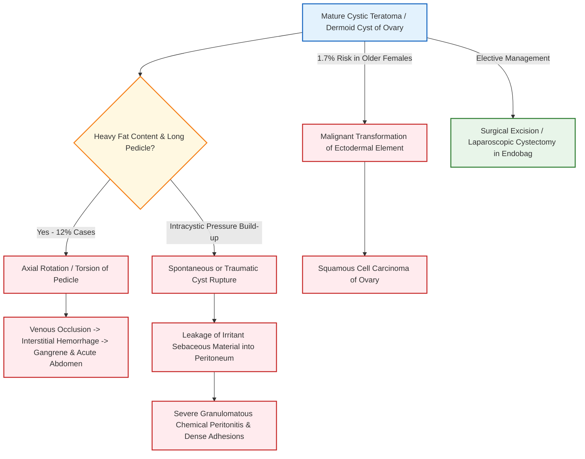
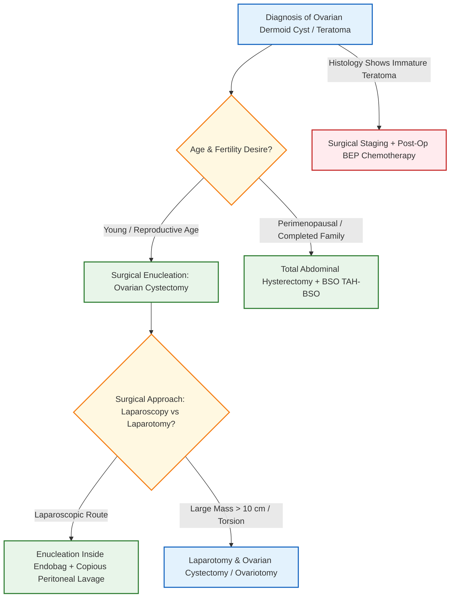

# Dermoid Cyst and Ovarian Teratoma [⭐ High-Yield]

### Mark Weightage
- **10 Marks / Long Answer Depth**

---

### 1. Definition [⭐ High-Yield]
- **Teratoma**: A germ cell neoplasm composed of tissues derived from more than one of the three embryonic germ cell layers (ectoderm, mesoderm, and endoderm). Germ cell tumors account for 15–20% of all ovarian neoplasms and >60% of ovarian tumors in females under 20 years of age.
- **Dermoid Cyst (Mature Cystic Teratoma)**: The most common benign germ cell tumor of the ovary (accounting for 95% of all ovarian teratomas and 5–10% of all cystic ovarian tumors). It is a unilocular cyst lined predominantly by squamous epithelium containing sebaceous material, hair, teeth, bone, cartilage, and thyroid tissue.
- **Rokitansky Protuberance (Embryonic Node / Focus)**: A prominent solid nipple-like projection on the inner wall of the dermoid cyst from which hair, teeth, and bone characteristically arise.

---

### 2. Etiology & Histogenesis [⭐ High-Yield]
- **Origin**: Arises from totipotent primordial germ cells that undergo abnormal parthenogenetic development (failure of meiosis I or meiosis II) within the ovarian cortex.
- **Germ Layer Differentiation**:
  - **Ectoderm (Dominant Component)**: Stratified squamous epithelium, sebaceous glands, sweat glands, hair follicles, tooth elements, and neural tissue (brain, glia).
  - **Mesoderm**: Bone, hyaline cartilage, smooth muscle, adipose tissue, and blood vessels.
  - **Endoderm**: Gastrointestinal mucosa, bronchial ciliated epithelium, and thyroid tissue.
- **Age Distribution**: Occurs at any age from childhood to postmenopause, but most commonly diagnosed during the reproductive years (peak incidence between 20 and 40 years).

---

### 3. Classification of Ovarian Teratomas [⭐ High-Yield]

```
                       ┌────────────────────────────────────────┐
                       │          Ovarian Teratomas             │
                       └───────────────────┬────────────────────┘
                                           │
         ┌─────────────────────────────────┼─────────────────────────────────┐
         ▼                                 ▼                                 ▼
┌─────────────────┐               ┌─────────────────┐               ┌─────────────────┐
│  Mature Teratoma│               │Immature Teratoma│               │   Monodermal    │
│ (Benign Cystic) │               │   (Malignant)   │               │    Teratoma     │
└────────┬────────┘               └────────┬────────┘               └────────┬────────┘
         │                                 │                                 │
  Dermoid Cyst                      Solid Teratoma                    ┌──────┴──────┐
 (Mature Tissue)                   (Immature Neuro-                   │             │
                                      ectoderm)                    Struma        Carcinoid
                                                                   Ovarii          Tumor
```

1. **Mature Teratoma (Benign)**:
   - **Mature Cystic Teratoma (Dermoid Cyst)**: Composed entirely of well-differentiated mature adult tissues.
   - **Mature Solid Teratoma**: Rare, solid variant composed exclusively of mature tissue types.
2. **Immature Teratoma (Malignant)**:
   - Contains variable amounts of immature embryonic/fetal tissues, predominantly **immature neuroectoderm** (primitive neuroepithelial rosettes). Graded I to III based on the quantity of immature neural tissue.
3. **Monodermal / Highly Specialized Teratomas**:
   - **Struma Ovarii**: Composed predominantly (>50%) of mature thyroid glandular tissue containing colloid; may induce clinical **thyrotoxicosis**.
   - **Ovarian Carcinoid**: Derived from Kulchitsky cells of endodermal intestinal tissue; produces 5-hydroxytryptamine (5-HT), leading to **carcinoid syndrome** (episodic flushing and cyanosis).

---

### 4. Pathophysiology (Complications & Progression Pathway) [⭐ High-Yield]



---

### 5. Gross and Microscopic Pathology [⭐ High-Yield]

#### A. Gross Features of Dermoid Cyst
- **External Appearance**: Smooth, globular, unilocular cyst with a thick yellowish-white opaque capsule, usually measuring 5–10 cm (rarely >15 cm).
- **Bilateral Incidence**: **12–15%** of cases are bilateral; multiple independent dermoids can exist in the same ovary.
- **Combined Tumors**: In up to **40%** of cases, dermoid cysts coexist with **mucinous cystadenoma** or Brenner tumor in the same ovary.
- **Contents**: Filled with thick, oily, buttery **sebaceous fluid** at body temperature (solidifies at room temperature) and matted balls of hair. Up to 1000 small "sebaceous balls" can float within the cyst fluid.
- **Rokitansky Protuberance**: A prominent solid focus projecting into the lumen containing hair follicles, fully formed teeth (incisors/canines/molars), calcified bone, and cartilage.

#### B. Microscopic Features
- **Cyst Wall**: Lined partly by stratified squamous epithelium with well-developed dermal appendages (hair follicles, sebaceous glands, sweat glands).
- **Stroma**: Contains mature glial tissue, ganglionic cells, thyroid follicles, respiratory ciliated columnar mucosa, cartilage, and bone trabeculae.
- **Foreign-Body Giant Cell Reaction**: Areas where the epithelial lining is lost demonstrate a prominent histiocytic and foreign-body giant cell response to extruded sebaceous material and keratin debris.

---

### 6. Clinical Features [⭐ High-Yield]

#### A. Symptoms
- **Asymptomatic (Commonest)**: Frequently discovered incidentally during routine pelvic ultrasound or antepartum scanning.
- **Palpable Abdominal Mass**: Slow-growing, painless lower abdominal swelling or feeling of pelvic heaviness.
- **Pressure Symptoms**: Increased urinary frequency or retention (if displaced anteriorly into the uterovesical pouch) or constipation/tenesmus (if impacted in the pouch of Douglas).
- **Acute Abdominal Pain**: Severe, sudden-onset lower abdominal pain accompanied by nausea, vomiting, and low-grade fever indicates acute **torsion**, **rupture**, or **haemorrhage**.

#### B. Physical Signs
- **Abdominal Examination**: Smooth, non-tender, mobile, tense cystic-to-doughy mass arising from the pelvis.
- **Pelvic Examination (PV)**: Well-defined, mobile adnexal mass placed **anterior to the uterus** in the uterovesical space (owing to its high fat content, low specific gravity, and long pedicle).

---

### 7. Complications [⭐ High-Yield]

1. **Axial Rotation (Torsion)**:
   - **Most common complication (12% of cases)**; dermoid cyst is the **most frequent ovarian tumor to undergo torsion** due to its buoyant fat content, smooth capsule, and long pedicle.
   - Venous stasis causes hemorrhagic infarction, acute abdomen, and peritonitis.
2. **Infection**:
   - Occurs in 1–2% of cases, usually by coliforms via hematogenous spread or intestinal transudation following minor torsion/adhesions. Leads to pelvic abscess formation.
3. **Rupture & Chemical Peritonitis**:
   - Spontaneous or traumatic rupture spills irritant sebaceous material, cholesterol crystals, and hair into the peritoneal cavity.
   - Causes intense **granulomatous chemical peritonitis**, presenting with severe abdominal pain, ascites, and dense pelvic adhesions mimicking tuberculosis or advanced ovarian carcinoma.
4. **Malignant Transformation**:
   - Occurs in **1.7%** of mature cystic teratomas, predominantly in postmenopausal women (>50 years).
   - **Squamous Cell Carcinoma (80–85%)** arising from the ectodermal lining is the commonest secondary malignancy; adenocarcinoma, melanoma, and carcinoid are rare variants.
5. **Rupture or Impacted Mass in Pregnancy / Labor**:
   - May cause acute abdomen during pregnancy or act as a soft-tissue obstruction causing dystocia during labor.

---

### 8. Diagnosis & Investigations [⭐ High-Yield]

#### A. Imaging Modalities (Gold Standard)
- **Pelvic Ultrasonography (TVS / TAS)**:
  - **Diagnostic Findings**: Hyperechoic focus with acoustic shadowing (**Rokitansky nodule**), "tip-of-the-iceberg" sign (dense echogenic sebaceous material obscuring posterior structures), hyperechoic lines/dots ("dermoid mesh" corresponding to hair strands), and floating sebaceous globules.
- **Plain Abdominal / Pelvic Radiograph (X-Ray)**:
  - Demonstrates calcified structures such as fully formed **teeth** or bone within the pelvis in 30–50% of cases, surrounded by a radiolucent halo of fat.
- **Computed Tomography (CT) & Magnetic Resonance Imaging (MRI)**:
  - **CT**: Highly specific; reveals pathognomonic **intracystic fat** (negative Hounsfield units -20 to -100 HU), fat-fluid levels, and calcified dental elements.
  - **MRI**: Demonstrates high signal intensity on T1-weighted images due to sebaceous fat, which drops on fat-suppressed sequences.

#### B. Laboratory & Tumor Markers
- **Serum Tumor Markers**: Useful to differentiate benign mature teratomas from malignant germ cell tumors:
  - **Mature Teratoma**: Normal AFP, hCG, and LDH.
  - **Immature Teratoma / Yolk Sac Component**: Elevated **Alpha-Fetoprotein (AFP)**.
  - **Choriocarcinoma Component**: Elevated **β-hCG**.
  - **Dysgerminoma Component**: Elevated **Lactate Dehydrogenase (LDH)** and PLAP.
  - **Secondary Squamous Cell Carcinoma**: Raised **SCC antigen** and **CA-125**.

---

### 9. Differential Diagnosis

| Feature | Mature Cystic Teratoma (Dermoid) | Mucinous Cystadenoma | Endometrioma (Chocolate Cyst) | Immature Teratoma |
| :--- | :--- | :--- | :--- | :--- |
| **Age Group** | Reproductive age (20–40 yrs) | 30–60 yrs | 20–40 yrs | Adolescents (<20 yrs) |
| **Consistency & Site** | Cystic-to-doughy; **Anterior pelvis** | Multilocular; huge cystic mass | Tense, fixed, retroverted pelvis | Predominantly **solid** with necrosis |
| **Ultrasonography** | Rokitansky nodule, hyperechoic fat, teeth | Multilocular honeycomb cysts with mucin | Ground-glass homogeneous low-level echoes | Solid-cystic mass with coarse calcifications |
| **Tumor Markers** | Normal markers (AFP/hCG normal) | CA-125, CEA elevated (>5 ng/mL) | CA-125 mildly raised (<100 U/mL) | **Markedly elevated AFP** |
| **Malignancy Risk** | **1.7%** (Squamous cell) | 5–10% | Rare (<1%) | **High (Malignant)** |

---

### 10. Management & Treatment [⭐ High-Yield]



#### A. Surgical Management of Benign Dermoid Cyst
1. **Young Women / Reproductive Age (Fertility Preservation)**:
   - **Ovarian Cystectomy (Enucleation)**: Treatment of choice. The normal ovarian capsule is incised, the cyst wall is dissected and peeled off without rupture, and the remaining normal ovarian cortex is reconstructed.
   - **Laparoscopic Approach**: Preferred minimal-access method.
   - **Spillage Prevention Protocol**: The dermoid cyst must be placed inside a impermeable synthetic retrieval bag (**Endobag**) prior to extraction or controlled aspiration to prevent intraperitoneal spillage of sebaceous fluid and hair (preventing chemical peritonitis). Copious pelvic irrigation with warm saline is performed if spillage occurs.
   - **Contralateral Ovary Inspection**: Bimanual inspection and sonographic evaluation of the opposite ovary is mandatory due to the 12–15% bilateral incidence.
2. **Perimenopausal / Postmenopausal Women**:
   - **Total Abdominal Hysterectomy with Bilateral Salpingo-Oophorectomy (TAH + BSO)**.
3. **Dermoid Cyst Associated with Pregnancy**:
   - If asymptomatic, observe during pregnancy.
   - If removal is required, perform **elective cystectomy at 14–16 weeks of gestation** (2nd trimester) when the risk of abortion is lowest.
   - If diagnosed late in pregnancy, perform cystectomy in the early puerperium or during Cesarean section if obstructing labor.

#### B. Management of Immature Teratoma / Malignant Germ Cell Tumor
- **Surgical Staging**: Unilateral salpingo-oophorectomy with preservation of the uterus and contralateral normal ovary in young females desiring fertility.
- **Adjuvant Chemotherapy**: Indicated for all Grade II–III immature teratomas using the **BEP Regimen**.

---

### 11. Drug Dosage Table (BEP Regimen for Malignant / Immature Teratoma) [⭐ High-Yield]

| Name | Mechanism of Action | Dose | Dosage / Route | Frequency | Features | Side Effects | When to Start / Stop |
| :--- | :--- | :--- | :--- | :--- | :--- | :--- | :--- |
| **Bleomycin** | Induces DNA strand scission and single-strand breaks via iron-dependent free radical generation. | **15 mg** | Intravenous (IV) or IM | Days 1 and 2 of each 21-day cycle | Component of **BEP regimen** for malignant germ cell tumors. | **Pulmonary fibrosis** (monitor DLCO), hyperpigmentation, fever. | Start Day 1 of cycle; repeat every 3 weeks for 3–4 cycles. |
| **Etoposide (VP-16)** | Inhibits Topoisomerase II, inducing double-stranded DNA breaks and metaphase arrest. | **100 mg/m²** | Intravenous (IV) infusion | Daily on **Days 1 to 5** of cycle | Highly effective in germ cell malignancies. | **Myelosuppression** (neutropenia), alopecia, nausea, vomiting. | Administer Days 1–5 every 21 days for 3–4 cycles. |
| **Cisplatin** | Alkylating-like platinum agent; forms intrastrand DNA cross-links inhibiting replication. | **20 mg/m²** | Intravenous (IV) with hydration | Daily on **Days 1 to 5** of cycle | Potent antineoplastic backbone. | **Nephrotoxicity** (requires aggressive pre/post hydration), ototoxicity, severe emesis. | Administer Days 1–5 every 21 days for 3–4 cycles. |

---

### 12. Prognosis
- **Mature Cystic Teratoma**: Excellent prognosis following surgical excision (>99% cure rate); recurrence rate is <2% after complete cystectomy.
- **Immature Teratoma**: 5-year survival rates exceed **85–90%** when managed with fertility-sparing surgery followed by BEP combination chemotherapy.

---

### 13. Clinical Pearl & Exam Trap

### Clinical Pearl
- **Anterior Location Marker**: Dermoid cysts characteristically lie in the **anterior pelvic compartment (uterovesical space)** superior to the bladder. This occurs because their high fat content gives them a lower specific gravity than pelvic fluid, allowing them to float anteriorly on a long pedicle—making them uniquely susceptible to **axial rotation (torsion)**.

### Exam Trap
- **The Mix-Up**: Confusing a **Dermoid Cyst (Mature Teratoma)** with an **Immature Teratoma** or **Struma Ovarii** regarding malignancy potential and tumor markers.
- **Distinguishing Fact**: A mature dermoid cyst contains *fully differentiated adult tissues*, has normal tumor markers (AFP/hCG normal), and a malignancy rate of only 1.7%. An **immature teratoma** contains *primitive embryonal neural tissue*, exhibits markedly elevated **AFP**, and is an aggressive malignancy requiring BEP chemotherapy.

---

### 14. Diagram Guides

### Diagram 1: Gross Structure of Cut-Open Dermoid Cyst (Mature Cystic Teratoma)
- **Type**: Labeled gross anatomical diagram
- **Outline shape to draw**: Unilocular sphere with a thick capsule cut open to reveal internal contents.
- **Labels in order**:
  1. **Thick Fibrous Capsule** — outer wall lined partly by skin
  2. **Sebaceous Material & Hair Matt** — central thick buttery fluid with hair fibers
  3. **Rokitansky Protuberance (Embryonic Node)** — solid tissue nipple projecting from inner wall
  4. **Calcified Tooth / Bone Element** — embedded within the Rokitansky protuberance
- **Arrows/connections**: Capsule → Rokitansky Protuberance → Hair & Teeth projecting into Sebaceous Cavity.
- **One annotation worth extra marks**: *"Rokitansky protuberance is the main solid focus containing ectodermal, mesodermal, and endodermal elements including teeth, bone, and neural tissue."*

---

### Diagram 2: Radiological Features of Dermoid Cyst (X-Ray & Ultrasound)
- **Type**: Radiological schematic diagram
- **Outline shape to draw**: Pelvic X-ray / Ultrasound view of lower abdomen.
- **Labels in order**:
  1. **Radiopaque Molar Tooth / Calcification** — pelvic X-ray finding
  2. **Radiolucent Halo** — representing fat density on plain film
  3. **Tip-of-the-Iceberg Sign** — ultrasound finding where dense sebaceous/hair mass attenuates sound waves
  4. **Dermoid Mesh** — fine hyperechoic lines corresponding to hair strands
- **Arrows/connections**: Ultrasound Beam → Echogenic Nodule → Posterior Acoustic Shadowing.

---

### 15. Mnemonic / Memory Palace

#### Mnemonic: D-E-R-M-O-I-D
- **D**: **Dermal appendages** (hair follicles, sebaceous glands, teeth, bone)
- **E**: **Ectoderm dominates** (80–85% secondary carcinomas are Squamous Cell Type)
- **R**: **Rokitansky protuberance** (embryonic node bearing teeth and hair)
- **M**: **Most common complication is Torsion (12%)** due to high fat buoyancy
- **O**: **Ovarian Cystectomy in Endobag** is the surgical treatment of choice in young women
- **I**: **Intraperitoneal spillage leads to Chemical Peritonitis**
- **D**: **Diagnostic ultrasound signs**: Tip-of-the-iceberg sign and hyperechoic fat-hair mesh

---

### Quick Revision
- **Incidence**: Most common benign germ cell tumor of ovary (95% of teratomas; 12–15% bilateral).
- **Key Histology**: Contains tissues from all 3 germ layers; Rokitansky protuberance bears teeth and hair.
- **Primary Complication**: **Axial Rotation / Torsion (12%)**; dermoid is the most common ovarian cyst to twist.
- **Malignant Transformation**: Occurs in **1.7%** (mostly Squamous Cell Carcinoma in older females).
- **Surgical Gold Standard**: Laparoscopic **Ovarian Cystectomy inside an Endobag** to avoid chemical peritonitis.

---

### One-Line Exam Opener
- **A dermoid cyst (mature cystic teratoma) is the commonest benign ovarian germ cell tumor, composed of mature tissues from all three germ layers surrounding a Rokitansky protuberance containing hair, teeth, and sebaceous fluid, characterized clinically by a high propensity for axial rotation (12%) and managed by fertility-sparing laparoscopic cystectomy.**

---

💡 *Would you like me to generate practice MCQs, clinical case scenarios, or flashcards on Ovarian Germ Cell Tumors to test your recall for the exam?*