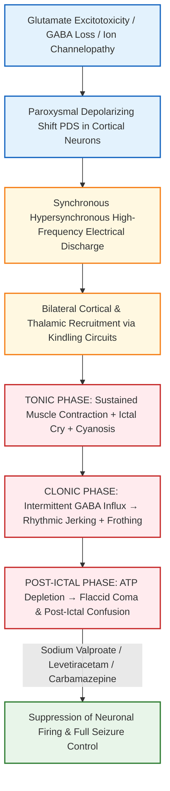

[[C25-Neurology]]
# Epilepsy and Seizures

## 1. Definition [⭐ High-Yield]

**Seizure:** A brief, paroxysmal, transient episode of neurological dysfunction (sensory, motor, autonomic, or cognitive) resulting from abnormal, excessive, and hypersynchronous electrical discharges of a population of cerebral cortical neurons [Kdt 1 p. 437].

**Epilepsy:** A chronic neurological disorder characterized by recurrent (≥2), unprovoked seizure episodes due to underlying paroxysmal cerebral dysrhythmia [Kdt 1 p. 437].

**Grand Mal Epilepsy (Idiopathic Generalized Tonic-Clonic Seizure - GTCS):** A primary generalized seizure disorder characterized by a sudden loss of consciousness accompanied by widespread bilateral tonic muscular contraction followed by rhythmic clonic jerking, without a focal anatomical onset in the cerebral cortex [Kdt 1 p. 437].

---

## 2. Classification of Seizures (ILAE Classification) [⭐ High-Yield]

Seizures are classified based on clinical semiology and electroencephalographic (EEG) patterns into **Generalized Seizures** (diffuse bilateral cortical onset) and **Focal / Partial Seizures** (unilateral, localized cortical onset) [Kdt 1 p. 437, 438]:

```
                            ┌──────────────────────────────────────────┐
                            │        CLASSIFICATION OF SEIZURES        │
                            └────────────────────┬─────────────────────┘
                                                 │
   ┌─────────────────────────────────────────────┴─────────────────────────────────────────────┐
   ▼                                                                                           ▼
┌──────────────────────────────┐                                            ┌──────────────────────────────┐
│ A. GENERALIZED SEIZURES      │                                            │ B. FOCAL / PARTIAL SEIZURES  │
│    (Bilateral cortical origin)│                                           │    (Unilateral origin)       │
├──────────────────────────────┤                                            ├──────────────────────────────┤
│ • Generalized Tonic-Clonic   │                                            │ • Simple Partial Seizures    │
│   (GTCS / Grand Mal)         │                                            │   (SPS; Awareness preserved) │
│ • Absence Seizures           │                                            │ • Complex Partial Seizures   │
│   (Petit Mal; 3 Hz spike/wave│                                            │   (CPS; Awareness impaired)  │
│ • Myoclonic Seizures         │                                            │ • Focal Seizures evolving to │
│ • Atonic Seizures (Akinetic) │                                            │   Secondarily Generalized    │
│ • Infantile Spams            │                                            │   Tonic-Clonic Seizures      │
└──────────────────────────────┘                                            └──────────────────────────────┘
```

### A. Generalized Seizures (Diffuse Bilateral Brain Origin)

1. **Generalized Tonic-Clonic Seizures (GTCS / Major Epilepsy / Grand Mal):** Characterized by sudden unconsciousness, tonic extensor rigidity, clonic jerking, frothing, tongue biting, and post-ictal sleep/depression lasting 1 to 3 minutes [Kdt 1 p. 437].
2. **Absence Seizures (Petit Mal / Minor Epilepsy):** Prevalent in children (ages 4 to 12 years); characterized by ==sudden, brief (5 to 15 seconds)== momentary loss of consciousness, stare, and eye blinking, without loss of postural tone. Classical EEG shows **bilaterally synchronous 3 Hz spike-and-wave pattern** [Kdt 1 p. 437, 443].
3. **Myoclonic Seizures:** Sudden, shock-like, brief involuntary single or multiple muscular contractions of a limb, trunk, or whole body without prolonged loss of consciousness [Kdt 1 p. 437].
4. **Atonic / Akinetic Seizures (Drop Attacks):** Sudden, brief loss of postural muscle tone causing the patient to collapse to the ground, with high risk of head injury [Kdt 1 p. 437].
5. **Infantile Spasms (Hypsarrhythmia / West Syndrome):** Brief, sudden flexion or extension spasms of trunk and limbs in infants, associated with severe intellectual delay and chaotic EEG hypsarrhythmia [Kdt 1 p. 437, 450].

---

### B. Focal / Partial Seizures (Unilateral Localized Origin)

1. **Simple Partial Seizures (SPS):** Localized motor jerking (Jacksonian march) or localized sensory/autonomic symptoms without impairment of consciousness [Kdt 1 p. 437].
2. **Complex Partial Seizures (CPS / Temporal Lobe / Psychomotor Epilepsy):** Starts with an aura (epigastric rising sensation, olfactory/auditory hallucinations), followed by impairment of consciousness, bizarre automatisms (lip smacking, swallowing, chewing), and post-ictal confusion [Kdt 1 p. 437, 438].
3. **Partial Seizures Secondarily Generalized:** A focal (simple or complex partial) seizure that spreads bilaterally through thalamocortical pathways to evolve into a generalized tonic-clonic seizure [Kdt 1 p. 438].

---

## 3. Etiology / Causes of Seizures [⭐ High-Yield]

### A. Primary / Idiopathic Epilepsy (~50% to 60% of cases)

- No identifiable structural brain lesion; genetic channelopathies affecting voltage-gated Na⁺, K⁺, or Ca²⁺ channels or GABA_A receptors underlie inherent neuronal hyperexcitability [Kdt 1 p. 438].

---

### B. Secondary / Symptomatic Causes

1. **Structural & Vascular Lesions:** Cerebrovascular accidents (ischemic stroke, intracerebral hemorrhage, SAH), arteriovenous malformations (AVMs), and mesial temporal sclerosis [Robbins 5 p. 1253, 1257, 1260].
2. **Intracranial Space-Occupying Lesions (SOL):** Primary brain tumors (gliomas, meningiomas, gangliogliomas) and metastatic brain tumors [Robbins 5 p. 1293, 1301].
3. **CNS Infections & Granulomas:** Neurocysticercosis (_Taenia solium_ cysts; most common cause of acquired epilepsy in developing countries), tuberculoma, acute bacterial/viral meningitis, and viral encephalitis (Herpes simplex) [Davidson 1 p. 1121, Kdt 4 p. 1005, Robbins 5 p. 1261, 1265].
4. **Head Trauma:** Post-traumatic brain injury, cerebral contusions, and depressed skull fractures [Kdt 1 p. 451, Robbins 5 p. 1249].
5. **Metabolic & Electrolyte Disturbances:** Severe hypoglycemia (<40 mg/dL), hypocalcemia (serum Ca²⁺ <8.4 mg/dL), hyponatremia (<120 mEq/L), uremia, and hepatic encephalopathy [Davidson 1 p. 182, 358, 738, Kdt 1 p. 883].
6. **Toxic & Drug-Induced Causes:** Alcohol withdrawal (drop in brain alcohol levels lowers seizure threshold), local anesthetic toxicity (lidocaine), organophosphate poisoning, systemic sympathomimetic drugs (cocaine, amphetamines), and withdrawal of sedatives/AEDs [Davidson 1 p. 182, Kdt 1 p. 422, 1005].

---

## 4. Pathophysiology & GTCS Event Sequence (with Flowchart) [⭐ High-Yield]

### Pathogenetic Sequence

1. **Paroxysmal Depolarizing Shift (PDS):** Imbalance between excitatory neurotransmission (**Glutamate** acting via NMDA/AMPA receptors) and inhibitory neurotransmission (**GABA** acting via GABA_A receptors). Neuronal membrane instability generates high-frequency repetitive electrical discharges [Kdt 1 p. 440].
2. **Synchronous Recruitment & Cortical Spread:** High-frequency discharges recruit surrounding cortical and subcortical (thalamic) neural networks via reverberatory circuits (kindling phenomenon) [Kdt 1 p. 439, 440].
3. **Tonic Phase Generation:** Massive bilateral discharge across both cerebral hemispheres triggers sustained contraction of all flexor and extensor skeletal muscles [Kdt 1 p. 437].
4. **Clonic Phase Generation:** Intermittent inhibitory GABAergic volleys periodically interrupt the continuous tonic spasm, producing rhythmic clonic jerking movements [Kdt 1 p. 437, 440].
5. **Post-Ictal Exhaustion:** Complete depletion of ATP, accumulation of metabolic waste (lactate), and active GABA-mediated inhibition induce prolonged post-ictal coma, flaccidity, and cerebral depression [Kdt 1 p. 437].

### Pathophysiology Flowchart



---

## 5. Clinical Features of GTCS (Grand Mal Epilepsy) [⭐ High-Yield]

An attack of Generalized Tonic-Clonic Seizure progresses classically through 4 distinct clinical phases:

```
                            ┌──────────────────────────────────────────┐
                            │      PHASES OF A GTCS (GRAND MAL) FIT    │
                            └────────────────────┬─────────────────────┘
                                                 │
   ┌─────────────────┬───────────────────────────┼───────────────────────────┬─────────────────┐
   ▼                 ▼                           ▼                           ▼                 ▼
┌─────────────┐   ┌──────────────┐            ┌─────────────┐             ┌─────────────┐   ┌─────────────┐
│ 1. PRODROME │   │ 2. TONIC     │            │ 3. CLONIC   │             │ 4. POST-    │   │ RECOVERY    │
│    & AURA   │   │    PHASE     │            │    PHASE    │             │    ICTAL    │   │ PHASE       │
└──────┬──────┘   └──────┬───────┘            └──────┬──────┘             └──────┬──────┘   └──────┬──────┘
       │                 │                           │                           │                 │
       ├─► Vague anxiety ├─► Sudden LOC & fall       ├─► Rhythmic jerking        ├─► Deep stupor/  ├─► Headache
       ├─► Epigastric    ├─► Ictal Cry (laryngeal)   ├─► Frothing at mouth           sleep         ├─► Muscle aches
       │   sensation     ├─► Extensor rigidity       ├─► Tongue biting (lateral) ├─► Confusion /   └─► Retrograde
       └─► Focal aura    └─► Respiration stops       └─► Incontinence (bowel/        delirium          amnesia
                             (Cyanosis)                  bladder)                    └─► Flaccidity
```

### A. Prodrome & Aura

- **Prodrome:** Hours to days before the attack; vague discomfort, apathy, irritability, or headache.
- **Aura:** Represents the true focal electrical onset of a fit before consciousness is lost (e.g., epigastric rising sensation, strange taste, olfactory aura). _Primary idiopathic GTCS lacks a true aura_ [Kdt 1 p. 437].

---

### B. Tonic Phase (Lasts 10 to 30 seconds) [⭐ High-Yield]

1. **Sudden Loss of Consciousness & Fall:** Patient abruptly loses awareness and collapses to the ground, incurring potential mechanical trauma [Kdt 1 p. 437, 449].
2. **Ictal Cry:** Forced expiration of air past spasmotic vocal cords caused by sudden involuntary contraction of thoracic and laryngeal muscles [Kdt 1 p. 437].
3. **Tonic Muscle Spasm:** Symmetric contraction of all muscles; arms flex initially, then extend rigidly alongside extensor spasm of legs and trunk.
4. **Cyanosis & Autonomic Storm:** Respiratory muscle spasm causes respiratory arrest and cyanosis. Autonomic features include dilated unreactive pupils, hypertension, tachycardia, and diaphoresis [Kdt 1 p. 437].

---

### C. Clonic Phase (Lasts 30 to 60 seconds) [⭐ High-Yield]

1. **Rhythmic Clonic Jerking:** Violent, synchronous, rhythmic alternating contraction and relaxation of flexor and extensor muscles across all four limbs [Kdt 1 p. 437].
2. **Lateral Tongue Biting:** Violent contraction of jaw muscles causes severe laceration of the **lateral border of the tongue** [Davidson 1 p. 181].
3. **Frothing at the Mouth:** Saliva mixed with air and blood from tongue lacerations forms pink frothy sputum [Kdt 1 p. 437].
4. **Incontinence:** Involuntary relaxation of urinary sphincter (and occasionally anal sphincter) leads to urinary incontinence [Davidson 1 p. 181].

---

### D. Post-Ictal Phase (Lasts 15 minutes to several hours)

1. **Post-Ictal Coma / Sleep:** Patient enters a deep unarousable sleep with muscle flaccidity and stertorous breathing [Kdt 1 p. 437].
2. **Post-Ictal Confusion & Delirium:** Upon awakening, the patient experiences disorientation, severe generalized muscle soreness, frontal headache, and complete amnesia for the seizure event [Davidson 1 p. 181].

---

## 6. Diagnosis & Laboratory Investigations [⭐ High-Yield]

### A. Clinical Evaluation & Eyewitness History [⭐ Gold Standard Diagnostic Step]

- **Eyewitness Account:** Detailed corroboration from a bystander regarding the onset, tonic/clonic movements, lateral tongue biting, cyanosis, duration, and post-ictal confusion is the single most vital component of diagnosis [Davidson 1 p. 181].

---

### B. Electroencephalography (EEG) [⭐ High-Yield]

1. **Interictal EEG:** May show generalized spikes, sharp waves, or spike-and-wave complexes [Davidson 1 p. 181].
2. **Ictal EEG:** Demonstrates high-frequency generalized sharp spikes during the tonic phase, evolving into periodic spike-and-wave bursts during the clonic phase [Kdt 1 p. 437].
3. _Critical Diagnostic Rule:_ **A normal interictal EEG DOES NOT rule out epilepsy!** Approximately ~50% of epileptic patients have a normal baseline routine EEG. Conversely, ~10% of healthy non-epileptic individuals may show incidental epileptiform discharges [Davidson 1 p. 181].

---

### C. Neuroimaging Protocols

1. **Magnetic Resonance Imaging (MRI Brain - Epilepsy Protocol) [⭐ Test of Choice]:** High-resolution T1, T2, FLAIR, and coronal oblique sequences to identify structural epileptogenic foci:
    - Mesial Temporal Sclerosis (hippocampal sclerosis) [Robbins 5 p. 1275].
    - Neurocysticercosis (calcified or ring-enhancing parenchymal cysticerci) [Davidson 1 p. 1121, Kdt 4 p. 1005].
    - Tuberculoma, low-grade gliomas (gangliogliomas), vascular malformations (AVMs), and cortical dysplasias [Kdt 1 p. 438, Robbins 5 p. 1260, 1298].
2. **Computed Tomography (CT Head):** Emergency test of choice to rule out acute intracranial hemorrhage, skull fractures, or massive space-occupying lesions [Davidson 1 p. 186].

---

### D. Systemic Biochemical & Metabolic Screen

- **Capillary Blood Glucose [⭐ Mandatory Bedside Test]:** Excludes severe hypoglycemia (<40 mg/dL) [Davidson 1 p. 182, 186].
- **Serum Electrolytes:** Measures serum Na⁺ (hyponatremia), serum Ca²⁺ (hypocalcemia), and serum Mg²⁺ [Davidson 1 p. 182].
- **Serum Prolactin Level:** Transient surge in serum prolactin (measured within 15 to 30 minutes of seizure fit) helps differentiate true epileptic fits from psychogenic non-epileptic seizures (PNES) [Davidson 1 p. 181].
- **Renal & Liver Function Tests:** Evaluates baseline organ function before initiating antiepileptic drugs.

---

## 7. Differential Diagnosis Comparison Table [⭐ High-Yield]

|Feature|GTCS (Grand Mal Epilepsy)|Vasovagal Syncope|Psychogenic Non-Epileptic Seizures (PNES)|Hypoglycemic Seizure|
|:--|:--|:--|:--|:--|
|**Onset Trigger**|Unprovoked / Spontaneous|Prolonged standing, pain, emotion|Stressful emotional audience|Missed meal, insulin overdosage|
|**Premonitory Symptoms**|Vague prodrome / No aura|Lightheadedness, pallor, nausea|Variable / Bizarre emotional outbursts|Sweating, tremor, palpitations|
|**Motor Activity**|**Symmetric Tonic → Clonic jerks**|Brief muscle twitching (<15 secs)|Asymmetric, pelvic thrusting, side-to-side head shaking|Generalized tonic-clonic convulsions|
|**Tongue Biting**|**LATERAL border of tongue**[Davidson 1 p. 181]|Tip of tongue / Absent|Tip of tongue / Absent|Absent / Rare|
|**Post-Ictal State**|**Prolonged confusion & sleep (>15 min)** [Davidson 1 p. 181]|Rapid recovery (<1 to 2 min)|Rapid recovery / No true post-ictal state|Resolves upon IV Glucose administration|
|**Interictal EEG**|Epileptiform spikes / waves|Normal|Normal|Normal|

---

## 8. Treatment / Management [⭐ High-Yield]

```
                     ┌──────────────────────────────────────────────┐
                     │          MANAGEMENT OF EPILEPSY              │
                     └──────┬───────────────────────────────────────┘
                            │
   ┌────────────────────────┼────────────────────────┐
   ▼                        ▼                        ▼
┌──────────────────────┐ ┌──────────────────────┐ ┌──────────────────────┐
│ A. FIRST AID DURING  │ │ B. CHRONIC PHARMACO- │ │ C. STATUS EPILEPTICUS│
│    ACUTE GTCS FIT    │ │    THERAPY (AEDs)    │ │    EMERGENCY PROTOCOL│
├──────────────────────┤ ├──────────────────────┤ ├──────────────────────┤
│ • Prone/Lateral      │ │ • SODIUM VALPROATE   │ │ • Maintain Airway    │
│   recovery position  │ │   (1st line GTCS)    │ │ • 50% Dextrose IV    │
│ • Clear airway       │ │ • CARBAMAZEPINE      │ │ • LORAZEPAM 4 mg IV  │
│ • Protect from injury│ │ • LEVETIRACETAM      │ │ • FOSPHENYTOIN IV    │
│ • Do NOT force mouth │ │ • PHENYTOIN          │ │ • Phenobarbitone /   │
│   open               │ │ • Monotherapy rule   │ │   Propofol           │
└──────────────────────┘ └──────────────────────┘ └──────────────────────┘
```

---

### A. First Aid & General Measures During an Acute Attack

1. **Patient Positioning:** Immediately lay the patient down in the **prone or lateral recovery position with head turned to one side** to allow saliva to drain, maintain airway patency, and prevent aspiration pneumonia [Kdt 1 p. 449].
2. **Prevent Injury:** Clear hard/sharp surrounding objects. Do NOT forcefully restrict limb movements [Kdt 1 p. 449].
3. **DO NOT Force Mouth Open:** Never insert spoon, cloth, or fingers into the patient's mouth during active jaw spasm [Kdt 1 p. 449].
4. **Post-Fit Reassurance:** Reassure patient upon awakening; no emergency IV medicine is required for a single uncomplicated fit lasting <2 minutes [Kdt 1 p. 449].

---

### B. Pharmacotherapy & Antiepileptic Drug (AED) Protocols (Dosage Rules) [⭐ High-Yield]

#### General Principles of AED Therapy

- **Initiation:** Start treatment after two unprovoked seizures or after a single seizure if high recurrence risk is present (abnormal MRI, abnormal EEG) [Kdt 1 p. 448, 451].
- **Monotherapy Rule:** Always start with a **single first-line antiepileptic drug at low dose**, titrating gradually until full seizure control or side effects appear [Kdt 1 p. 448].

---

#### 1. Sodium Valproate [⭐ First-Line Broad-Spectrum Drug for GTCS]

- **Name:** Sodium Valproate / Valproic Acid [Kdt 1 p. 444].
- **Mechanism of Action:** (KDT Textbook p. 440, 444). Multiple complementary mechanisms:
    
    - Prolongs the inactivated state of voltage-gated neuronal **Na⁺ channels** (phenytoin-like action) [Kdt 1 p. 440, 444].
    - Attenuates low-threshold **T-type Ca²⁺ currents** in thalamic neurons [Kdt 1 p. 440, 444].
    - Enhances brain **GABA levels** by inhibiting GABA-transaminase (degradation) and stimulating Glutamic Acid Decarboxylase (GAD; synthesis) [Kdt 1 p. 440, 444].
    - Blocks excitatory NMDA glutamate receptors [Kdt 1 p. 440, 444].
    
    ```
    Sodium Valproate → Prolongs Na+ Channel Inactivation + ↑ GABA Levels + Blocks T-type Ca2+ Channels → Broad-Spectrum Seizure Suppression
    ```
    
- **Receptors / Ion Channels:** Voltage-gated Na⁺ channels, T-type Ca²⁺ channels, GABA_A system, NMDA receptors.
- **Dose:** **Adults:** Start with **200 mg PO thrice daily (TDS)**, increased up to **600 mg PO TDS** (15 to 30 mg/kg/day). **Children:** 15 to 30 mg/kg/day in divided doses [Kdt 1 p. 444].
- **Dosage / Route:** Oral (PO) tablets / Controlled-release (CR) tablets / Syrup / IV infusion.
- **Frequency:** 2 to 3 times daily (BD or TDS).
- **Features:** Gold standard broad-spectrum AED; highly effective in GTCS, absence, myoclonic, and focal seizures [Kdt 1 p. 444, 449].
- **Side Effects:** Weight gain, transient alopecia (curling of hair), fine tremors, thrombocytopenia, asymptomatically raised transaminases, **fulminant hepatotoxicity** (rare in children <2 years), and **teratogenicity (spina bifida / neural tube defects)** [Kdt 1 p. 444].
- **When to Start / Stop:** First-line drug for primary GTCS; continue for 2 to 3 years seizure-free before attempting gradual tapering over 6 months [Kdt 1 p. 444, 449].

#### 2. Carbamazepine [⭐ First-Line Drug for Focal Seizures & GTCS]

- **Name:** Carbamazepine [Kdt 1 p. 442].
- **Mechanism of Action:** (KDT Textbook p. 440, 442). Binds to voltage-gated **Na⁺ channels** in their inactivated state, prolonging inactivation and suppressing high-frequency repetitive detonation of action potentials without impairing normal low-frequency synaptic transmission [Kdt 1 p. 440, 442].
    
    ```
    Carbamazepine → Prolongs Voltage-Gated Na+ Channel Inactivation → Inhibits High-Frequency Repetitive Neuronal Detonation
    ```
    
- **Receptors / Ion Channels:** Voltage-gated Na⁺ channels.
- **Dose:** **Adults:** **200 mg to 400 mg PO thrice daily (TDS)** (Start 100–200 mg BD, titrate upward). **Children:** 15 to 30 mg/kg/day [Kdt 1 p. 442].
- **Dosage / Route:** Oral (PO) tablets / SR tablets / Syrup.
- **Frequency:** 2 to 3 times daily (BD or TDS).
- **Features:** Drug of choice for partial/focal seizures and GTCS; auto-induces its own metabolism (hepatic CYP3A4/CYP2C9); also drug of choice in trigeminal neuralgia [Kdt 1 p. 442].
- **Side Effects:** Dose-related neurotoxicity (sedation, dizziness, diplopia, ataxia), hyponatremia (SIADH-like effect), hypersensitivity skin rashes, Stevens-Johnson syndrome, agranulocytosis, and aplastic anemia [Kdt 1 p. 442].
- **When to Start / Stop:** Initiated in GTCS or focal epilepsy; avoid abrupt withdrawal [Kdt 1 p. 442, 448].

#### 3. Levetiracetam [⭐ First-Line / Add-on Broad-Spectrum AED]

- **Name:** Levetiracetam [Kdt 1 p. 447].
- **Mechanism of Action:** (KDT Textbook p. 440, 447). Binds selectively to **Synaptic Vesicular Protein 2A (SV2A)**in presynaptic terminals, inhibiting vesicular exocytosis of excitatory glutamate neurotransmitters across the synaptic cleft [Kdt 1 p. 440, 447].
    
    ```
    Levetiracetam → Binds Presynaptic SV2A Protein → Decreases Vesicular Glutamate Release → Suppresses Hypersynchronous Discharges
    ```
    
- **Receptors / Target:** Presynaptic Synaptic Vesicular Protein 2A (SV2A).
- **Dose:** **500 mg PO/IV twice daily (BD)**, titrated up to **1000 mg PO BD** (Maximum 3000 mg/day) [Kdt 1 p. 447].
- **Dosage / Route:** Oral (PO) tablets / IV injection.
- **Frequency:** Twice daily (BD).
- **Features:** Excellent safety profile, zero CYP enzyme interactions, rapid titration, safe in liver disease [Kdt 1 p. 447].
- **Side Effects:** Somnolence, dizziness, fatigue, and behavioral changes (irritability, agitation, depression) [Kdt 1 p. 447].
- **When to Start / Stop:** First-line or add-on therapy for GTCS and focal seizures.

#### 4. Phenytoin [⭐ Standard AED]

- **Name:** Phenytoin (Diphenylhydantoin) [Kdt 1 p. 439].
- **Mechanism of Action:** (KDT Textbook p. 440). Prolongs voltage-gated Na⁺ channel inactivation [Kdt 1 p. 440].
- **Dose:** **100 mg PO twice to thrice daily (BD/TDS)** (3 to 5 mg/kg/day) [Kdt 1 p. 441].
- **Features & Side Effects:** Saturation kinetics (zero-order elimination at therapeutic doses); causes **gum hypertrophy** (20%), hirsutism, acne, megaloblastic anemia, osteomalacia, and **Fetal Hydantoin Syndrome** [Kdt 1 p. 440, 441].

---

### C. Emergency Protocol for Status Epilepticus [⭐ High-Yield]

**Status Epilepticus:** Continuous seizure activity lasting **>30 minutes**, or **≥2 discrete seizures** without complete recovery of consciousness between episodes (a medical emergency carrying high mortality) [Kdt 1 p. 450].

```
                     ┌──────────────────────────────────────────────┐
                     │    STATUS EPILEPTICUS EMERGENCY PROTOCOL     │
                     └──────┬───────────────────────────────────────┘
                            │
   ┌────────────────────────┼────────────────────────┐
   ▼                        ▼                        ▼
┌──────────────────────┐ ┌──────────────────────┐ ┌──────────────────────┐
│ 0 – 5 MINUTES        │ │ 5 – 20 MINUTES       │ │ 20 – 40 MINUTES      │
│ INITIAL RESUSCITATION│ │ FIRST-LINE THERAPY   │ │ SECOND-LINE THERAPY  │
├──────────────────────┤ ├──────────────────────┤ ├──────────────────────┤
│ • Secure Airway & O2 │ │ • IV LORAZEPAM 4 mg  │ │ • IV FOSPHENYTOIN    │
│ • Establish IV line  │ │   (0.1 mg/kg at      │ │   15–20 mg PE/kg     │
│ • Capillary Glucose: │ │   2 mg/min) [Choice] │ │   (100–150 mg/min)   │
│   Inject 20–50 mL of │ │   OR                 │ │   OR                 │
│   50% Dextrose IV    │ │ • IV DIAZEPAM 10 mg  │ │ • IV Phenytoin       │
└──────────────────────┘ └──────────┬───────────┘ └──────────┬───────────┘
                                    │                        │
                                    └───────────┬────────────┘
                                                ▼
                                 ┌──────────────────────────────┐
                                 │ >40 MINUTES: REFRACTORY STATUS│
                                 ├──────────────────────────────┤
                                 │ • General Anesthesia:        │
                                 │   IV Midazolam / Propofol /  │
                                 │   Thiopentone + Intubation   │
                                 └──────────────────────────────┘
```

1. **0 to 5 Minutes (Resuscitation Phase):**
    - Secure airway, administer 100% oxygen, monitor vitals/ECG [Kdt 1 p. 450].
    - Check capillary blood glucose; inject **20 to 50 mL of 50% Dextrose IV** to correct potential hypoglycemia [Kdt 1 p. 450].
2. **5 to 20 Minutes (First-Line Benzodiazepine Phase) [⭐ Choice Therapy]:**
    - **IV Lorazepam [First Choice Drug]:** **4 mg IV (0.1 mg/kg)** injected at **2 mg/min**. More effective (75-90%) and longer-acting (6 to 12 hours) than diazepam due to lower lipid solubility [Kdt 1 p. 450].
    - _Alternative:_ **IV Diazepam:** **10 mg (0.2–0.3 mg/kg) IV** at 2 mg/min. Anticonvulsant effect wanes rapidly after 20 minutes due to redistribution [Kdt 1 p. 450].
3. **20 to 40 Minutes (Second-Line Control Phase):**
    - **IV Fosphenytoin [Preferred Water-Soluble Prodrug]:** **15 to 20 mg PE/kg IV** infused at **100 to 150 mg/min** under continuous ECG monitoring [Kdt 1 p. 450].
    - _Alternative:_ **IV Phenytoin Sodium:** 15 to 20 mg/kg IV infused at max 50 mg/min in 0.9% Normal Saline [Kdt 1 p. 451].
4. **>40 Minutes (Refractory Status Epilepticus):**
    - Transfer to ICU, intubate, and initiate continuous IV general anesthetic infusion: **Midazolam** (0.2 mg/kg bolus → 0.05–2.0 mg/kg/hr) or **Propofol** or **Thiopentone Sodium** [Kdt 1 p. 451].

---

## 9. Complications

1. **Status Epilepticus:** Mortality 10% to 20%; leads to excitotoxic brain damage, cerebral edema, metabolic acidosis, hyperthermia, and rhabdomyolysis [Kdt 1 p. 450].
2. **Sudden Unexpected Death in Epilepsy (SUDEP):** Fatal respiratory depression or cardiac arrhythmia occurring during or immediately following a seizure episode.
3. **Aspiration Pneumonia:** Aspiration of gastric contents during loss of consciousness [Kdt 1 p. 449].
4. **Physical Trauma:** Fractures, shoulder dislocation, head injury, and severe tongue lacerations [Kdt 1 p. 449].
5. **Psychosocial Impairment:** Anxiety, depression, loss of driving privileges, and social stigma.

---

## 10. Prognosis & Withdrawal of AEDs

- ~70% of patients achieve complete long-term seizure freedom with a single first-line AED [Kdt 1 p. 448].
- **AED Withdrawal Criteria:** Drug withdrawal can be attempted if the patient remains completely **seizure-free for 2 to 3 years**, has a normal neurological examination, normal intelligence, and a normal interictal EEG [Kdt 1 p. 449].
- _Tapering Rule:_ **Always taper AEDs slowly over 3 to 6 months! Abrupt stoppage can precipitate status epilepticus!** [Kdt 1 p. 448].

---

## 11. Clinical Pearl

> **Clinical Pearl:** A normal interictal EEG DOES NOT exclude a diagnosis of epilepsy! Over ~50% of patients with clinically proven epilepsy have a completely normal routine interictal EEG! Epilepsy remains a **strictly clinical diagnosis based primarily on an accurate eyewitness account** [Davidson 1 p. 181]!

---

## 12. Exam Trap

### Exam Trap

- **The Mix-Up:** Abruptly discontinuing antiepileptic therapy (especially Sodium Valproate, Carbamazepine, or Benzodiazepines) once a patient becomes seizure-free for a few months.
- **Distinguishing Fact:** Sudden withdrawal of antiseizure medication removes tonic GABAergic inhibition and triggers rebound cortical hyperexcitability.
- **Resolution:** **NEVER abruptly stop antiepileptic drugs!** Taper AED doses slowly over a minimum of **3 to 6 months** after a 2- to 3-year seizure-free period to avoid precipitating life-threatening **Status Epilepticus** [Kdt 1 p. 448, 449]!

---

## 13. Diagram Guide

### Diagram 1 : Temporal Phases & Physical Movements of a GTCS Fit

_(Reference in text: See Section 5 - Clinical Features of GTCS)_

- **Type:** Sequential Clinical Event Flow Diagram.
- **Outline Shape to Draw:** 4 sequential rectangular boxes linked by horizontal arrows.
- **Labels in Order:**
    1. **Aura / Prodrome:** Epigastric sensation / vague discomfort.
    2. **Tonic Phase (10–30s):** Sudden LOC → Fall → Ictal Cry → Rigid Extensor Spasm → Apnea & Cyanosis.
    3. **Clonic Phase (30–60s):** Bilateral Rhythmic Muscle Jerking → Lateral Tongue Biting → Frothing at mouth → Incontinence.
    4. **Post-Ictal Phase (15m–Hours):** Unarousable Sleep → Flaccidity → Post-ictal confusion & headache.
- **Extra Mark Annotation:** _"Lateral tongue biting occurring during the clonic phase is highly specific for differentiating epileptic GTCS from syncope or pseudoseizures."_.

---

### Diagram 2 : Pharmacological Targets of Antiepileptic Drugs at Neural Synapse

_(Reference in text: See Section 8 - Treatment / Management)_

- **Type:** Labeled Synaptic Mechanism Diagram.
- **Outline Shape to Draw:** Presynaptic axon terminal facing a postsynaptic dendritic membrane across a synaptic cleft.
- **Labels in Order:**
    1. **Presynaptic Na⁺ Channels:** Blocked by **Phenytoin, Carbamazepine, Valproate, Lamotrigine**.
    2. **Presynaptic SV2A Vesicular Protein:** Bound and inhibited by **Levetiracetam**.
    3. **Presynaptic T-type Ca²⁺ Channels:** Blocked by **Ethosuximide, Valproate**.
    4. **Postsynaptic GABA_A Receptor:** Facilitated by **Benzodiazepines, Barbiturates, Valproate** (↑ GABA inhibitory influx).
    5. **Postsynaptic NMDA/AMPA Receptors:** Blocked by **Valproate, Topiramate**.
- **Extra Mark Annotation:** _"Sodium Valproate possesses a broad spectrum of action by combining Na+ channel blockade, GABA elevation, T-type Ca2+ channel inhibition, and NMDA receptor blockade."_.

---

## 14. Mnemonic / Memory Palace

### Mnemonic for Clinical Features of GTCS: "T-O-N-I-C - C-L-O-N-I-C"

- **T** — **T**ongue biting (lateral border) [Davidson 1 p. 181]
- **O** — **O**nset sudden with loss of consciousness [Kdt 1 p. 437]
- **N** — **N**o recall (retrograde amnesia)
- **I** — **I**ctal cry (laryngeal spasm) [Kdt 1 p. 437]
- **C** — **C**yanosis & apnea in tonic phase [Kdt 1 p. 437]
- **C** — **C**lonic rhythmic jerking [Kdt 1 p. 437]
- **L** — **L**oss of bladder control (incontinence) [Davidson 1 p. 181]
- **O** — **O**verwhelming post-ictal confusion & headache [Davidson 1 p. 181]
- **N** — **N**o memory of fit
- **I** — **I**V Lorazepam 4 mg for status epilepticus [Kdt 1 p. 450]
- **C** — **C**ontrol achieved with Sodium Valproate / Levetiracetam [Kdt 1 p. 444, 447]

### Memory Palace: "The High-Voltage Electrical Substation"

Visualize walking through 3 stations in a power grid substation:

1. **Station 1 (The Short-Circuiting Transformer - GTCS Fit):** A massive transformer exploding with blue sparks (**Hypersynchronous cortical discharge**), causing a worker to collapse, scream an alarm (**Ictal Cry**), lock rigid (**Tonic phase**), start shaking uncontrollably (**Clonic phase**), and bite his tongue (**Lateral tongue biting**).
2. **Station 2 (The Diagnostic Oscilloscope - EEG & MRI):** A diagnostic screen showing 3 Hz spike-and-wave patterns (**Absence EEG**) while an MRI scanner highlights a round white cystic parasite (**Neurocysticercosis focus**).
3. **Station 3 (The Emergency Control Panel - Status Protocol):** A red emergency control panel where an operator inserts a 4 mg blue key labeled "Lorazepam 4 mg IV" (**First choice for Status**) followed by a 500 mg green switch labeled "Valproate" (**Broad spectrum AED**).

---

## 15. Quick Revision

- **Definition:** GTCS is a primary generalized seizure with sudden unconsciousness, extensor tonic rigidity, clonic jerking, frothing, and post-ictal coma [Kdt 1 p. 437].
- **Pathognomonic Physical Sign:** **Lateral tongue biting** during the clonic phase [Davidson 1 p. 181].
- **Gold Standard Diagnostic Diagnostic Rule:** EEG shows epileptiform discharges, but **~50% of epilepsy patients have a normal interictal EEG**; diagnosis is clinical [Davidson 1 p. 181].
- **First-Line Drug for GTCS:** **Sodium Valproate** (200–600 mg PO TDS) or **Levetiracetam** (500–1000 mg PO BD) [Kdt 1 p. 444, 447, 449].
- **First Choice Drug for Status Epilepticus:** **IV Lorazepam 4 mg (0.1 mg/kg) at 2 mg/min** [Kdt 1 p. 450].

---

## 16. One-Line Exam Opener

> **Grand mal epilepsy (generalized tonic-clonic seizure) is a generalized seizure disorder characterized by sudden loss of consciousness, tonic extensor spasm, rhythmic clonic jerking with lateral tongue biting, and post-ictal confusion, diagnosed clinically alongside EEG and MRI, and managed using first-line broad-spectrum antiepileptics such as Sodium Valproate or Levetiracetam.**

---

💡 _Next steps: Would you like to review practice exam questions on antiepileptic drug side-effects and drug interactions, or generate a high-yield flashcard set on Status Epilepticus management protocols?_