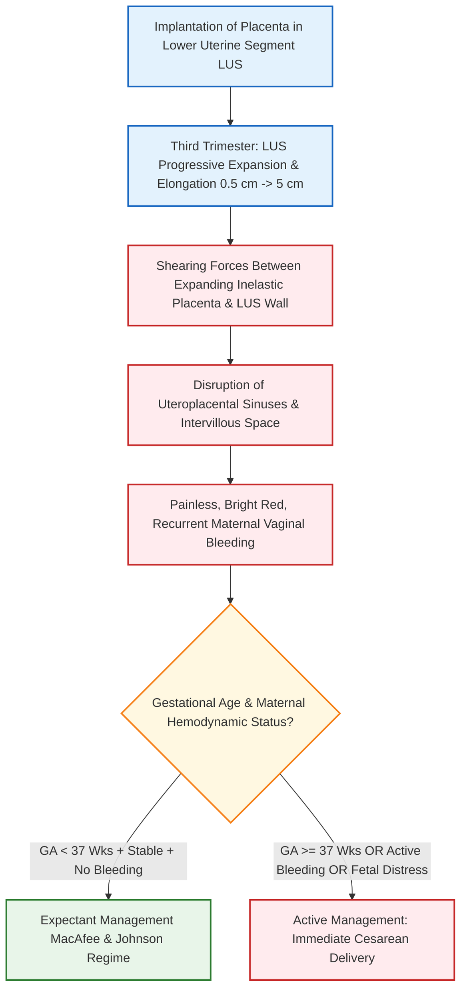
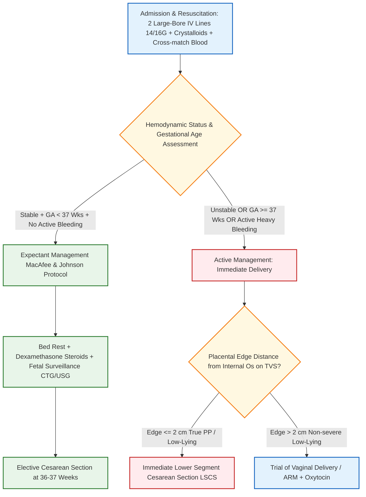

[[C19-Antepartum hemorrhage]]


# Antepartum Hemorrhage & Placenta Previa [⭐ High-Yield]

### Mark Weightage

- **10 Marks / Long Answer Depth**

---

### 1. Definition of Antepartum Hemorrhage (APH) [⭐ High-Yield]

- **Antepartum Hemorrhage (APH)** is defined as bleeding from or into the genital tract occurring after the **20th week** of gestation (arbitrarily taken as 28th week in traditional literature based on the lower limit of fetal viability) up to the birth of the baby. It includes the first and second stages of labor.
- **Incidence**: Occurs in approximately **3%** of all pregnancies.

---

### 2. Etiology / Causes of Antepartum Hemorrhage [⭐ High-Yield]

```
                                  ┌────────────────────────────────────────┐
                                  │      Antepartum Hemorrhage (APH)       │
                                  └───────────────────┬────────────────────┘
                                                      │
         ┌────────────────────────────────────────────┼────────────────────────────────────────────┐
         ▼                          ▼                                  ▼
┌──────────────────┐           ┌──────────────────┐         ┌──────────────────┐
│ Placental Causes │                         │ Unexplained /    │                         │ Extraplacental   │
│      (70%)       │                         │ Indeterminate    │                         │   Causes (5%)    │
└────────┬─────────┘                         │      (25%)       │                         └────────┬─────────┘
         │                                   └────────┬─────────┘                                  │
   ┌─────┴─────┐                                      │                                      ┌─────┴─────┐
   ▼           ▼                                      ▼                                      ▼           ▼
Placenta    Abruptio                             Vasa Previa,                             Cervical    Carcinoma,
Previa     Placentae                             Succenturiate                            Polyps,     Erosion,
 (35%)       (35%)                                  Lobe                                  Trauma      Varicosities
```

1. **Placental Causes (70%)**:
    - **Placenta Previa (35%)**: Implantation of the placenta in the lower uterine segment.
    - **Abruptio Placentae / Accidental Hemorrhage (35%)**: Premature separation of a normally situated placenta from the upper uterine segment.
2. **Unexplained / Indeterminate Causes (25%)**:
    - Bleeding where no definite placental or local cause can be identified (e.g., vasa previa rupture, marginal sinus bleeding, circumvallate placenta, or excessive 'show').
3. **Extraplacental / Local Causes (5%)**:
    - Cervical polyp, carcinoma of the cervix, cervical ectopy/erosion, vulvovaginal varicosities, and local genital tract trauma.

---

### 3. Detailed Study of Placenta Previa (Primary Topic)

#### A. Definition & Incidence

- **Placenta Previa**: A condition where the placenta is implanted partially or completely over the lower uterine segment (over or adjacent to the internal cervical os).
- **Incidence**: Accounts for 1/3rd of all APH cases (0.5–1% of hospital deliveries). It is more common in multiparous women (80%), mothers aged >35 years, smokers, and multiple pregnancies.

#### B. Etiology & Risk Factors [⭐ High-Yield]

- **Exact Mechanism**: Unknown, but several theories exist:
    - _Dropping Down Theory_: The fertilized ovum drops down and implants in the lower uterine segment due to poor decidual reaction in the upper segment.
    - _Trophotropism_: Extension of chorionic villi into the lower segment to seek better vascularized tissue.
    - _Hyperplacentosis_: Unusually large placental surface area (e.g., twin gestation, diabetes) extending into the lower segment.
- **High-Risk Factors**:
    - **Multiparity & Advanced Maternal Age (>35 years)**: 4-fold increase.
    - **Prior Uterine Scar**: Previous Cesarean Delivery (CD), myomectomy, or hysterotomy. Risk increases from 0.9% with 1 prior CD up to 3% with ≥3 prior CDs.
    - **Prior Uterine Curettage / Endometritis**: Causes endometrial damage.
    - **Prior History of Placenta Previa**: Recurrence rate is 4–8%.
    - **Multiple Gestation / ART**: Increased placental mass.
    - **Maternal Smoking**: Carbon monoxide-induced hypoxemia causes compensatory placental hypertrophy.

---

### 4. Classification of Placenta Previa [⭐ High-Yield]

#### A. Revised Classification (ACOG / ACR 2014)

- **True Placenta Previa**: The placenta completely covers the internal cervical os.
- **Low-Lying Placenta**: The lower placental edge lies within **2 cm** of the internal cervical os but does not cover it.

#### B. Traditional Morphological Classification (Types I–IV)

|Type / Grade|Descriptive Name|Anatomical Relation to Internal Os|
|:--|:--|:--|
|**Type I**|**Low-Lying**|Placenta encroaches the lower segment; edge is **<5 cm** from internal os but does not reach it.|
|**Type II**|**Marginal**|Placenta reaches the margin of the internal os but does not cover it. _Note: Type II Posterior is termed "Dangerous Placenta Previa"_.|
|**Type III**|**Incomplete / Partial Central**|Placenta covers the internal os when closed, but covers it only partially when fully dilated.|
|**Type IV**|**Complete / Total Central**|Placenta covers the internal os completely even when cervix is fully dilated.|

> **Dangerous Placenta Previa (Type II Posterior)**: Implanted over the posterior wall of the lower uterine segment. The ~2.5 cm thick placental mass overlies the sacral promontory, narrowing the anteroposterior diameter of the inlet, preventing head engagement, compressing the cord, and causing torrential bleeding.

---

### 5. Pathophysiology [⭐ High-Yield]

- **Mechanism of Bleeding**:
    - During the third trimester, the lower uterine segment progressively expands and elongates (from 0.5 cm at 20 weeks to >5 cm at term).
    - The inelastic placenta cannot stretch alongside the expanding lower segment, leading to shearing and detachment of placental villi from uteroplacental sinuses.
    - Tearing of open sinuses causes **inevitable, painless, maternal hemorrhage**.
- **Placental Migration**: A misnomer where early second-trimester placenta previa (seen in 15% at 17 weeks) appears to move away from the os by 34 weeks (>90% resolution) due to differential lower segment growth and trophotropism toward the well-vascularized fundus.



---

### 6. Clinical Features [⭐ High-Yield]

#### A. Symptoms

- **Painless, Causeless, Bright Red, Recurrent Vaginal Bleeding**: The cardinal hallmark.
    - _Painless_: Unassociated with uterine contractions.
    - _Causeless_: Occurs without trauma or prior warning, often waking the patient from sleep in a "pool of blood".
    - _Recurrent_: Initial "warning hemorrhage" is mild but subsequent bouts become progressively heavier.

#### B. Signs

- **General Examination**: Anemia and hypovolemia are strictly **proportionate to visible blood loss**.
- **Abdominal Examination**: (Tender + rigid )
	- Height of uterus is more than POG.
    - Uterus is **soft, relaxed, and completely non-tender**.
    - Height of uterus corresponds to the period of amenorrhea.
    - **High Floating Head**: Presenting part remains unengaged at term.
    - **Malpresentation**: High incidence of transverse lie or breech presentation.
    - **Fetal Heart Rate (FHR)**: Usually normal and reassuring.
    - **Stallworthy's Sign**: Slowing of FHR on pressing the floating head down into the pelvis, which promptly recovers when pressure is released (characteristic of low-lying posterior placenta previa).
- **Vaginal Examination (P/V)**: **STRICTLY CONTRAINDICATED** in the ward/clinic as digital probing can dislodge clots and cause fatal, torrential hemorrhage.

---

### 7. Diagnosis and Investigations [⭐ High-Yield]

#### A. Imaging Studies (Placentography - Gold Standard)

- **Transvaginal Sonography (TVS)**: The **investigation of choice (IOC)**. Safe, highly accurate (100% sensitivity), and does not provoke bleeding when the probe is placed in the lower vagina.
- **Transabdominal Sonography (TAS)**: Primary screening tool; requires a full bladder (may falsely diagnose PP due to lower segment compression).
- **Color Doppler Ultrasound**: Evaluates subplacental vascularity and detects co-existing **Placenta Accreta Spectrum (PAS)** (turbulent vascular lakes, loss of retroplacental sonolucent zone).
- **Magnetic Resonance Imaging (MRI)**: Superior for posterior placenta previa, deep myometrial invasion, and bladder wall involvement in PAS.

#### B. Laboratory Profile

- Complete blood count, Hemoglobin, Hematocrit.
- ABO and Rh blood grouping with cross-matching.
- Coagulation screen (PT, aPTT, Fibrinogen, Platelets).
- **Apt Test / Singer's Alkali Denaturation Test**: Differentiates fetal blood from maternal blood in cases of suspected vasa previa (Fetal HbF is alkali-resistant).

---

### 8. Differential Diagnosis

|Diagnostic Feature|Placenta Previa|Abruptio Placentae|Vasa Previa|Local Cervical Lesions|
|:--|:--|:--|:--|:--|
|**Nature of Bleeding**|Painless, causeless, bright red, recurrent.|Painful, dark red, continuous, associated with trauma/HTN.|Painless, occurs upon rupture of membranes.|Minor contact spot bleeding.|
|**Uterine Feel**|Soft, relaxed, non-tender.|Tense, rigid, "woody hard", tender.|Soft, non-tender.|Soft, non-tender.|
|**General Condition**|Proportionate to visible blood loss.|Disproportionate (shock > visible loss in concealed).|Fetal distress out of proportion to minor loss.|Unaffected.|
|**Fetal Status / FHS**|Usually present and normal.|Absent or non-reassuring (fetal distress/IUFD).|Severe fetal bradycardia / sinusoidal FHR.|Normal.|
|**Placentography**|Placenta in lower uterine segment.|Retroplacental hematoma in upper segment.|Vessels crossing internal os on Doppler.|Normal placental site.|

---

### 9. Treatment and Management [⭐ High-Yield]



#### A. Initial Hospital Resuscitation & Stabilization

1. Immediate bed rest and continuous vitals monitoring.
2. Establish two large-bore IV lines (14G or 16G) and start IV crystalloid infusion (Ringer's Lactate).
3. Draw blood samples for Hb, hematocrit, ABO/Rh grouping, cross-matching 2–4 units of packed RBCs, and coagulation profile.
4. Administer supplemental oxygen and insert an indwelling Foley catheter to monitor hourly urine output.
5. **Strictly avoid digital vaginal examination**.

#### B. Expectant Management (MacAfee and Johnson Regime)

- **Objective**: Prolong pregnancy to achieve fetal lung maturity without endangering maternal life.
- **Selection Criteria (ALL must be met)**:
    1. Maternal hemodynamically stable.
    2. Active vaginal bleeding has ceased or is minimal.
    3. Gestational age **<37 weeks**.
    4. Fetal status is reassuring (reactive CTG) with no gross congenital malformations.
- **Protocol**:
    - Complete hospital bed rest.
    - **Antenatal Corticosteroids**: Inj. Dexamethasone 6 mg IM 12-hourly for 4 doses (or Betamethasone 12 mg IM 24-hourly for 2 doses) if <34 weeks to promote surfactant synthesis.
    - **Tocolysis**: Short-term MgSO₄ or Nifedipine may be used if uterine irritability/preterm labor is present.
    - **Rh Immunoglobulin**: Administer **300 µg Anti-D Immunoglobulin** IM within 72 hours to all Rh-negative unsensitized mothers.
    - Plan elective delivery at **36–37 weeks**.

#### C. Active / Definitive Management (Delivery)

- **Indications**:
    1. Gestational age **≥37 weeks**.
    2. Maternal instability or severe persistent bleeding.
    3. Non-reassuring fetal heart rate status / fetal distress.
    4. Presence of labor.
- **Mode of Delivery**:
    - **Cesarean Section (LSCS)**: Mode of choice for all cases of **True Placenta Previa** and low-lying placenta where the edge is **≤2 cm** from the internal os.
    - **Trial of Vaginal Delivery**: May be considered ONLY if the lower edge is **>2 cm** away from the os, fetal head is engaged, and bleeding is absent.

---

### 10. Drug Dosage Table (DOSAGE RULE) [⭐ High-Yield]

|Name|Mechanism of Action|Dose|Dosage / Route|Frequency|Features|Side Effects|When to Start / Stop|
|:--|:--|:--|:--|:--|:--|:--|:--|
|**Dexamethasone**|Corticosteroid; stimulates Type II pneumocytes to synthesize surfactant, enhancing fetal lung maturity.|**6 mg**|Intramuscular (IM)|Every 12 hours for 4 doses|**Essential in expectant management <34 weeks**; reduces RDS, IVH, and NEC.|Transient maternal hyperglycemia, leukocytosis.|Start upon admission in expectant group <34 wks; complete 4 doses.|
|**Anti-D Immunoglobulin**|Neutralizes fetal Rh-D positive RBCs in maternal circulation to prevent Rh isoimmunization.|**300 µg**(1500 IU)|Intramuscular (IM)|Single stat dose|**Mandatory for all Rh-negative unsensitized women**presenting with APH.|Local site pain, mild fever.|Administer within 72 hours of an APH episode.|
|**Magnesium Sulfate (MgSO₄)**|Neuroprotective agent and tocolytic; competes with Ca²⁺ at motor endplates, stabilizing neuronal membranes.|**4 g IV loading**+ **1–2 g/hr infusion**|IV infusion|Continuous|**Fetal neuroprotection <32 weeks**; also inhibits preterm uterine contractions.|Loss of deep tendon reflexes, respiratory depression, flushing.|Start in expectant management <32 wks; stop after 24 hrs or post-delivery.|
|**Oxytocin**|Binds G-protein coupled receptors → increases intracellular Ca²⁺ → induces rhythmic uterine contractions.|**10 IU**|IM or slow IV infusion (10–20 IU in 500 mL RL)|Continuous IV drip|**First-line uterotonic to prevent atonic PPH** during LSCS or third stage.|Transient hypotension, fluid retention with prolonged infusion.|Administer immediately after fetal delivery during CS/labor.|

---

### 11. Complications [⭐ High-Yield]

#### A. Maternal Complications

- **Antepartum & Intrapartum Hemorrhage**: Hypovolemic shock and acute anemia.
- **Placenta Accreta Spectrum (PAS)**: Morbidly adherent placenta due to poor decidualization in the lower segment. Risk reaches **60%** with ≥3 prior Cesarean sections.
- **Postpartum Hemorrhage (PPH)**: Caused by **imperfect myometrial retraction** of the fibrous lower segment and large placental bed surface area.
- **Sepsis & Subinvolution**: Increased risk due to low placental site proximity to vagina.

#### B. Fetal / Perinatal Complications

- **Prematurity & Low Birth Weight**: Main contributor to perinatal death.
- **Intrauterine Growth Restriction (IUGR)**: Chronic placental insufficiency from recurrent minor detachments.
- **Birth Asphyxia & Hypoxia**: Cord prolapse or premature placental separation.
- **Perinatal Mortality**: Ranges from **10 to 25%**.

---

### 12. Prognosis

- **Maternal Mortality**: Dramatically reduced to **<1%** globally due to routine TVS, avoidance of P/V exam, availability of blood transfusions, and timely Cesarean delivery.
- **Fetal / Perinatal Mortality**: Remains at **10–25%**, primarily driven by extreme prematurity and acute intrapartum hypoxia.

---

### 13. Clinical Pearl & Exam Trap

### Clinical Pearl

- **The "Safety Rule" of Placentography**: Transvaginal Sonography (TVS) is 100% safe in placenta previa despite probe insertion into the vagina because the transducer angle (orienting against the anterior vaginal fornix) maintains a clearance of >2 cm from the cervical os, eliminating any risk of placental disruption.

### Exam Trap

- **The Mix-Up**: Performing a **digital vaginal examination (P/V)** in a patient presenting with third-trimester vaginal bleeding before obtaining an ultrasound.
- **Distinguishing Fact**: Digital P/V examination is **ABSOLUTELY CONTRAINDICATED** in the clinic/ward for suspected APH. It should ONLY be performed as a "Double Set-up Examination" inside the operating theater with full preparation for immediate Cesarean section when USG is unavailable or equivocal.

---

### 14. Diagram Guides

### Diagram 1: Revised Classification of Placenta Previa (ACOG / ACR)

- **Type**: Labeled anatomical sagittal diagram
- **Outline shape to draw**: Outline of gravid uterus showing lower uterine segment and internal cervical os.
- **Labels in order**:
    1. **Upper Uterine Segment** — normal thick muscular wall
    2. **Lower Uterine Segment** — thin wall
    3. **True Placenta Previa** — placental tissue covering internal os completely
    4. **Low-Lying Placenta** — placental edge within 2 cm of internal os
    5. **Internal Cervical Os & Cervical Canal**
- **Arrows/connections**: Lower Edge of Placenta ↔ Internal Os distance measurement (≤2 cm).
- **Annotation**: _"Placenta previa is classified as True PP (covers internal os) or Low-Lying PP (edge within 2 cm of os)."_

---

### Diagram 2: Double Set-Up Examination Concept

- **Type**: Clinical procedural guide
- **Outline shape to draw**: Operating theater setup showing patient in lithotomy position prepared for emergency surgery.
- **Labels in order**:
    1. **Patient Scrubbed & Draped** — under anesthesia in OT
    2. **Vaginal Examining Hand** — fingers gently entering fornix
    3. **Scrubbed Surgical Team & Anaesthetist** — standing ready with open laparotomy pack
    4. **Immediate Outcome Options** — Feel Placenta → Immediate LSCS / Feel Soft Tissue → Artificial Rupture of Membranes (ARM)
- **Annotation**: _"Double set-up examination is performed exclusively in the operating theater with full preparation for immediate Cesarean delivery."_

---

### 15. Mnemonic / Memory Palace

#### Mnemonic: P-R-E-V-I-A (Clinical Features & Rules)

- **P**: **Painless, causeless, bright red, recurrent bleeding**
- **R**: **Relaxed, soft, non-tender uterus** on abdominal palpation
- **E**: **Expectant management (MacAfee & Johnson)** for GA <37 weeks if stable
- **V**: **Vaginal examination is strictly contraindicated** in the ward
- **I**: **Investigation of Choice = Transvaginal Ultrasound (TVS)**
- **A**: **Adherent placenta (PAS) risk** increases significantly with prior C-sections

---

### Quick Revision

- **APH Definition**: Genital tract bleeding after **20 weeks** gestation up to delivery (Causes: Placenta Previa 35%, Abruptio Placentae 35%, Extraplacental 5%, Unexplained 25%).
- **Placenta Previa Triad**: **Painless, causeless, bright red recurrent bleeding**; uterus is **soft and non-tender**.
- **Contraindication**: **No digital vaginal examination (P/V)**.
- **IOC**: **Transvaginal Sonography (TVS)**.
- **Management Thresholds**: Expectant management if GA <37 wks + stable; **LSCS** if GA ≥37 wks, active bleeding, or placental edge **≤2 cm** from internal os.

---

### One-Line Exam Opener

- **Antepartum hemorrhage (APH) is bleeding from or into the genital tract after 20 weeks of gestation, most commonly caused by placenta previa—a condition characterized by painless, bright red, recurrent bleeding due to abnormal implantation in the lower uterine segment, diagnosed accurately via transvaginal ultrasound and managed by expectant protocol or timely Cesarean delivery.**