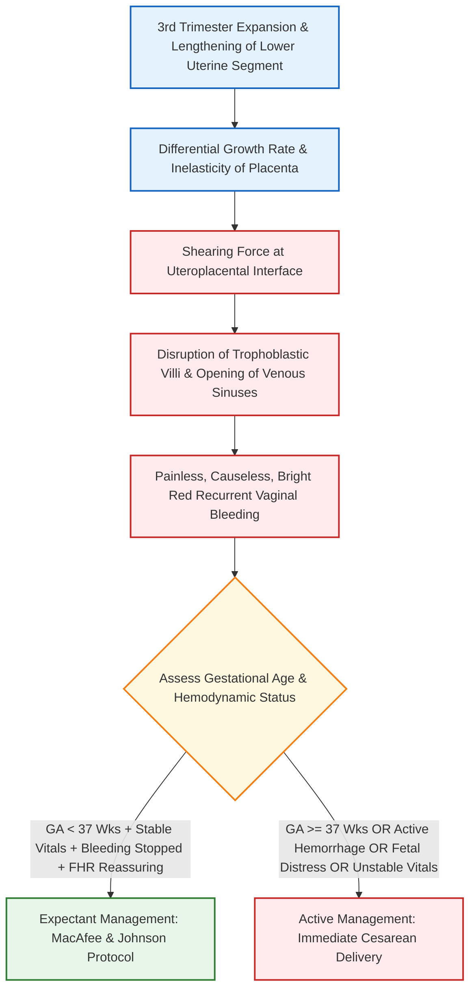

[[C19-Antepartum hemorrhage]]
# Antepartum Hemorrhage and Placenta Previa [⭐ High-Yield]

### 1. Definition [⭐ High-Yield]

- **Antepartum Hemorrhage (APH)**: Defined as bleeding from or into the genital tract after the **20th week** of gestation (or 28th week, taken arbitrarily as the lower limit of fetal viability) up to the birth of the baby (including the first and second stages of labor).
- **Placenta Previa**: An obstetric condition where the placenta is implanted partially or completely over the lower uterine segment (over, adjacent to, or within 2 cm of the internal cervical os) in front of the fetal presenting part.

---

### 2. Etiology / Causes / Risk Factors [⭐ High-Yield]

#### A. Overall Causes of Antepartum Hemorrhage (APH)

1. **Placental Bleeding (70% of cases)**:
    - **Placenta Previa (35%)**: Implantation in the lower uterine segment.
    - **Abruptio Placentae (35%)**: Premature separation of a normally implanted placenta.
2. **Unexplained / Indeterminate Bleeding (25% of cases)**: Vasa previa, succenturiate lobe, marginal sinus rupture, or circumvallate placenta.
3. **Extraplacental Causes (5% of cases)**: Local cervicovaginal lesions such as cervical polyps, carcinoma of cervix, cervical ectopy, varicose veins, or local genital trauma.

```
                                  ┌────────────────────────────────────────┐
                                  │      Antepartum Hemorrhage (APH)       │
                                  └───────────────────┬────────────────────┘
                                                      │
         ┌────────────────────────────────────────────┼────────────────────────────────────────────┐
         ▼                                            ▼                                            ▼
┌─────────────────────────┐                  ┌─────────────────────────┐                  ┌─────────────────────────┐
│  Placental Causes (70%) │                  │  Unexplained / Indet.   │                  │  Extraplacental Causes  │
│                         │                  │         (25%)           │                  │          (5%)           │
└────────────┬────────────┘                  └────────────┬────────────┘                  └────────────┬────────────┘
             │                                            │                                            │
   ┌─────────┴─────────┐                         ┌────────┴────────┐                          ┌────────┴────────┐
   ▼                   ▼                         ▼                 ▼                          ▼                 ▼
Placenta            Abruptio                   Vasa             Marginal                   Cervical          Cervical
Previa (35%)     Placentae (35%)              Previa            Sinus                      Polyp/Ectopy      Ca / Trauma
```

#### B. Etiology & Risk Factors for Placenta Previa

- **Dropping Down Theory**: Delayed nidatory capability of the fertilized ovum causes it to drop down and implant in the lower uterine segment.
- **Prior Uterine Scarring (Major Risk Factor)**: History of previous **Cesarean Delivery (CD)**, myomectomy, or curettage.
    - Risk of **Placenta Accreta Spectrum (PAS)** rises dramatically with prior C-sections: **3% with 1 prior CD**, escalating up to **61% with ≥3 prior CDs**.
- **Multiparity & Advanced Maternal Age (>35 years)**: Atrophic endometrial changes or scarring from repeated pregnancies favor lower segment implantation (4-fold risk elevation).
- **Hyperplacentosis**: Multiple gestation (twins/triplets) or large placental size encroaches into the lower uterine segment.
- **Maternal Smoking & Substance Use**: Carbon monoxide-induced hypoxemia triggers compensatory placental hypertrophy, COCAIN abuse
- Preeclampsia 
- Hydramnious
- Increased age
- Submucous fibroid
- RTA
- Folic acid deficiency
- Thrombophelia

---

### 3. Classification of Placenta Previa [⭐ High-Yield]

#### A. Revised Classification (ACOG & ACR Criteria)

- **True Placenta Previa**: The placenta directly covers the internal cervical os.
- **Low-Lying Placenta**: The placental edge lies within **2 cm** of the internal cervical os but does not cover it.

#### B. Classic Anatomical Degrees / Types

- **Type 1 (Low-Lying)**: The lower edge of the placenta extends into the lower uterine segment but lies within 2–5 cm of the internal os.
- **Type 2 (Marginal)**: The placental edge reaches the margin of the internal cervical os but does not cover it.
    - _Type 2 Posterior ("Dangerous Variety")_: The placenta lies over the sacral promontory, diminishing the AP diameter of the pelvic inlet and compressing the umbilical cord during fetal head descent.
- **Type 3 (Incomplete / Partial)**: The placenta covers the internal os when closed, but covers it only partially when dilated.
- **Type 4 (Complete / Central)**: The placenta completely covers the internal cervical os even when fully dilated.

---

### 4. Pathophysiology (Mechanism of Bleeding) [⭐ High-Yield]

- **Lower Uterine Segment Development & Shearing Force**:
    - As pregnancy advances into the third trimester, the lower uterine segment progressively elongates and stretches (expanding from 0.5 cm at 20 weeks to >5 cm at term).
    - The rigid, inelastic placenta cannot stretch alongside the expanding lower uterine segment.
    - This differential growth rate creates **shearing forces** that detach the placental villi, opening up uteroplacental venous sinuses and causing **inevitable, painless maternal hemorrhage**.
- **Placental Migration**:
    - Sonography at 17 weeks identifies low-lying placenta in ~15% of cases; however, >90% resolve by 34–36 weeks.
    - This apparent "migration" occurs due to progressive LUS elongation relocating the placental margin upward, alongside **trophotropism** (preferential growth of trophoblastic tissue toward the more vascular fundus).



---

### 5. Clinical Features [⭐ High-Yield]

#### A. Symptoms

- **Painless Vaginal Bleeding**: The cardinal hallmark symptom.
- **Causeless & Unprovoked**: Occurs spontaneously without trauma or exertion, often awakening the patient from sleep in a pool of blood.
- **Recurrent Pattern**: Characterized by an initial slight **"warning hemorrhage"**, followed by subsequent bouts of progressively heavier bleeding.
- **Bright Red Blood**: Fresh maternal blood from open uteroplacental sinuses close to the internal os.

#### B. Physical Signs

- **General Physical Examination**:
    - Pallor, pulse rate, and blood pressure changes are **strictly proportionate to the visible external blood loss**.
- **Abdominal Examination**:
    - **Uterine Contour & Feel**: Uterus is soft, relaxed, non-tender, and elastic, corresponding to the period of amenorrhea.
    - **Malpresentation & High Head**: High incidence of floating head, transverse lie, or breech presentation because the low-lying placenta occupies the pelvic inlet.
    - **Stallworthy's Sign**: Slowing of the fetal heart rate (FHR) upon pressing the fetal head down into the pelvic inlet, which promptly recovers upon releasing pressure (suggestive of low-lying posterior placenta previa).
- **STRICT CONTRAINDICATION**: **Digital Vaginal Examination (P/V) is strictly prohibited** in any suspected case of APH until placenta previa is ruled out by sonography, as it can provoke fatal, torrential hemorrhage!

---

### 6. Diagnosis / Investigations [⭐ High-Yield]

- **Transvaginal Ultrasonography (TVS - Investigation of Choice)**:
    - **Gold Standard** imaging modality (superior accuracy and safety compared to TAS).
    - Accurately measures the precise distance between the lower placental edge and the internal cervical os in millimeters.
- **Transabdominal Ultrasonography (TAS)**:
    - Initial rapid screening tool; requires a moderately full bladder.
- **Color Doppler Ultrasonography & MRI**:
    - Mandatory in women with placenta previa and a history of previous C-section to screen for **Placenta Accreta Spectrum (PAS)**.
    - Key PAS signs on USG: Loss of retroplacental hypoechoic clear zone (<1 mm myometrial thickness), intraplacental vascular lacunae ("moth-eaten" appearance), and hypervascularity at the bladder-serosal interface.
    - **MRI**: Superior for confirming posterior placenta previa, parametrial extension, or deep bladder invasion.
- **Laboratory Studies**: Complete blood count, Hb/hematocrit, ABO and Rh blood grouping, cross-matching 2–4 units of PRBC, and coagulation profile (PT/aPTT/Fibrinogen).

---

### 7. Differential Diagnosis

#### Comparison Table: Placenta Previa vs Abruptio Placentae vs Vasa Previa

|Parameter / Feature|Placenta Previa|Abruptio Placentae|Vasa Previa|
|:--|:--|:--|:--|
|**Nature of Bleeding**|**Painless, causeless, recurrent, and bright red**.|**Painful, continuous, dark red, and often traumatic/HTN-associated**.|Painless, occurs upon **rupture of membranes**.|
|**Variety of Bleeding**|Always **Revealed** (visible externally).|Revealed, Concealed, or Mixed.|Revealed (fetal blood).|
|**General Condition**|Proportionate to visible external blood loss.|Out of proportion to visible blood loss (in concealed/mixed).|Fetal distress out of proportion to minor maternal loss.|
|**Uterine Feel**|**Soft, relaxed, and non-tender**.|**Tense, tender, and woody-hard (rigid)**.|Soft and non-tender.|
|**Fetal Heart Sounds**|Usually normal and easily heard.|Absent or non-reassuring (fetal distress).|Severe fetal bradycardia / sinusoidal FHR pattern.|
|**Placental Location**|Lower uterine segment (within 2 cm of internal os).|Upper uterine segment (retroplacental clot positive).|Fetal vessels crossing internal os over membranes.|

---

### 8. Treatment / Management of Placenta Previa (at 32 Weeks / 34 Weeks) [⭐ High-Yield]

```
flowchart TD

classDef primary fill:#e3f2fd,stroke:#1565c0,stroke-width:2px
classDef danger fill:#ffebee,stroke:#c62828,stroke-width:2px
classDef success fill:#e8f5e9,stroke:#2e7d32,stroke-width:2px
classDef warning fill:#fff8e1,stroke:#f57f17,stroke-width:2px

A[Admission of APH Case + Immediate Resuscitation 14/16G IV Cannula + Blood Grouping]:::primary --> B[Screening TVS / Color Doppler for Placental Edge Distance & PAS]:::primary
B --> C{Assess Maternal Vitals, Bleeding Severity & Gestational Age 32/34 Wks}:::warning
C -->|POG < 37 Wks + Vitals Stable + Bleeding Stopped + FHR Reassuring| D[Expectant Management: MacAfee & Johnson Protocol]:::success
D --> E[Hospital Bed Rest + Dexamethasone/Betamethasone + MgSO4 if <32 Wks + Anti-D]:::success
E --> F[Elective C-Section at 36-37 Weeks]:::success
C -->|POG >= 37 Wks OR Active Hemorrhage OR Fetal Distress OR Unstable Vitals| G[Active Management / Immediate Delivery]:::danger
G --> H{Placental Edge to Internal Os Distance on TVS?}:::warning
H -->|Edge <= 2 cm or True Placenta Previa| I[Lower Segment Cesarean Section LSCS]:::danger
H -->|Edge > 2 cm & Uncomplicated Low-Lying| J[Trial of Vaginal Delivery via ARM +- Oxytocin]:::success
```

#### A. Emergency Resuscitation & Initial Hospital Admission

1. **Immediate Resuscitation**: Establish two large-bore IV cannulas (14G or 16G), infuse Ringer's lactate, order urgent blood grouping, Rh typing, cross-matching 2–4 units of PRBC, and complete blood count.
2. **Avoid Digital Examination**: Put patient strictly on bed rest; avoid all pelvic digital exams.

#### B. Expectant Management at 32–34 Weeks (MacAfee & Johnson Protocol)

- **Aim**: Continue pregnancy to attain fetal pulmonary maturity without endangering maternal life.
- **Selection Criteria (ALL Must Be Present)**:
    - Maternal hemodynamic stability (normal pulse, BP, and Hb ≥10 g/dL).
    - Absence of active or severe vaginal bleeding.
    - Gestational age **<37 weeks** (case presents at 32–34 weeks).
    - Reassuring fetal status (normal FHS / reactive CTG).
- **Protocol Steps during Hospitalization**:
    - Complete hospital pelvic bed rest with washroom privileges.
    - **Antenatal Corticosteroids (Mandatory at <34 Weeks)**: Administer **Betamethasone 12 mg IM 24 hours apart for 2 doses** (or Dexamethasone 6 mg IM 12 hours apart for 4 doses) to accelerate fetal lung maturation and reduce neonatal Respiratory Distress Syndrome (RDS), Intraventricular Hemorrhage (IVH), and Necrotizing Enterocolitis (NEC).
    - **Neuroprotection**: Administer **Magnesium Sulfate (MgSO₄)** loading and maintenance infusion if gestational age is **<32 weeks** to reduce cerebral palsy risk.
    - **Rh Immunoglobulin**: Administer Anti-D immunoglobulin (**300 µg IM**) within 72 hours if the mother is Rh-negative unsensitized.
    - **Serial Fetal Surveillance**: Periodic inspection of vulval pads, CTG, and TVS every 2–3 weeks to assess placental position.
    - **Timing of Elective Delivery**: Planned elective C-section at **36°/7 to 37°/7 weeks** once maturity is reached.

#### C. Indications for Breaking Expectant Management (Active Delivery)

- Brisk, recurrent, or continuing active hemorrhage.
- Maternal hemodynamic instability or shock.
- Non-reassuring fetal status / fetal distress.
- Onset of spontaneous active labor.

#### D. Mode of Delivery

- **Cesarean Delivery (LSCS - Primary Choice)**: Mandatory for all cases of true placenta previa or low-lying placenta where the edge is **≤2 cm** from the internal os.
- **Trial of Vaginal Delivery**: Allowed ONLY if TVS confirms the placental edge is **>2 cm** away from the internal os, with low artificial rupture of membranes (ARM) ± oxytocin infusion.

---

### 9. Complications [⭐ High-Yield]

#### A. Maternal Complications

- **Antepartum & Intrapartum Hemorrhage**: Profuse bleeding leading to hypovolemic shock.
- **Placenta Accreta Spectrum (PAS)**: Morbid adherence requiring emergency hysterectomy.
- **Postpartum Hemorrhage (PPH)**: High risk of atonic PPH because the lower uterine segment lacks middle interlacing "living ligature" muscle fibers and retracts poorly.
- **Operative Hazards & Sepsis**: Increased rates of C-section, uterine artery ligation, hysterectomy, and puerperal sepsis.

#### B. Fetal / Neonatal Complications

- **Prematurity**: Leading cause of perinatal death due to spontaneous or indicated preterm birth.
- **Fetal Hypoxia & Birth Asphyxia**: Secondary to placental detachment or cord compression.
- **Fetal Growth Restriction (FGR)**: Caused by chronic placental insufficiency from recurrent minor bleedings.
- **Perinatal Mortality**: Increased perinatal loss due to prematurity and hypoxia.

---

### 10. Prognosis

- **Maternal Prognosis**: Excellent in modern tertiary centers (<1% mortality) due to early sonographic diagnosis, avoidance of digital examinations, liberal C-section use, and blood banking.
- **Fetal Prognosis**: Significantly improved via MacAfee expectant management and NICU advances, though perinatal mortality remains elevated due to prematurity.

---

### 11. Clinical Pearl & Exam Trap

### Clinical Pearl

- **The Living Ligature Deficiency**: The lower uterine segment contains predominantly longitudinal and circular muscle fibers but **lacks the thick, interlacing middle "Figure-of-8" muscle layer** present in the upper segment. Consequently, after placental separation, the lower segment cannot retract forcefully to clamp open uteroplacental vessels, resulting in severe, refractory **Postpartum Hemorrhage (PPH)**.

### Exam Trap

- **The Mix-Up**: Performing a digital vaginal examination (P/V) in a patient presenting with third-trimester vaginal bleeding before obtaining a sonogram.
- **Distinguishing Fact**: **Digital P/V examination is strictly CONTRAINDICATED** in suspected placenta previa. A single finger introduced through the cervix can detach a central placenta, tearing major venous sinuses and triggering fatal, torrential hemorrhage within seconds! Always perform a **screening ultrasound** first.

---

### 12. Drug Dosage Table (DOSAGE RULE) [⭐ High-Yield]

|Name|Mechanism of Action|Dose|Dosage / Route|Frequency|Features|Side Effects|When to Start / Stop|
|:--|:--|:--|:--|:--|:--|:--|:--|
|**Betamethasone**|Glucocorticoid agonist; stimulates fetal type II pneumocytes to synthesize surfactant, increasing lung compliance.|**12 mg**|Intramuscular (IM)|2 doses, **24 hours apart**|**First-line steroid** in MacAfee expectant management (<34 weeks).|Mild maternal hyperglycemia, transient leukocytosis.|Start upon admission in expectant management (<34 wks); complete course in 24 hrs.|
|**Dexamethasone**|Glucocorticoid; induces fetal lung maturation and surfactant synthesis.|**6 mg**|Intramuscular (IM)|4 doses, **12 hours apart**|Alternative steroid regimen for lung maturity <34 weeks.|Transient decrease in fetal heart rate variability.|Start upon admission (<34 wks); complete 4 doses over 36 hrs.|
|**Magnesium Sulfate (MgSO₄)**|NMDA receptor antagonist; stabilizes neuronal membranes to reduce cerebral ischemia and provide neuroprotection.|**4 g IV loading**, then **1 g/hr IV maintenance**|Intravenous (IV) infusion|Continuous for **12–24 hours**|Reduces cerebral palsy in preterm birth **<32 weeks POG**.|Loss of deep tendon reflexes, respiratory depression, flushing.|Start prior to anticipated early preterm delivery (<32 wks); stop after delivery.|
|**Anti-D Immunoglobulin**|Neutralizes Rh-positive fetal red cells in maternal circulation, preventing Rh isoimmunization.|**300 µg** (1500 IU)|Intramuscular (IM)|Single stat dose|Mandatory for all **Rh-negative unsensitized**mothers presenting with APH.|Local site pain, mild fever.|Administer within **72 hours** of any episode of APH.|
|**Oxytocin**|Binds G-protein coupled receptors → increases intracellular Ca²⁺ → induces rhythmic uterine contractions.|**10 IU** (or 10–20 IU in 1 L RL)|IM or slow IV drip|Continuous infusion during CS / labor|**First-line uterotonic to prevent atonic PPH**during C-section.|Transient hypotension, fluid retention with prolonged infusion.|Administer immediately after fetal delivery during C-section / labor.|

---

### 13. Diagram Guides

### Diagram 1: Anatomical Degrees / Types of Placenta Previa

- **Type**: Labeled coronal anatomical diagram.
- **Outline shape to draw**: Coronal profile of gravid uterus showing lower uterine segment, internal cervical os, and placenta.
- **Labels in order**:
    1. **Type 1 (Low-Lying)** — Placenta in LUS, edge 2–5 cm from os.
    2. **Type 2 (Marginal)** — Placental edge reaches margin of internal os.
    3. **Type 3 (Incomplete / Partial)** — Placenta covers internal os partially.
    4. **Type 4 (Complete / Central)** — Placenta completely covers internal os.
- **Arrows/connections**: Internal Os ↔ Placental Margin (measuring exact gap in cm).
- **One annotation worth extra marks**: _"Type 2 Posterior Placenta Previa is termed the 'Dangerous Variety' because it compresses the umbilical cord against the sacral promontory during fetal descent."_

---

### Diagram 2: Sonographic Assessment of Placenta Previa Distance to Internal Os

- **Type**: Transvaginal Ultrasound (TVS) schematic diagram.
- **Outline shape to draw**: Sagittal pelvic ultrasound section showing TVS probe, endocervical canal, internal os, and placental edge.
- **Labels in order**:
    1. **TVS Transducer Probe** — positioned in anterior vaginal fornix.
    2. **Internal Cervical Os** — landmark point.
    3. **Lower Edge of Placenta** — measuring distance to internal os.
    4. **Cervical Canal Length** — closed internal to external os.
- **Arrows/connections**: Placental Edge ↔ Internal Os (Bi-directional arrow indicating ≤2 cm vs >2 cm thresholds).
- **One annotation worth extra marks**: _"TVS is the Gold Standard for diagnosing placenta previa; an edge distance ≤2 cm mandates Cesarean delivery."_

---

### 14. Mnemonic / Memory Palace

#### Mnemonic: P-R-E-V-I-A

- **P**: **Painless, causeless, bright red, recurrent bleeding** (hallmark symptom)
- **R**: **Relaxed, soft, non-tender uterus** on abdominal palpation
- **E**: **Expectant management (MacAfee Protocol)** for POG <37 weeks if stable
- **V**: **Vaginal examination is STRICTLY CONTRAINDICATED**
- **I**: **Investigation of Choice = Transvaginal Sonography (TVS)**
- **A**: **Active delivery via C-section** if edge ≤2 cm from internal os or at ≥37 weeks

---

### Quick Revision

- **APH Definition**: Genital tract bleeding from **20th/28th week of pregnancy up to fetal delivery**.
- **Top 2 Causes**: **Placenta Previa (35%)** and **Abruptio Placentae (35%)**.
- **Placenta Previa Triad**: **Painless, causeless, bright red recurrent bleeding** with a **soft, non-tender uterus**.
- **Contraindication**: **NEVER perform digital P/V exam** in suspected APH.
- **Gold Standard Diagnostic Tool**: **Transvaginal Sonography (TVS)** measuring placental edge to internal os distance.
- **Management at 32/34 Weeks**: Expectant management (MacAfee Protocol) with hospital bed rest, **Betamethasone/Dexamethasone steroids**, MgSO₄ (<32 wks), and elective C-section at 36–37 weeks.

---

### One-Line Exam Opener

- **Antepartum hemorrhage (APH) is bleeding from or into the genital tract occurring after the 20th–28th week of gestation prior to fetal birth, most commonly caused by placenta previa—a condition characterized by painless, bright red, recurrent hemorrhage from lower segment placental implantation, diagnosed accurately via transvaginal ultrasound (TVS) and managed expectantly at 32–34 weeks using the MacAfee & Johnson protocol with antenatal corticosteroids to achieve fetal maturity.**

---

💡 _Would you like me to generate practice MCQs, clinical case scenarios, or flashcards on Antepartum Hemorrhage and Placenta Previa to help test your recall before the exam?_