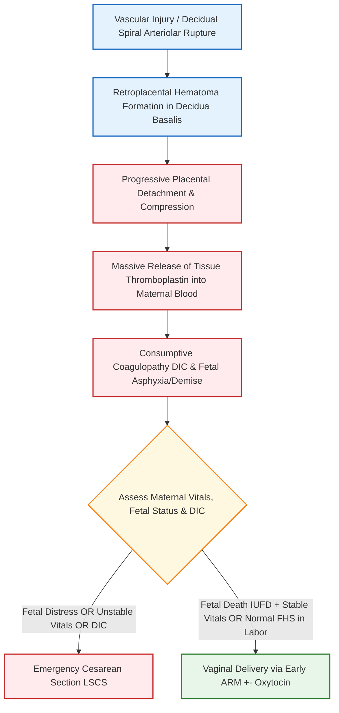
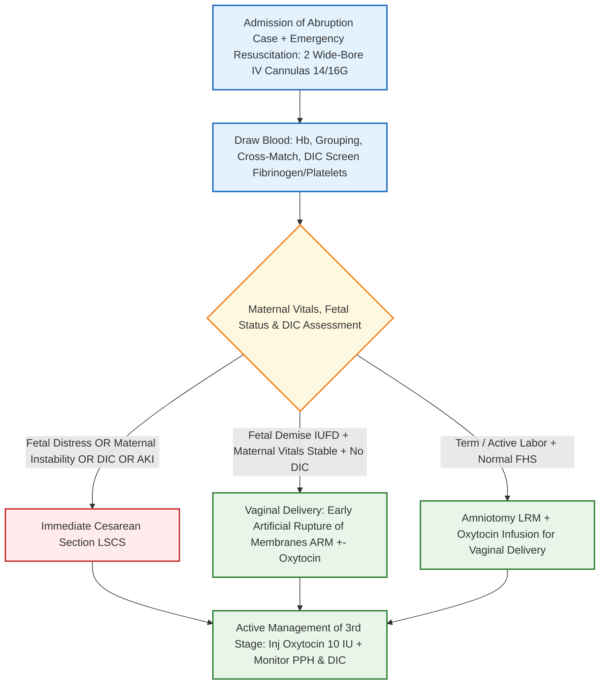

[[C19-Antepartum hemorrhage]]
# : Management and Complications [⭐ High-Yield]

### Mark Weightage

- **5 Marks**

---

### 1. Definition [⭐ High-Yield]

- **Abruptio Placentae (Accidental Hemorrhage / Premature Separation of Placenta)**: A form of antepartum hemorrhage (APH) defined as the premature separation of a normally implanted placenta from the uterine wall (upper uterine segment) after the **20th week** of gestation (or 28th week) prior to the delivery of the fetus.
- **Incidence**: Contributes to nearly **30%** of all APH cases, occurring in ~1 in 100 deliveries.

---

### 2. Etiology & High-Risk Factors [⭐ High-Yield]

- **Hypertensive Disorders of Pregnancy (Most Common Risk Factor - 30–50%)**: Pre-eclampsia, eclampsia, and chronic hypertension cause spiral artery vasospasm, endothelial dysfunction, and decidual necrosis.
- **Abdominal Trauma**: Motor vehicle accidents, direct abdominal blows, domestic violence, or forceful external cephalic version.
- **Sudden Uterine Decompression**: Rapid loss of liquor during artificial or spontaneous rupture of membranes in polyhydramnios, or following the birth of the first twin in multiple gestation.
- **Uterine & Placental Anomalies**: Short umbilical cord, uterine leiomyomas behind the placental bed, circumvallate placenta.
- **Maternal Lifestyle & Demographic Factors**: High parity, advanced maternal age (>35 years), cigarette smoking (nicotine-induced vasospasm), cocaine abuse, and prior history of abruption (5–20% recurrence risk).

---

### 3. Classification [⭐ High-Yield]

#### A. Anatomical Varieties

```
                                  ┌────────────────────────────────────────┐
                                  │      Abruptio Placentae Varieties      │
                                  └───────────────────┬────────────────────┘
                                                      │
         ┌────────────────────────────────────────────┼────────────────────────────────────────────┐
         ▼                                            ▼                                            ▼
┌─────────────────────────┐                  ┌─────────────────────────┐                  ┌─────────────────────────┐
│ Revealed Variety (20%)  │  │ Concealed Variety (15%) │  │  Mixed Variety (65%)    │
│ Blood escapes via os    ││ Clot retained in uterus │ Both concealed & revealed│
└─────────────────────────┘                  └─────────────────────────┘                  └─────────────────────────┘
```

1. **Revealed Variety**: Blood dissects between the membranes and uterine wall, escaping through the cervical os; retroplacental clot is minimal or absent.
2. **Concealed Variety**: Blood accumulates retroplacentally behind the placenta or membranes with no external bleeding; all blood remains trapped inside.
3. **Mixed Variety (Most Common)**: A combination where part of the blood escapes externally through the os and part remains retroplacentally concealed.

#### B. Page Clinical Grading System

|Grade|Clinical Features|Fetal Status|Maternal & Coagulation Status|
|:--|:--|:--|:--|
|**Grade 0**|Asymptomatic; retroplacental clot diagnosed retrospectively after delivery.|Normal|Normal.|
|**Grade 1 (40%)**|Slight dark vaginal bleeding; mild localized uterine irritability/tenderness.|Normal FHS|Normal BP and normal serum fibrinogen.|
|**Grade 2 (45%)**|Mild-to-moderate vaginal bleeding; **tense, tender uterus**; uterine contractions present.|**Fetal distress** / non-reassuring CTG|Tachycardia present; BP maintained; fibrinogen decreased.|
|**Grade 3 (15%)**|Moderate-to-severe / concealed bleeding; **markedly rigid "woody-hard" tender uterus**.|**Fetal death (IUFD) is the rule**|**Maternal shock pronounced; DIC ± acute kidney injury**.|

---

### 4. Pathophysiology [⭐ High-Yield]

- **Decidual Hemorrhage**: Ruptured maternal spiral arterioles in the decidua basalis lead to decidual hematoma formation.
- **Placental Shearing**: Expanding hematoma dissects the decidua, separating the overlying placenta from the uterine wall and destroying intervillous vascular exchange.
- **Thromboplastin Release**: Damaged placental and decidual tissues release large quantities of **tissue thromboplastin** into the maternal circulation, triggering systemic intravascular coagulation (DIC) and consumptive coagulopathy.



---

### 5. Clinical Features [⭐ High-Yield]

#### A. Symptoms

- **Dark Red Vaginal Bleeding**: Non-recurrent, continuous dark blood or serosanguineous discharge.
- **Continuous Abdominal Pain**: Severe, unremitting, agonizing lower abdominal or back pain.
- Uterine tenderness 

#### B. Physical Signs

- **General Examination**:
    - Pallor and degree of ==shock are **severely out of proportion to visible external blood loss** in concealed== and mixed varieties.
- **Abdominal Examination**:
    - **Uterine Contour & Feel**: Uterus is **tense, tender, rigid, and "==woody-hard=="** on palpation.
    - **Uterine Height**: Fundal height may be ==greater== than expected for the period of amenorrhea due to concealed intra-uterine clot accumulation.
    - **Fetal Palpation**: Fetal parts are difficult or impossible to feel due to intense uterine rigidity.
    - **Fetal Heart Sounds (FHS)**: Absent (in severe Grade 3 abruption) or exhibiting non-reassuring patterns (decelerations/bradycardia).

---

### 6. Diagnosis & Investigations [⭐ High-Yield]

- **Clinical Diagnosis**: Primarily a clinical diagnosis based on the classic triad of **dark vaginal bleeding, continuous abdominal pain, and a woody-hard tender uterus**.
- **Ultrasonography (TVS / TAS)**: Demonstrates retroplacental hyperechoic/heterogeneous hematoma, "jello sign" (shimmering of placental tissue on movement), and ==negative results doesn’t rules out== placenta previa.
- **Laboratory DIC Profile**:
    - **Serum Fibrinogen**: Reduced (<150 mg/dL; critical level <100 mg/dL).
    - **Platelet Count**: Thrombocytopenia (<100,000/μL).
    - **D-Dimer & FDPs**: Markedly elevated.
    - **Prothrombin Time (PT) & aPTT**: Prolonged.
- **Renal Function Tests**: Elevated serum uric acid, creatinine, and urine protein.
- **Kleihauer-Betke Acid Elution Test**: Detects fetomaternal hemorrhage in Rh-negative mothers.

---

### 7. Differential Diagnosis

|Parameter / Feature|Abruptio Placentae|Placenta Previa|Ruptured Uterus|
|:--|:--|:--|:--|
|**Bleeding Character**|**Dark red, continuous, painful**.|**Bright red, unprovoked, painless**.|Dark red, variable.|
|**Uterine Tone**|**Tense, tender, woody-hard**.|**Soft, relaxed, non-tender**.|Contour lost; uterus felt contracted separately.|
|**Shock Status**|Out of proportion to external bleeding.|Proportionate to visible blood loss.|Severe shock with abdominal tenderness.|
|**Fetal Parts**|Difficult to feel.|Easily felt; high floating head.|**Easily felt in peritoneal cavity**.|
|**FHS**|Absent or non-reassuring.|Usually normal.|Absent or fetal distress.|

---

### 8. Treatment / Management [⭐ High-Yield]



#### A. Emergency Resuscitation & Initial Hospital Stabilization

1. **Airway, Breathing, Circulation**: Oxygen inhalation (5–6 L/min) and continuous vitals tracking.
2. **Vascular Access & Fluid Therapy**: Establish two large-bore IV lines (14G or 16G); rapidly infuse crystalloids (Ringer's Lactate) to restore intravascular volume.
3. **Blood Component Transfusion Protocol**:
    - Transfuse **fresh Packed Red Blood Cells (PRBCs)** to correct anemia and shock.
    - **Fresh Frozen Plasma (FFP)**: Transfuse 4 units to replenish clotting factors.
    - **Cryoprecipitate**: Indicated if serum fibrinogen remains **<100–150 mg/dL**.
    - **Platelet Concentrates**: Transfused if platelets drop **<50,000/μL**.
    - **Tranexamic Acid (TXA)**: Administer **1 g IV over 10 minutes** to inhibit hyperfibrinolysis.
4. **Catheterization**: Insert a Foley catheter to monitor hourly urine output (aim **>30 mL/hr**).

#### B. Obstetric Management (Definitive Delivery)

- **Principle**: _"Delivery is the definitive treatment."_ Expectant management is an exception reserved only for rare, stable Grade 1 cases <34 weeks in a tertiary care unit with steroids and MgSO₄.
- **Indications for Emergency Cesarean Section (LSCS)**:
    - Non-reassuring fetal heart rate status / fetal distress.
    - Severe active bleeding or worsening maternal shock/DIC.
    - Acute Kidney Injury (AKI).
    - Unfavorable cervix with no labor progress.
- **Indications for Vaginal Delivery**:
    - **Fetal Demise (IUFD)** with stable maternal vitals and no DIC.
    - Patient in active, rapidly progressing labor with normal FHS.
    - **Artificial Rupture of Membranes (ARM / Amniotomy)**: Performed early in all cases suitable for vaginal delivery.
        - _Advantages of ARM_: Reduces intrauterine pressure, accelerates labor (delivery within 4–6 hours), enhances myometrial compression on spiral vessels, and decreases entry of tissue thromboplastin into maternal circulation (reducing DIC and renal failure risk).
    - Add **Oxytocin Infusion** to augment labor contractions once membranes are ruptured.

#### C. Post-Delivery Management

- Administer **Inj. Oxytocin 10 IU IM/IV** or Methergine 0.2 mg IV immediately following fetal delivery to prevent atonic PPH.
- Inspect placenta and membranes for completeness and measure retroplacental clot volume.

---

### 9. Complications [⭐ High-Yield]

#### A. Maternal Complications

1. **Hemorrhagic Shock**: Secondary to massive revealed or concealed blood loss.
2. **Consumptive Coagulopathy / DIC**: Triggered by tissue thromboplastin entering maternal circulation, consuming fibrinogen, platelets, and factors V & VIII.
3. **Couvelaire Uterus (Uteroplacental Apoplexy)**: Widespread extravasation of blood into the myometrium and subserosa, giving the uterus a dark port-wine purplish appearance; treated conservatively with oxytocics.
4. **Acute Kidney Injury (AKI) / Renal Cortical or Tubular Necrosis**: Resulting from prolonged hypovolemic shock, serotonin release from damaged uterine muscle, and renal vasospasm.
5. **Postpartum Hemorrhage (PPH)**: Driven by myometrial atony (disrupted muscle architecture) and high levels of circulating Fibrin Degradation Products (FDPs).
6. **Sheehan Syndrome**: Postpartum ischemic necrosis of the anterior pituitary gland.
7. **Puerperal Sepsis and Maternal Death (2–5%)**.

#### B. Fetal / Neonatal Complications

1. **Perinatal Mortality (25–100%)**: Exceeds 50–100% in severe concealed Grade 3 abruption.
2. **Intrauterine Fetal Demise (IUFD) & Birth Asphyxia**.
3. **Prematurity and Low Birth Weight**.
4. **Periventricular Leukomalacia & Cerebral Palsy**: Long-term neurological sequelae from severe intrapartum hypoxia.

---

### 10. Drug Dosage Table (DOSAGE RULE) [⭐ High-Yield]

| Name                          | Mechanism of Action                                                                                               | Dose                                                 | Dosage / Route                       | Frequency                                                         | Features                                                                         | Side Effects                                                    | When to Start / Stop                                                    |
| :---------------------------- | :---------------------------------------------------------------------------------------------------------------- | :--------------------------------------------------- | :----------------------------------- | :---------------------------------------------------------------- | :------------------------------------------------------------------------------- | :-------------------------------------------------------------- | :---------------------------------------------------------------------- |
| **Tranexamic Acid (TXA)**     | Antifibrinolytic; competitively inhibits plasminogen activation to plasmin, halting clot breakdown.               | **1 g (1000 mg)**                                    | Slow IV (over 10 mins)               | Single stat dose (repeat once if bleeding persists after 30 mins) | **First-line antifibrinolytic in APH/PPH & DIC**; reduces mortality.             | Nausea, vomiting, hypotension if rapid IV, rare thrombosis.     | Administer immediately upon diagnosis of abruption/DIC.                 |
| **Oxytocin**                  | Binds G-protein coupled myometrial receptors → ↑ intracellular Ca²⁺ → rhythmic uterine contractions.              | **10 IU** (or 10–20 IU in 500 mL RL)                 | IM or slow IV drip (40–60 drops/min) | Continuous drip in labor / 3rd stage                              | **First-line agent to augment labor & prevent atonic PPH**.                      | Transient hypotension, water intoxication with prolonged IV.    | Start during labor augmentation / delivery of baby; stop 1 hr post-PPH. |
| **Betamethasone**             | Glucocorticoid agonist; accelerates fetal type II pneumocyte maturation and surfactant synthesis.                 | **12 mg**                                            | Intramuscular (IM)                   | 2 doses, **24 hours apart**                                       | Indicated in rare expectant management **<34 weeks POG**.                        | Maternal hyperglycemia, transient leukocytosis.                 | Administer ,upon admission in expectant cases <34 wks.                  |
| **Magnesium Sulfate (MgSO₄)** | Competitive Ca²⁺ antagonist & NMDA receptor blocker; suppresses uterine contractility & provides neuroprotection. | **4 g IV loading**, then **1–2 g/hr IV maintenance** | Intravenous (IV) infusion            | Continuous for 12–24 hours                                        | Used for tocolysis & fetal neuroprotection in preterm abruption **<32 weeks**.   | Loss of deep tendon reflexes, respiratory depression, flushing. | Start prior to early preterm birth (<32 wks); stop post-delivery.       |
| **Anti-D Immunoglobulin**     | Clears Rh-D positive fetal red cells from maternal blood, preventing Rh isoimmunization.                          | **300 µg (1500 IU)**                                 | Intramuscular (IM)                   | Single stat dose                                                  | **Mandatory for all Rh-negative unsensitized mothers** with traumatic abruption. | Local pain, mild pyrexia.                                       | Administer within **72 hours** of abruption episode.                    |

---

### 11. Clinical Pearl & Exam Trap

### Clinical Pearl

- **Amniotomy (ARM) is Therapeutic**: Early Artificial Rupture of Membranes (ARM) in abruptio placentae reduces intrauterine pressure, stops entry of tissue thromboplastin into maternal circulation (preventing DIC and renal cortical necrosis), and accelerates delivery.

### Exam Trap

- **The Mix-Up**: Confusing the cause of shock in **Concealed Abruptio Placentae** with external bleeding.
- **Distinguishing Fact**: In concealed abruption, **shock is severely out of proportion to visible external blood loss**because a massive volume of blood is trapped retroplacentally and extravasated within the myometrium (Couvelaire uterus).

---

### 12. Diagram Guides

### Diagram 1: Anatomical Varieties of Abruptio Placentae

- **Type**: Labeled anatomical coronal diagram.
- **Outline shape to draw**: Outline of gravid uterus showing upper segment placenta and retroplacental blood.
- **Labels in order**:
    1. **Revealed Abruption** — blood escaping down cervical canal
    2. **Concealed Abruption** — retroplacental blood clot trapped behind placenta
    3. **Mixed Abruption** — both concealed retroplacental clot and revealed vaginal blood
- **Arrows/connections**: Retroplacental Clot → Dissection along Membranes → External Cervical Os.
- **One annotation worth extra marks**: _"In concealed abruption, tissue thromboplastin from the retroplacental clot enters maternal veins to trigger severe DIC."_

---

### Diagram 2: Couvelaire Uterus (Uteroplacental Apoplexy)

- **Type**: Gross anatomical / surgical diagram.
- **Outline shape to draw**: Anterior view of gravid uterus exposed at laparotomy.
- **Labels in order**:
    1. **Dark Port-Wine / Purplish Bruised Myometrium**
    2. **Subserosal Petechial Hemorrhages**
    3. **Broad Ligament Hematoma**
- **Arrows/connections**: Retroplacental Clot → Intramyometrial Extravasation → Subserosa Discoloration.
- **One annotation worth extra marks**: _"Couvelaire uterus is managed conservatively with oxytocics and DIC correction; hysterectomy is NOT routinely required."_

---

### 13. Mnemonic / Memory Palace

#### Mnemonic: A-B-R-U-P-T-I-O

- **A**: **Accidental hemorrhage** / Asphyxia risk to fetus
- **B**: **Blood loss dark red**; shock out of proportion in concealed type
- **R**: **Rigid, woody-hard, tender uterus** on palpation
- **U**: **Uterine decompression** or pre-eclampsia as key risk factors
- **P**: **Page classification** (Grades 0 to 3)
- **T**: **Thromboplastin release** causing DIC and consumptive coagulopathy
- **I**: **Immediate delivery via LSCS or ARM** (definitive treatment)
- **O**: **Oxytocics & blood components (PRBC, FFP, Cryo, TXA)** for resuscitation

---

### Quick Revision

- **Definition**: Premature separation of a normally implanted placenta in the upper segment after 20/28 weeks.
- **Key Risk Factors**: Pre-eclampsia/HTN (#1 cause), abdominal trauma, and sudden uterine decompression.
- **Clinical Triad**: **Dark vaginal bleeding, continuous abdominal pain, and a rigid "woody-hard" tender uterus**.
- **Primary Complications**: Consumptive coagulopathy (DIC), Couvelaire uterus, AKI, atonic PPH, and fetal demise.
- **Management Principle**: Immediate delivery via **LSCS** (if fetal distress/DIC/instability) or **ARM + Oxytocin** for vaginal delivery (if IUFD or term labor).

---

### One-Line Exam Opener

- **Abruptio placentae is the premature separation of a normally situated placenta from the upper uterine segment after 20 weeks of gestation, presenting with dark vaginal bleeding, continuous pain, and a woody-hard tender uterus, managed by emergency resuscitation, DIC correction, and immediate delivery.**

---

💡 _Would you like me to generate practice MCQs, clinical case scenarios, or flashcards on Abruptio Placentae and Antepartum Hemorrhage to test your recall before the exam?_