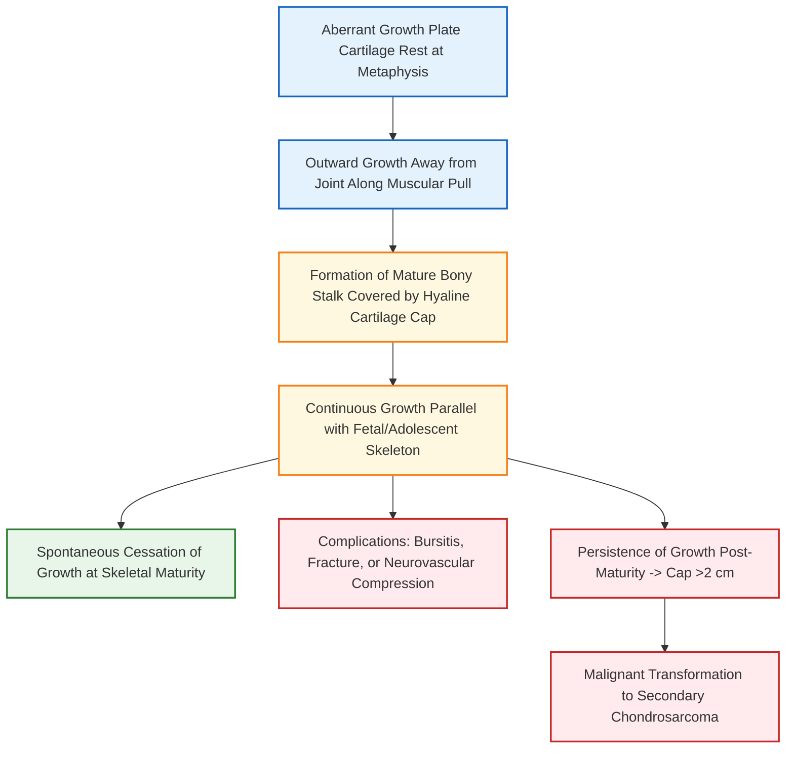

#   (Exostosis) [⭐ High-Yield]

---

### 1. Definition [⭐ High-Yield]

- **Osteochondroma** (commonly termed **Exostosis**): Defined as the **most common benign bone tumor** (tumor-like developmental outgrowth) of the human skeleton.
- **Pathological Nature**: It is a cartilage-capped bony projection arising from the **metaphysis** of long bones, characterized by direct anatomical continuity of both the **cortex** and the **medullary cavity** of the host bone with the lesion.
- **Biological Growth Pattern**: Follows normal skeletal growth—begins in childhood, increases in size during active growth, and **ceases growth upon skeletal maturity** (closure of the adjacent epiphyseal plate).
- **Sex Predilection**: **Males > Females** (2:1 ratio).
- **Most Common Anatomical Site**: Metaphysis of long bones around the knee joint (**Distal end of femur > Proximal end of tibia > Proximal end of humerus**).

---

### 2. Etiology & Risk Factors

- **Etiology**: Aberrant development and displacement of a small rest of unossified epiphyseal growth plate cartilage centrifugally through the periosteal Ring of Ranvier.
- **Direction of Growth**: Bony outgrowth projects **away from the adjacent joint** along the vector of muscle/tendon pull (following normal epiphyseal-to-metaphyseal growth direction).
- **Genetic Factors**:
    - _Solitary Osteochondroma_: Sporadic mutation.
    - _Hereditary Multiple Exostosis (Diaphyseal Aclasis)_: Autosomal dominant mutation in **EXT1** or **EXT2** tumor suppressor genes.

---

### 3. Classification [⭐ High-Yield]

#### A. Morphological Classification

1. **Pedunculated Type**: Narrow, slender bony stalk attaching the exostosis to the host metaphyseal cortex.
2. **Sessile Type**: Broad-based attachment to the underlying cortex without a distinct neck.

#### B. Clinical Presentation Types

1. **Solitary Osteochondroma**: Single lesion; low risk of malignant transformation (**<1%**).
2. **Hereditary Multiple Exostosis (Diaphyseal Aclasis)**: Multiple bilateral osteochondromas associated with metaphyseal remodeling defects ("trumpet-shaped" metaphysis) and higher risk of malignant transformation (**~5%**).

---

### 4. Pathophysiology [⭐ High-Yield]



#### Histological Architecture:

- **Base & Stalk**: Normal, mature lamellar cortical bone enclosing normal trabecular bone marrow.
- **Cartilaginous Cap**: Mature hyaline cartilage undergoing endochondral ossification.
- **Cap Thickness Threshold**: Normal cap thickness is **<1.5 to 2 cm**; a cap thickness exceeding **2 cm** in adults is strongly indicative of **secondary malignant transformation to Chondrosarcoma**.

---

### 5. Clinical Features [⭐ High-Yield]

#### A. Symptoms

- **Asymptomatic Presentation**: Most solitary lesions are completely painless and present as an incidental discovery during adolescence (10–20 years).
- **Painless Swelling**: Slowly expanding, hard, painless bony lump near a joint (around the knee or upper arm).
- **Pain Onset (Secondary Causes)**:
    - **Adventitious Bursitis**: Inflammation of the bursa forming over the apex of the exostosis (**most common cause of acute pain**).
    - **Fracture**: Acute traumatic fracture through a thin pedunculated stalk.
    - **Nerve Compression**: Tingling or paresthesia from pressure on nearby peripheral nerves (e.g., Common Peroneal Nerve at the fibular neck).
    - **Vascular Compromise**: False aneurysm formation or venous occlusion.
- **Mechanical Block**: Limitation of adjacent joint range of motion.

#### B. Physical Examination Signs

- **Palpation**: Bony-hard, non-tender (unless inflamed), immobile mass fixed to the underlying bone.
- **Overlying Skin**: Normal, mobile, and non-adherent.

---

### 6. Diagnosis / Investigations [⭐ High-Yield]

#### A. Plain Radiography (X-Ray - AP & Lateral Views)

- **Pathognomonic Sign**: Bony outgrowth arising from the metaphysis pointing **away from the joint**.
- **Cortical & Medullary Continuity**: Direct uninterrupted line between the cortex and cancellous marrow cavity of the host bone and the exostosis.
- **Cartilaginous Cap**: Cap is radiolucent and non-visible on plain X-rays unless stippled "popcorn" calcifications develop.

#### B. Cross-Sectional Imaging (CT & MRI)

- **MRI (Investigation of Choice for Cartilage Cap)**: Accurately measures **cartilaginous cap thickness**.
    - Cap thickness **<1.5 cm**: Benign osteochondroma.
    - Cap thickness **>2 cm**: High suspicion of **secondary Chondrosarcoma**.
- **CT Scan**: Best demonstrates cortical continuity in complex anatomical locations (e.g., pelvis or scapula).

---

### 7. Differential Diagnosis

|Feature|Osteochondroma|Parosteal Osteosarcoma|Myositis Ossificans|
|:--|:--|:--|:--|
|**Origin**|Metaphyseal outgrowth|Juxtacortical surface of bone|Extra-osseous muscle soft tissue|
|**Cortical Continuity**|**Present (Direct connection)**|Absent (Separated by a thin cleft)|Absent (Clear radiolucent zone)|
|**Cartilage Cap**|**Present (<2 cm)**|Absent|Absent|
|**Growth Pattern**|Points away from joint|Broad-based lobulated mass|Zonal maturation (mature bone outside)|
|**Pain**|Painless (unless complicated)|Dull persistent pain|Acute painful mass post-trauma|

---

### 8. Treatment / Management [⭐ High-Yield]

```
flowchart TD

classDef primary fill:#e3f2fd,stroke:#1565c0,stroke-width:2px
classDef danger fill:#ffebee,stroke:#c62828,stroke-width:2px
classDef success fill:#e8f5e9,stroke:#2e7d32,stroke-width:2px
classDef warning fill:#fff8e1,stroke:#f57f17,stroke-width:2px

A[Diagnosis of Osteochondroma]:::primary --> B{Asymptomatic or Symptomatic?}:::warning
B -->|Asymptomatic & Skeletally Immature| C[Conservative Management: Observation till Skeletal Maturity]:::success
B -->|Symptomatic / Cosmetic / Nerve Pressure / Cap >2 cm| D[Surgical Intervention Required]:::danger
D --> E[Extraperiosteal Excision / Exostosectomy at Base of Stalk]:::success
E --> F[Complete Histopathological Examination of Cartilage Cap]:::primary
F --> G[Curative Outcome with Zero Recurrence]:::success
```

#### A. Conservative / Non-Operative Management

- **Watchful Neglect / Serial Observation**: Indicated for small, asymptomatic lesions in growing children; periodic clinical and X-ray evaluation until growth plate closure.

#### B. Surgical Management

- **Procedure**: **Extraperiosteal Excision (Exostosectomy)**.
- **Surgical Technique**:
    - Resection of the entire bony projection flush at its base with the host cortex.
    - **Crucial Step**: Complete removal of the overlying periosteum and cartilaginous cap to leave zero residual chondrocytes, preventing local recurrence.
- **Timing**: Ideally performed **after skeletal maturity** to minimize damage to the adjacent normal growth plate, unless urgent pressure symptoms necessitate early excision.

---

### 9. Complications [⭐ High-Yield]

- **Adventitious Bursitis**: Friction bursitis developing over the prominent tip.
- **Fracture**: Traumatic avulsion of pedunculated stalk.
- **Neurovascular Entrapment**: Peroneal nerve palsy or popliteal pseudoaneurysm.
- **Growth Disturbance & Deformity**: Angular deformities (e.g., genu valgum) or limb length discrepancy in diaphyseal aclasis.
- **Secondary Malignant Transformation**: Transformation into **Chondrosarcoma** (suspected if pain arises or size increases after growth plate fusion).

---

### 10. Prognosis

- **Excellent**: Solitary osteochondroma carries an outstanding prognosis following complete extraperiosteal excision, with near-zero recurrence rates.

---

### 11. Dosage Rule

- _Not Applicable_: Osteochondroma is a structural developmental lesion; pharmacotherapy has no role in primary management (short-term NSAIDs like Ibuprofen 400 mg PO TDS may be used solely for acute bursitis pain).

---

### 12. Mnemonic / Memory Palace

#### Mnemonic: EXOSTOSIS

- **E** - **E**xtra-periosteal excision is treatment of choice
- **X** - **X**-ray shows continuity of cortex and medullary canal
- **O** - **O**utgrowth points AWAY from adjacent joint
- **S** - **S**tops growing after skeletal maturity
- **T** - **T**hickness of cap >2 cm indicates Chondrosarcoma
- **O** - **O**verlying bursitis is the most common cause of pain
- **S** - **S**olitary (commonest) vs **S**ystemic Diaphyseal Aclasis
- **I** - **I**ncidence: Commonest benign bone tumor
- **S** - **S**ite: Metaphysis around knee joint

#### Memory Palace: The Knee Garden Gate

1. **At the Garden Gate (Knee Metaphysis)**: A wooden fence post projecting **away from the gate hinges** (**Points away from joint**).
2. **Inside the Post**: A hollow pipe running continuously from the main wall right into the post (**Cortex and marrow continuity**).
3. **On top of the Post**: A snow cap measuring less than **2 cm** thick (**Cartilaginous cap**).
4. **When Snow Melts (Skeletal Maturity)**: The post stops growing completely; if it keeps growing, alarm bells ring (**Malignant transformation**).

---

### Clinical Pearl

- The definitive pathognomonic radiological feature distinguishing an osteochondroma from all other surface bone lesions (like parosteal osteosarcoma or myositis ossificans) is the **unbroken, direct continuity of both host cortical bone and host medullary marrow space** into the exostosis.

---

### Exam Trap

- **The Confusion**: Believing that osteochondroma projects _towards_ the adjacent joint or that a growing exostosis in an adult is benign.
- **Distinguishing Facts**:
    - **Direction**: Osteochondromas ALWAYS point **away from the joint** (towards the diaphysis).
    - **Growth in Adults**: Osteochondromas NEVER grow after skeletal maturity; any renewed growth or new pain in an adult indicates **malignant transformation to Chondrosarcoma**.

---

### Diagram Guide

### Diagram 1: Radiographic Features of Pedunculated Osteochondroma

- **Type**: Labeled radiological line schematic.
- **Outline shape to draw**: Long bone metaphysis (distal femur) with an exostosis.
- **Labels in order (proximal to distal)**:
    1. **Continuous Host Cortex** — Unbroken margin extending into the stalk.
    2. **Continuous Medullary Cavity** — Marrow space flowing into exostosis core.
    3. **Cartilaginous Cap (<2 cm)** — Covering the apex of the bony stalk.
    4. **Direction Arrow** — Stalk pointing **away from the adjacent joint**.
- **Extra Mark Annotation**: "Cartilaginous cap >2 cm on MRI indicates secondary malignant transformation to Chondrosarcoma".

---

### Quick Revision

- **Nature**: Most common benign bone tumor; metaphyseal origin.
- **Diagnostic Hallmark**: **Cortical and medullary continuity** with host bone.
- **Direction**: Outgrowth points **away from the joint**.
- **Pain Cause**: **Adventitious bursitis** over tip.
- **Malignancy Warning**: Cap thickness **>2 cm** on MRI or persistent growth after skeletal maturity.
- **Treatment**: **Extraperiosteal Excision** flush at the base.

---

### One-Line Exam Opener

- **Osteochondroma is the most common benign bone tumor, arising as a cartilage-capped metaphyseal bony outgrowth that maintains direct cortical and medullary continuity with the host bone, projects away from the adjacent joint, and is definitively managed by extraperiosteal excision upon skeletal maturity.**

---

🦴 _Would you like me to generate a quick practice quiz or flashcards on bone tumors to test your recall for the university exam?_