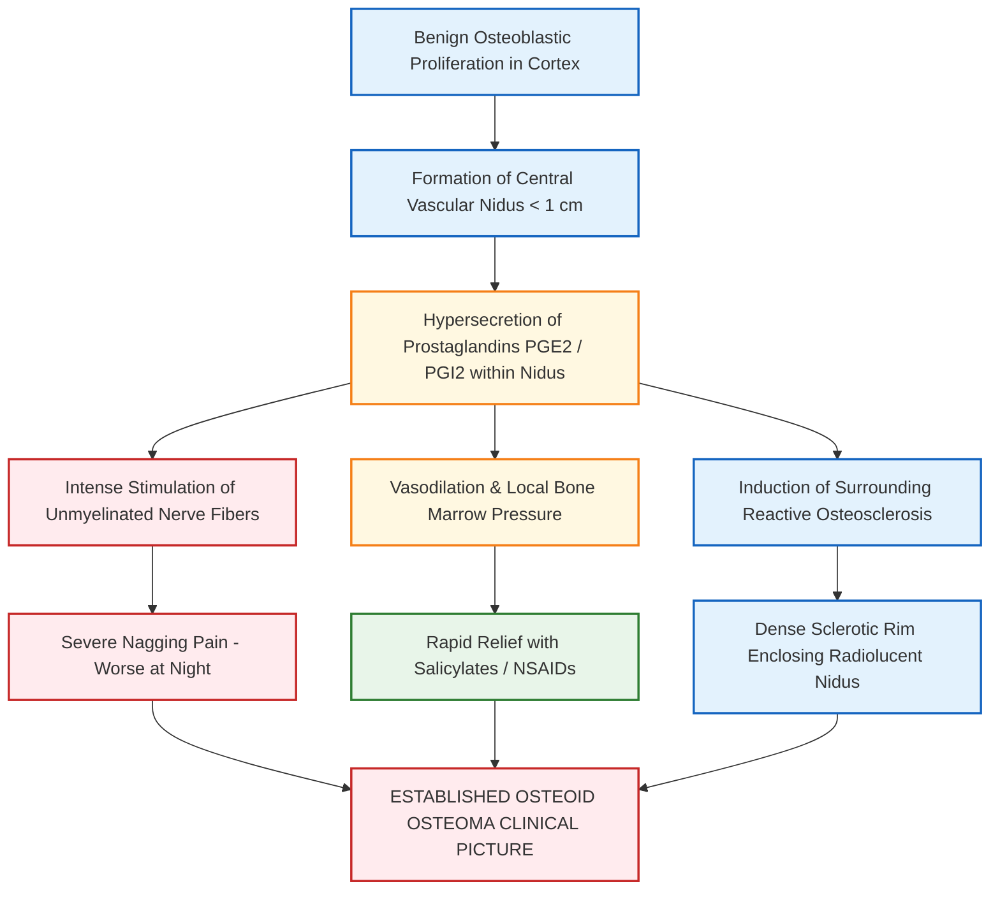
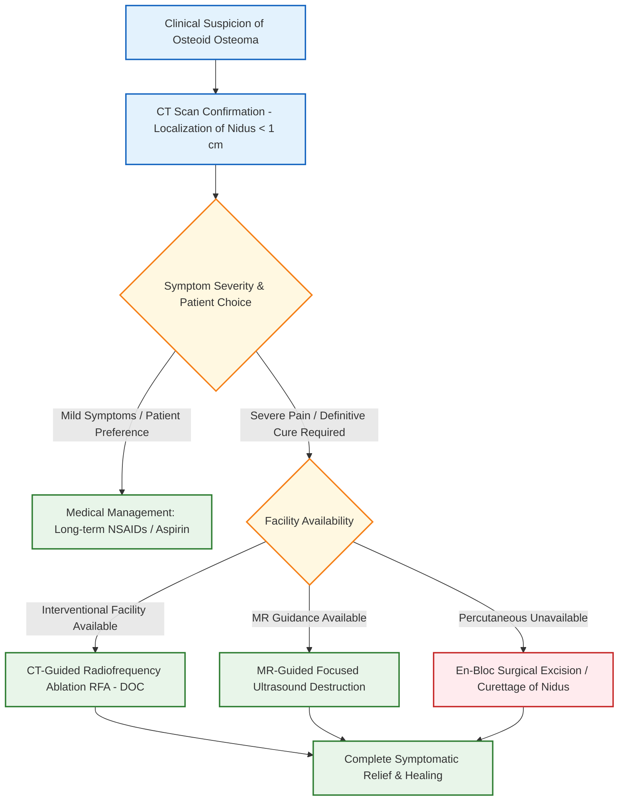

**Mark Weightage: 5 Marks (3-page answer sheet calibration)**

# Osteoid Osteoma [⭐ High-Yield]

---

### 1. Definition [⭐ High-Yield]

- **Osteoid Osteoma**: Defined as the **most common true benign bone-forming tumor** of the skeleton.
- **Pathological Nature**: It is a small, benign, non-malignant osteogenic lesion characterized by a central vascular core of osteoid trabeculae termed the **nidus** (typically **<1 cm** in size), enveloped by an extensive zone of dense, reactive sclerotic bone.
- **Bone Matrix**: Produces the maximum bone matrix among benign bone lesions.
- **Age Group**: Most commonly presents in children, adolescents, and young adults between **5 and 25 years** of age.
- **Sex Ratio**: **Males > Females** (2:1 ratio).
- **Predilection Sites**: Long bones of the lower extremity account for the majority of cases (**Femur > Tibia**), followed by the posterior elements (pedicle and lamina) of the spine.

---

### 2. Etiology / Causes / Risk Factors

- **Etiology**: Idiopathic benign neoplastic proliferation of osteoblasts.
- **Pathogenetic Mechanism**: The central nidus contains high concentrations of osteoblasts that hypersecrete **prostaglandin E₂ (PGE₂)** and **prostaglandin I₂ (PGI₂)**, which induce severe local nerve fiber stimulation and surrounding vascular engorgement, producing intense localized pain.
- **Anatomical Site Preference**:
    - Diaphysis or metaphysis of long bones (**eccentric/cortical location**).
    - Femoral neck, proximal femur, tibial shaft, and vertebral arches (posterior elements).

---

### 3. Classification

Based on the anatomical location within the bone architecture:

1. **Cortical Osteoid Osteoma** (**Most common type**): Located within the bone cortex; induces profound reactive periosteal and endosteal sclerosis.
2. **Cancellous / Medullary Osteoid Osteoma**: Located within spongy bone (e.g., femoral neck); produces minimal surrounding sclerosis.
3. **Subperiosteal Osteoid Osteoma**: Located beneath the periosteum; presents as a soft tissue mass adjacent to bone with minimal bone reaction.

---

### 4. Pathophysiology [⭐ High-Yield]

---

### 5. Clinical Features [⭐ High-Yield]

#### A. Symptoms

- **Classical Pain Pattern**:
    - Deep, boring, nagging local bone pain that is characteristically **==worse at night==** ("night pain").
    - **Aspirin / NSAID Response**: Pain is **dramatically and rapidly relieved by salicylates (aspirin) or NSAIDs**(due to inhibition of prostaglandin synthesis within the nidus).
- **Referred Pain**: Lesions in the spine may cause radicular pain or secondary painful scoliosis.
- **Gait Disturbances**: Antalgic limp when lower limb bones (femur/tibia) are involved.

#### B. Signs on Examination

- **Tenderness**: Point tenderness directly over the site of the lesion on deep palpation.
- **Swelling**: Minimal to no visible swelling unless the lesion is in a superficial bone like the tibia.
- **Joint Features**: Effusion and restricted movement if the lesion is juxta-articular (e.g., femoral neck).
- **Atrophy**: Disuse muscle atrophy of the affected limb in long-standing unmanaged cases.

---

### 6. Diagnosis / Investigations [⭐ High-Yield]

#### A. Imaging Modalities

1. **Plain Radiograph (X-Ray)**:
    - Demonstrates a small, well-circumscribed **radiolucent central nidus** (usually **<1 cm**) surrounded by a thick, dense zone of **reactive cortical sclerosis**.
    - In dense cortical lesions, the small central nidus may be obscured by the intense surrounding sclerosis.
2. **Computed Tomography (CT Scan) — Investigation of Choice (IOC)**:
    - **CT scan is the gold standard imaging modality** to confirm osteoid osteoma.
    - Accurately identifies and localizes the small radiolucent nidus with central punctate calcification embedded inside the dense sclerotic bone. - ==BULLS EYE LESION==
3. **Magnetic Resonance Imaging (MRI)**:
    - Useful for detecting associated bone marrow edema and soft tissue changes, but may overestimate the lesion size or miss a tiny calcified nidus.
4. **Radionuclide Bone Scan (Tc-99m)**:
    - Shows intense focal radioactive uptake (**==Double Density Sign==**: central high uptake in the nidus surrounded by a lower uptake zone in the reactive sclerotic bone).

---

### 7. Differential Diagnosis

|Feature|Osteoid Osteoma|Osteoblastoma|Brodie's Abscess (Subacute Osteomyelitis)|Stress Fracture|
|:--|:--|:--|:--|:--|
|**Nidus Size**|**< 1 cm**|**> 2 cm**|Variable subacute cavity|Linear fracture line|
|**Site**|**Diaphysis / Metaphysis**|Spine / Flat bones|Metaphysis (Tibia/Femur)|Tibia / Metatarsals|
|**Night Pain**|**Severe; dramatically relieved by Aspirin**|Present; **NOT relieved by Aspirin**|Dull pain; not relieved by aspirin|Pain aggravated by activity|
|**Imaging Finding**|Small lucent nidus + dense sclerosis|Expansile radiolucent lesion + minimal sclerosis|Central lucency + sclerotic rim (**Penumbra Sign on MRI**)|Periosteal callus + linear lucency|
|**Malignant Risk**|**None (Benign)**|Low risk of malignant transformation|None|None|

---

### 8. Treatment / Management [⭐ High-Yield]

#### A. Non-Pharmacological / Interventional Management

- **CT-Guided Radiofrequency Ablation (RFA) — Treatment of Choice (TOC)**:
    - Minimally invasive percutaneous procedure where an RF probe is inserted into the center of the nidus under CT guidance and heated to **85°–90°C for 4–6 minutes** to thermally destroy the osteoblasts.
    - Highly effective with short recovery time and minimal morbidity.
- **MR-Guided Focused Ultrasound Destruction**: Non-invasive thermal ablation alternative.
- **Surgical Excision / Curettage**:
    - Indicated when RFA facilities are unavailable or for lesions in close proximity to major neurological structures (e.g., spinal cord/nerve roots).
    - Complete surgical removal of the entire central nidus along with the sclerotic rim is necessary; incomplete excision of the nidus leads to recurrence.

#### B. Medical / Pharmacological Management

Used for symptomatic relief while awaiting interventional procedures or as primary conservative therapy in self-limiting cases.

### Dosage Rule

|Name|Mechanism of Action|Dose|Dosage / Route|Frequency|Features|Side Effects|When to Start / Stop|
|:--|:--|:--|:--|:--|:--|:--|:--|
|**Aspirin (Acetylsalicylic acid)**|Irreversible inhibition of Cyclooxygenase (COX-1 & COX-2) → ↓ Prostaglandins|**325–650 mg**|Oral|Every 4–6 hours as needed|Classical dramatic diagnostic & therapeutic response in osteoid osteoma|Gastritis, peptic ulceration, GI bleeding, tinnitus|Start upon clinical suspicion; stop following definitive RFA / surgical ablation|
|**Naproxen**|Reversible COX-1 and COX-2 inhibitor → ↓ Prostaglandin E₂ synthesis|**250–500 mg**|Oral|Twice daily (12-hourly)|Long-acting NSAID providing sustained night-time pain relief|Dyspepsia, renal impairment, fluid retention|Start for conservative management; discontinue post-procedure|

---

### 9. Complications

- **Recurrence**: Occurs if the central nidus is incompletely excised or inadequately ablated during surgery/RFA.
- **Painful Scoliosis**: Secondary structural or non-structural spinal curvature due to muscular spasm in vertebral osteoid osteoma.
- **Growth Disturbance / Deformity**: Local hypervascularity near an open growth plate may cause limb lengthening or angular deformity.

---

### 10. Prognosis

- **Excellent**: Osteoid osteoma is a strictly benign condition with **no potential for malignant transformation**.
- Complete relief of symptoms is achieved immediately following successful ablation or complete excision of the nidus.

---

### 11. Mnemonic / Memory Palace

#### Mnemonic: NIDUS

- **N** - **N**ight pain dramatically relieved by Aspirin/NSAIDs
- **I** - **I**maging of choice = CT scan
- **D** - **D**ense reactive osteosclerosis surrounding lucent center
- **U** - **U**nder 1 cm size of central radiolucent nidus
- **S** - **S**urgical/RF ablation of central nidus provides complete cure

#### Memory Palace: The Sclerotic Tower

1. **At the Entrance Gate**: A 15-year-old boy waking up in the middle of the night clutching his femur in pain (**5–25 yrs, Night pain, Femur site**).
2. **At the Medicine Counter**: He takes an **Aspirin tablet** and the pain instantly disappears (**Dramatic response to Salicylates**).
3. **In the Radiology Room**: A CT scanner highlighting a tiny bright lightbulb (**Nidus < 1 cm**) buried deep inside a thick concrete wall (**Dense reactive sclerosis**).
4. **In the Procedure Room**: A radiologist inserting a heated probe (**Radiofrequency Ablation**) directly into the center of the lightbulb to extinguish it forever.

---

### Clinical Pearl

- The key to treating osteoid osteoma is targeting the **nidus**, not the surrounding dense sclerotic bone; once the tiny central nidus is ablated or excised, the extensive surrounding reactive sclerosis completely resolves over time.

---

### Exam Trap

- **The Confusion**: Confusing **Osteoid Osteoma** with **Osteoblastoma**.
- **Distinguishing Facts**:
    - **Osteoid Osteoma**: Nidus size **<1 cm**, causes severe **night pain relieved by Aspirin**, and is located in the **diaphysis/metaphysis of long bones**.
    - **Osteoblastoma**: Nidus size **>2 cm**, causes dull pain **NOT relieved by Aspirin**, and is located predominantly in the **spine/vertebrae**.

---

### Diagram Guide

### Diagram 1: Radiographic Features of Cortical Osteoid Osteoma

- **Type**: Labeled radiological line schematic.
- **Outline shape to draw**: Long bone cortex (femur/tibia shaft).
- **Labels in order (inside to outside)**:
    1. **Central Radiolucent Nidus** — Lucent area **<1 cm** in diameter with central punctate calcification.
    2. **Dense Reactive Sclerotic Rim** — Thick, hyperdense bony shell surrounding the nidus.
    3. **Intact Outer Cortex** — Sclerosis expanding the bone margin.
- **Arrows/connections**: Central Nidus (Prostaglandin Release) → Periosteal Reaction → Dense Surrounding Sclerosis.
- **Extra Mark Annotation**: "CT scan is the investigation of choice to visualize the central radiolucent nidus".

---

### Quick Revision

- **Core Hallmark**: **Small radiolucent nidus (<1 cm)** producing prostaglandins, surrounded by **dense reactive bone sclerosis**.
- **Clinical Hallmark**: Severe **night pain dramatically relieved by aspirin / NSAIDs**.
- **Investigation of Choice**: **CT Scan**.
- **Treatment of Choice**: **CT-guided Radiofrequency Ablation (RFA)** of the central nidus.
- **Prognosis**: Excellent; zero risk of malignant transformation.

---

### One-Line Exam Opener

- **Osteoid osteoma is a classic benign osteogenic bone tumor of children and young adults, pathologically characterized by a prostaglandin-secreting central radiolucent nidus (<1 cm) surrounded by dense reactive osteosclerosis, clinically presenting with night pain dramatically relieved by aspirin, and definitively managed by CT-guided radiofrequency ablation.**

---

🦴 _Would you like me to generate practice flashcards or a multiple-choice quiz on bone tumors to help test your recall for the university exam?_