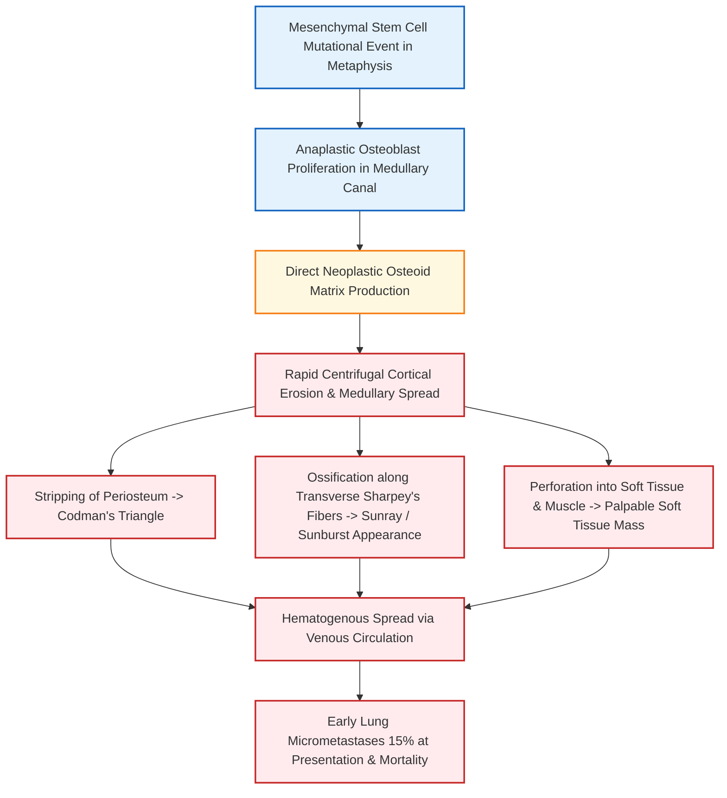
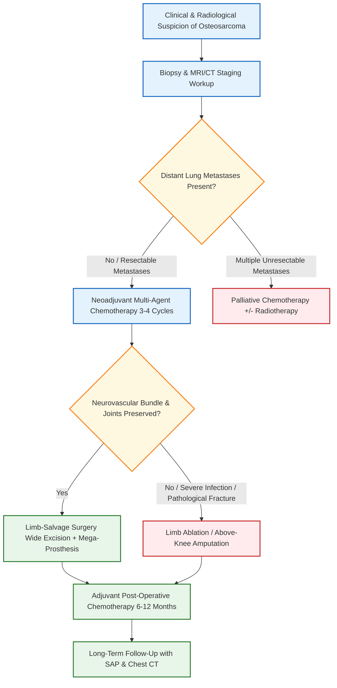

**Mark Weightage: Defaulted to 10 Marks / Long Answer (LAQ) Depth (5-page answer sheet calibration)**

# Classification of Bone Tumors & Osteosarcoma of Distal Femur / Proximal Tibia [⭐ High-Yield]

---

### 1. Definition [⭐ High-Yield]

- **Bone Tumors**: Neoplastic growths arising from bone tissue or its primitive mesenchymal constituents (cartilage, bone matrix, bone marrow, vascular tissue, or fibrous connective tissue).
- **Osteosarcoma (Osteogenic Sarcoma)**: A highly malignant primary bone tumor of mesenchymal origin characterized by the direct formation of osteoid or immature bone matrix by malignant anaplastic spindle cells.
    - **Incidence**: Second most common primary malignant bone tumor overall (after multiple myeloma) and the **most common non-hematological primary malignant bone tumor** in children and young adults.
    - **Bimodal Age Distribution**: Primary osteosarcoma peaks in the **2nd decade of life (10–25 years)**, while secondary osteosarcoma presents in older adults (**>45 years**).
    - **Sex Predilection**: Males > Females.
    - **Predilection Site**: **Metaphysis of long bones around the knee joint** (distal femur > proximal tibia).

---

### 2. Classification of Bone Tumors [⭐ High-Yield]

#### A. WHO Histogenetic Classification (Simplified)

|Histogenetic Origin|Benign Tumors|Malignant Tumors|
|:--|:--|:--|
|**1. Bone-Forming (Osteogenic)**|Osteoid osteoma, Osteoblastoma|Conventional Osteosarcoma and variants|
|**2. Cartilage-Forming (Chondrogenic)**|Osteochondroma (Exostosis), Enchondroma, Chondroblastoma, Chondromyxoid fibroma|Chondrosarcoma|
|**3. Giant Cell-Rich**|Osteoclastoma / Giant Cell Tumor (locally aggressive)|Malignant Giant Cell Tumor|
|**4. Hematopoietic / Marrow**|—|Solitary Plasmacytoma, Multiple Myeloma, Primary Lymphoma of bone|
|**5. Primitive Neuroectodermal**|—|Ewing Sarcoma / PNET|
|**6. Vascular**|Haemangioma, Glomangioma|Angiosarcoma|
|**7. Notochordal / Other**|Neurilemmoma, Neurofibroma|Chordoma, Adamantinoma, Fibrosarcoma|
|**8. Tumor-Like Lesions**|Simple Bone Cyst (SBC), Aneurysmal Bone Cyst (ABC), Fibrous Dysplasia, Eosinophilic Granuloma|—|

#### B. Enneking Surgical Staging System for Malignant Bone Tumors

- **Stage I (Low-Grade Malignancy)**:
    - **IA**: Low-grade, Intra-compartmental (within bone cortex).
    - **IB**: Low-grade, Extra-compartmental (extends beyond bone cortex).
- **Stage II (High-Grade Malignancy - e.g., Conventional Osteosarcoma)**:
    - **IIA**: High-grade, Intra-compartmental.
    - **IIB**: High-grade, Extra-compartmental.
- **Stage III (Distant Metastasis)**:
    - Presence of regional or distant metastases (e.g., lung or skip metastases in bone) regardless of grade.

#### C. Anatomical Location-Based Classification

- **Epiphyseal Lesions**: Chondroblastoma (before growth plate closure), Giant Cell Tumor (after growth plate closure).
- **Metaphyseal Lesions**: **Osteosarcoma**, Osteochondroma, Aneurysmal Bone Cyst, Simple Bone Cyst, Non-ossifying fibroma.
- **Diaphyseal Lesions**: Ewing's Sarcoma, Osteoid Osteoma, Fibrous Dysplasia, Adamantinoma.

---

### 3. Etiology & Risk Factors of Osteosarcoma [⭐ High-Yield]

- **Primary Osteosarcoma**:
    - Etiology is largely idiopathic.
    - Associated with periods of rapid adolescent skeletal growth spurt.
- **Secondary Osteosarcoma (Pre-Malignant Conditions)**:
    - **Paget's Disease of Bone**: Most common cause of secondary osteosarcoma in patients >40 years of age (1%–2% undergo malignant transformation).
    - **Post-Radiation Exposure**: Radiation-induced osteosarcoma typically manifests >10 years after radiation therapy.
    - **Pre-existing Benign Conditions**: Fibrous dysplasia, bone infarction, osteochondroma, or chronic osteomyelitis.
- **Anatomical Site Predilection**:
    - Metaphysis of long bones around the knee accounts for >60% of all cases.
    - **Distal end of femur** (most common site overall) → **Proximal end of tibia** → Proximal end of humerus.

---

### 4. Pathophysiology [⭐ High-Yield]

---

### 5. Pathology (Gross & Histopathology) [⭐ High-Yield]

- **Gross Pathology**:
    - Fleshy, destructive metaphyseal tumor breaking through the cortex into surrounding soft tissue.
    - Color and texture vary based on dominant matrix:
        - _Osteoblastic Subtype_: Greyish-white, hard, and gritty upon sectioning.
        - _Chondroblastic Subtype_: Opalescent and bluish-grey.
        - _Fibroblastic Subtype_: Soft, grey, "fish-flesh" sarcomatous texture.
        - _Telangiectatic Subtype_: Extremely vascular, cystic, blood-filled necrotic spaces.
- **Histopathology**:
    - **Pathognomonic Feature**: Presence of **malignant osteoid or primitive woven bone** deposited directly by anaplastic malignant stromal spindle cells.
    - Highly pleomorphic osteoblasts with hyperchromatic nuclei, coarse chromatin, and frequent atypical mitotic figures.
    - Marked hypervascularity with extensive tumor necrosis.

---

### 6. Clinical Features [⭐ High-Yield]

#### A. Symptoms

- **Pain**: The earliest, most constant, and cardinal presenting symptom.
    - Characterized as a deep, boring, persistent pain, which progressively worsens over weeks to months.
    - **Night pain** is characteristic and is not relieved by ordinary analgesics or rest.
- **Swelling**: Rapidly enlarging mass over the lower thigh (distal femur) or upper leg (proximal tibia).
- **History of Coincidental Trauma**: Patients frequently report minor trauma preceding the swelling; trauma does not cause the tumor but draws clinical attention to it.
- **Pathological Fracture**: May be the initial presentation in telangiectatic or osteolytic variants due to severe cortical thinning.

#### B. Signs on Physical Examination (See Diagram 1)

- **Inspection**:
    - Diffuse swelling situated eccentrically at the metaphyseal region around the knee joint.
    - Overlying skin is stretched, shiny, and shows **prominent, dilated superficial veins**.
- **Palpation**:
    - Local temperature is elevated (**warm to touch**).
    - Marked local bone tenderness.
    - Margins are ill-defined and diffuse owing to infiltration into surrounding soft tissues.
    - Consistency varies from bony hard to soft/cystic (in telangiectatic types).
    - **Pulsatile Tumour**: Osteosarcoma is the **most pulsatile primary bone tumor**; a thrill or vascular bruit may be appreciated on auscultation.
- **Joint Movement**: Restricted range of motion of the knee joint due to mechanical obstruction by the expanding soft tissue mass.
- **Regional Lymph Nodes**: May be enlarged, though usually due to reactive hyperplasia rather than direct tumor metastasis.

---

### 7. Diagnosis & Radiological Investigations [⭐ High-Yield]

#### A. Plain Radiographs (X-Rays - AP & Lateral Views of Knee)

Plain radiography remains the principal diagnostic investigation showing the **classic radiological triad**:

1. **Permeative Metaphyseal Destruction**:
    - Ill-defined, "moth-eaten" or permeative lytic bone destruction centered in the metaphysis with a **wide zone of transition** from normal to abnormal bone.
    - "Cotton-wool" or cloudy radiodense areas within the tumor matrix due to neoplastic osteoid mineralization.
2. **Codman's Triangle**:
    - A triangular periosteal elevation seen at the acute angle formed between the elevated periosteum and the underlying un-eroded cortex at the margin of the tumor.
3. **Sunray / Sunburst Appearance**:
    - Centrifugal growth of delicate calcified mineralized streaks extending perpendicularly along blood vessels and Sharpey's fibers into the soft tissue mass.

#### B. Laboratory Investigations

- **Serum Alkaline Phosphatase (SAP)**: Elevated significantly due to intense osteoblastic activity.
    - Serves as an invaluable **prognostic marker**; persistent elevation post-surgery or a secondary rise indicates local recurrence or distant metastasis.
- **Serum Lactate Dehydrogenase (LDH)**: Elevated levels correlate with high tumor burden and poorer prognosis.

#### C. Advanced Imaging Modalities

- **Magnetic Resonance Imaging (MRI) of Knee & Entire Long Bone (IOC for Local Staging)**:
    - Delineates exact intra-medullary longitudinal extent, epiphyseal extension, joint space breach, neurovascular involvement, and presence of **skip lesions** within the same bone.
- **High-Resolution CT Scan of Chest**: Mandatory screening tool to detect pulmonary micrometastases (lungs are the most common metastatic site).
- **Technetium-99m (Tc-99m) Whole Body Bone Scan / PET-CT**: Detects distant bony metastases and skip lesions throughout the skeleton.

#### D. Tissue Biopsy (Gold Standard Confirmation)

- **Core Needle Biopsy / Open Incisional Biopsy**: Establishes definitive histopathology.
- **Surgical Rule**: The biopsy tract must be strictly positioned in line with the planned future definitive surgical incision so that the entire tract can be excised en bloc during limb-salvage surgery to prevent tumor seeding.

---

### 8. Differential Diagnosis [⭐ High-Yield]

|Diagnostic Feature|Osteosarcoma|Ewing's Sarcoma|Giant Cell Tumor (GCT)|Chronic Osteomyelitis|
|:--|:--|:--|:--|:--|
|**Peak Age Group**|**10–25 years**|5–20 years|**20–40 years** (post-epiphyseal fusion)|Any age (children common)|
|**Location in Long Bone**|**Metaphysis** (distal femur / proximal tibia)|**Diaphysis** (mid-shaft)|**Epiphysis / Epiphysio-metaphyseal**|**Metaphysis**|
|**Classic X-Ray Sign**|**Sunray appearance, Codman's triangle**|**"Onion-peel" / lamellated periosteal reaction**|**"Soap-bubble" expansile lytic lesion**|Involucrum, sequestrum, thick periosteal reaction|
|**Pathology / Matrix**|**Malignant osteoid formation**|Small round blue cells, PAS positive|Multinucleated osteoclast-like giant cells|Pus, necrotic dead bone (sequestrum)|
|**Primary Therapy**|**Chemotherapy + Surgery**|Chemotherapy + Radiotherapy / Surgery|Extended curettage + Bone graft/cement|Antibiotics + Surgical Debridement|

---

### 9. Treatment & Management [⭐ High-Yield]

#### A. Multimodal Chemotherapy Protocol

- **TID Multi-Agent Protocol**: Combination of High-dose **Methotrexate**, **Doxorubicin (Adriamycin)**, **Cisplatin**, and **Ifosfamide**.
- **Neoadjuvant (Pre-Operative) Chemotherapy**:
    - Administered for **3–4 cycles prior to surgical resection**.
    - **Objectives**: Shrinks primary soft tissue mass, facilitates limb-salvage surgery, eradicates distant subclinical micrometastases, and allows histopathological assessment of tumor necrosis (>90% necrosis indicates excellent response).
- **Adjuvant (Post-Operative) Chemotherapy**:
    - Continued for **6–12 months post-surgery** to prevent systemic recurrence.

#### B. Operative / Surgical Management

1. **Limb-Salvage / Limb-Sparing Surgery (Gold Standard Preferred Approach)**:
    - Perform a **wide radical excision of the tumor en bloc** with a clear 2 cm cuff of normal surrounding tissue, including the biopsy tract.
    - **Reconstruction Options**:
        - Custom-made modular **endoprosthetic knee joint replacement** (most common).
        - Vascularized fibular autograft, massive allograft, or Turn-o-Plasty (Van Nes rotationplasty).
2. **Limb Ablation / Amputation**:
    - Indicated only when:
        - Direct tumor encasement of major neurovascular bundles.
        - Pathological fracture with severe hematoma contamination throughout muscle compartments.
        - Uncontrollable local infection or unfeasible limb reconstruction.
    - _Procedure_: **Above-knee amputation** for proximal tibial osteosarcoma; **hip disarticulation or high transfemoral amputation** for distal femoral lesions.
3. **Role of Radiotherapy**:
    - Conventional osteosarcoma is **radio-resistant**; radiotherapy is restricted strictly to inoperable axial skeletal lesions or for palliation of intractable bone pain.

---

### 10. Complications [⭐ High-Yield]

- **Pulmonary Metastasis**: Most frequent and lethal complication (occurs in >80% of untreated cases).
- **Pathological Fracture**: Occurs due to cortical destruction, increasing risk of local recurrence.
- **Chemotherapy Toxicity**:
    - Doxorubicin-induced cardiotoxicity.
    - Cisplatin-induced nephrotoxicity and ototoxicity.
    - Bone marrow suppression and opportunistic sepsis.
- **Limb-Salvage Reconstruction Failure**: Deep infection, mechanical prosthesis loosening, or flap necrosis.

---

### 11. Prognosis

- **Without Treatment**: Uniformly fatal within **1–2 years** (death usually occurs within 6 months of pulmonary metastasis).
- **Surgery Alone (Historical)**: 5-year survival rate was dismal at **20%**.
- **Modern Multimodal Therapy (Neoadjuvant Chemotherapy + Limb-Salvage Surgery)**: 5-year disease-free survival reaches **70%** in non-metastatic presentation.

---

### 12. Dosage Rule

### Chemotherapeutic Agents in Osteosarcoma Protocol

|Drug Name|Mechanism of Action|Dose|Route / Frequency|Key Side Effects|Monitoring / Stopping Rules|
|:--|:--|:--|:--|:--|:--|
|**Doxorubicin (Adriamycin)**|Intercalates DNA strands & inhibits Topoisomerase II|**60–75 mg/m²**|IV infusion every 3 weeks|Cardiomyopathy, alopecia, severe myelosuppression|Monitor cumulative dose (<550 mg/m²) and serial Echocardiography (ECHO)|
|**Cisplatin**|Produces intra-strand DNA cross-links|**100 mg/m²**|IV infusion with aggressive hydration|Acute tubular necrosis, ototoxicity, intractable emesis|Monitor serum creatinine, electrolyte levels, and baseline audiometry|
|**High-Dose Methotrexate**|Inhibits Dihydrofolate Reductase (DHFR)|**12 g/m²**|IV infusion over 4 hours with Leucovorin rescue|Hepatotoxicity, mucosal ulceration, renal tubular precipitation|Mandatory serial serum Methotrexate level monitoring & urinary alkalinization|

---

### 13. Mnemonic / Memory Palace

#### Mnemonic: SUNBURST

- **S** - **S**unray / Sunburst periosteal reaction on X-ray
- **U** - **U**nusually elevated Serum Alkaline Phosphatase (SAP)
- **N** - **N**eoadjuvant multi-agent chemotherapy
- **B** - **B**imodal age distribution (10–25 yrs primary; >45 yrs secondary)
- **U** - **U**pper end of tibia / distal end of femur (Knee metaphysis)
- **R** - **R**adioresistant malignancy (requires surgical resection)
- **S** - **S**pindle anaplastic cells laying down malignant osteoid matrix
- **T** - **T**riangle of Codman at subperiosteal margins

#### Memory Palace: The Sunshine On The Knee Clinic

1. **At the Entrance Gate**: A 15-year-old boy leaning on crutches with a glowing **Sun** painted over his knee (**Sunburst appearance, 10-25 yrs, Knee Metaphysis**).
2. **In the Reception**: A laboratory beaker overflowing with alkaline foam (**Elevated Serum Alkaline Phosphatase**).
3. **In the X-ray Room**: An X-ray image showing a **Triangular Tent** raised on the bone edge (**Codman's Triangle**).
4. **In the Pharmacy**: Four drug bottles labelled **M-A-C-I** (**Methotrexate, Adriamycin, Cisplatin, Ifosfamide**) handed over _before_ surgery (**Neoadjuvant Chemotherapy**).
5. **In the Operating Theater**: A surgeon carefully removing the tumor mass while saving the leg (**Limb-Salvage Surgery with Mega-Prosthesis**).

---

### Clinical Pearl

- The presence of malignant osteoid directly laid down by neoplastic spindle osteoblasts on histopathology is the absolute pathognomonic feature differentiating osteosarcoma from other bone-producing lesions like osteoblastoma or reactive fracture callus.

---

### Exam Trap

- **The Confusion**: Confusing **Osteosarcoma** with **Ewing's Sarcoma** or **Giant Cell Tumor (GCT)** regarding bone location and radiological features.
- **The Distinguishing Facts**:
    - **Osteosarcoma**: Metaphyseal location + Sunray appearance / Codman's triangle + Malignant osteoid.
    - **Ewing's Sarcoma**: Diaphyseal location + "Onion-peel" lamellated reaction + Small round blue cells.
    - **Giant Cell Tumor**: Epiphyseal location (post-epiphyseal fusion) + "Soap-bubble" lytic appearance.

---

### Diagram Guide

### Diagram 1: Clinical & X-Ray Features of Osteosarcoma Around Knee

- **Type**: Combined Clinical & Labeled X-ray Schematic Diagram.
- **Outline Shape**: Metaphysis of distal femur and proximal tibia.
- **Labels in Order**:
    1. **Metaphyseal Location** — Centered in distal femoral metaphysis.
    2. **Codman's Triangle** — Subperiosteal reactive bone at proximal tumor margin.
    3. **Sunray / Sunburst Appearance** — Fine spicules extending into soft tissue mass.
    4. **Overlying Skin** — Dilated, prominent superficial veins over shiny skin.
- **Arrows/Connections**: Intra-medullary Tumor → Breaks Cortical Bone → Raises Periosteum (Codman's) → Extravasates into Soft Tissue (Sunray).
- **Extra Mark Annotation**: "Knee Metaphysis is the most common site; MRI is IOC for local staging and skip lesions".

### Diagram 2: WHO Anatomical Location of Bone Tumors

- **Type**: Schematic Diagram of Long Bone Regions.
- **Outline Shape**: Long bone divided into Epiphysis, Metaphysis, and Diaphysis.
- **Labels in Order**:
    1. **Epiphysis** — Chondroblastoma (skeletally immature), Giant Cell Tumor (skeletally mature).
    2. **Metaphysis** — **Osteosarcoma**, Osteochondroma, Aneurysmal Bone Cyst, Simple Bone Cyst.
    3. **Diaphysis** — Ewing's Sarcoma, Osteoid Osteoma, Fibrous Dysplasia.
- **Extra Mark Annotation**: "Osteosarcoma predominantly arises from the highly vascular metaphyseal region".

---

### Quick Revision

- **Core Pathology**: Malignant spindle cells directly laying down **neoplastic osteoid matrix**.
- **Most Common Site**: Metaphysis around knee joint (**Distal femur > Proximal tibia**).
- **Key X-Ray Signs**: **Codman's Triangle**, **Sunray/Sunburst appearance**, permeative metaphyseal destruction.
- **Biochemical Marker**: **Serum Alkaline Phosphatase (SAP)** elevated; used to monitor recurrence.
- **Standard Treatment Protocol**: **Neoadjuvant Chemotherapy → Wide Radical Excision / Limb-Salvage Surgery → Adjuvant Chemotherapy**.

---

### One-Line Exam Opener

- **Osteosarcoma is the most common primary non-hematological malignant bone tumor of childhood and adolescence, arising characteristically in the metaphysis of the distal femur or proximal tibia, radiologically presenting with a sunburst periosteal reaction and Codman's triangle, and managed by neoadjuvant multi-agent chemotherapy combined with limb-salvage surgical resection.**

---

🦴 _Would you like me to generate a practice quiz or flashcards focusing on bone tumor classifications and X-ray signs to help test your memory for the exam?_