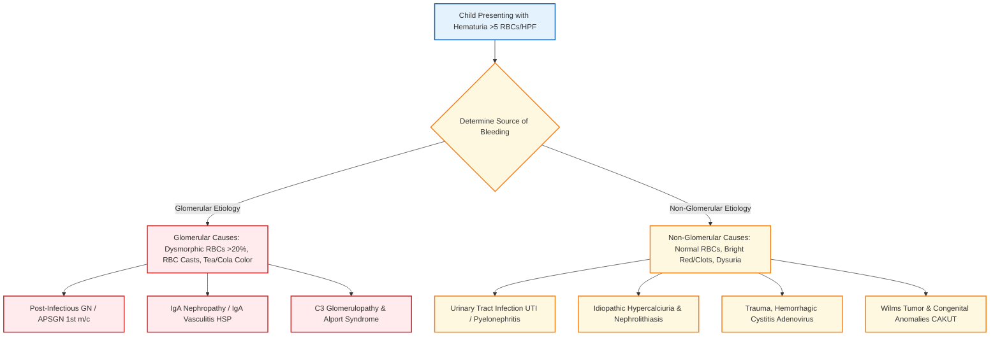
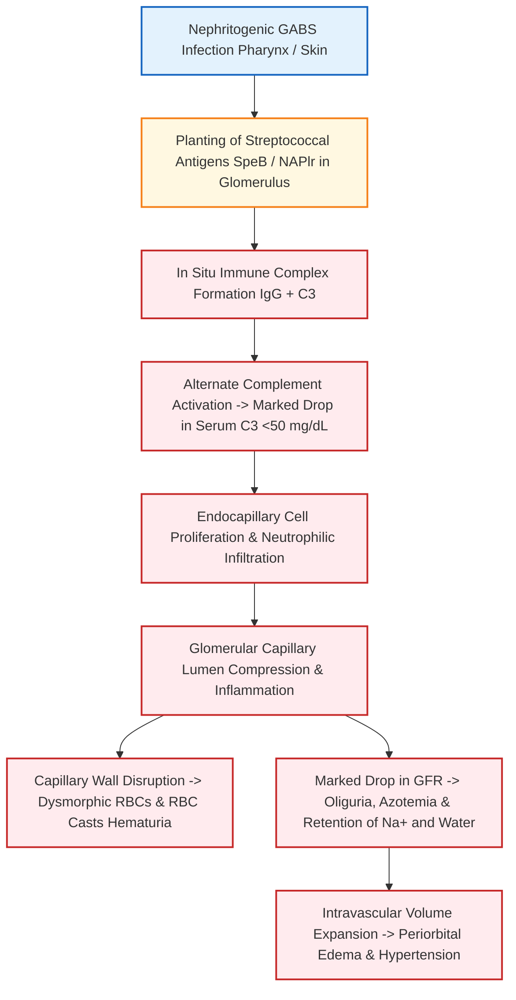

[[C17-Kidney disorder]]
**(Mark-Weightage Calibration: Defaulting to 10 Marks / Long Answer Depth)**

# Approach to a 3-Year-Old Child Presenting with Hematuria and Management of Acute Glomerulonephritis [⭐ High-Yield]

### 1. Definition [⭐ High-Yield]

- **Hematuria**: Defined as the presence of **>5 red blood cells (RBCs) per high-power field (HPF)** in a fresh, centrifuged urine specimen on microscopic examination.
    - **Gross (Macroscopic) Hematuria**: Visible discoloration of urine (cola-colored, tea-colored, smoky, or bright red).
    - **Microscopic Hematuria**: Normal-appearing urine with ≥5 RBCs/HPF on microscopy.
- **Acute Glomerulonephritis (AGN)**: An acute inflammatory disorder of the glomeruli characterized by the abrupt onset of **gross hematuria**, **periorbital edema**, **hypertension**, **oliguria**, and mild-to-moderate **proteinuria**.

---

### 2. Etiology & Causes of Hematuria in a 3-Year-Old Child [⭐ High-Yield]

Evaluating hematuria in a 3-year-old child requires differentiating **Glomerular** from **Non-Glomerular** causes:



#### A. Glomerular Causes (Most Common Source of Gross Hematuria in Children) [⭐ High-Yield]

1. **Post-Infectious / Poststreptococcal Glomerulonephritis (APSGN)**: Most common acute cause in India; follows Group A β-hemolytic streptococcal (GABS) pharyngitis or pyoderma.
2. **IgA Nephropathy (Berger Disease)**: Common cause of recurrent synpharyngitic gross hematuria.
3. **IgA Vasculitis (Henoch-Schönlein Purpura - HSP)**: Characterized by palpable purpura, abdominal pain, arthralgia, and hematuria.
4. **C3 Glomerulopathy / MPGN**: Characterized by persistent low serum C3 complement levels (>12 weeks).
5. **Alport Syndrome & Thin Basement Membrane Disease**: Hereditary nephritis linked to _COL4A5_ gene mutations, presenting with sensorineural deafness and hematuria.

#### B. Non-Glomerular Causes

1. **Urinary Tract Infection (UTI) / Pyelonephritis**: Associated with dysuria, fever, and leukocyturia.
2. **Idiopathic Hypercalciuria**: Most common non-glomerular cause of painless hematuria; spot urine calcium-to-creatinine ratio >0.2 mg/mg.
3. **Urolithiasis / Kidney Stones**: Presents with acute flank/abdominal pain and dysuria.
4. **Hemorrhagic Cystitis**: Viral (Adenovirus) or drug-induced (Cyclophosphamide).
5. **Wilms Tumor (Nephroblastoma) & CAKUT**: Palpable abdominal mass with gross hematuria.
6. **Trauma & Exercise-Induced Hematuria**.

---

### 3. Classification [⭐ High-Yield]

1. **By Clinical Appearance**:
    - **Gross Hematuria**: Visible tea-, cola-, or brown-colored urine (glomerular) vs. bright red with blood clots (non-glomerular).
    - **Microscopic Hematuria**: Discovered incidentally on routine urinalysis.
2. **By Symptom Profile**:
    - **Symptomatic Hematuria**: Associated with edema, hypertension, dysuria, or abdominal pain.
    - **Asymptomatic Isolated Hematuria**: Absence of edema, hypertension, or proteinuria.

---

### 4. Pathophysiology of Acute Glomerulonephritis [⭐ High-Yield]



- **Immune Complex Deposition**: Streptococcal antigens (SpeB/NAPlr) deposit in the glomerular basement membrane, triggering **in situ immune complex formation** (IgG and C3).
- **Complement Activation**: Activates the alternate complement pathway, consuming **C3 complement** and attracting neutrophils.
- **Glomerular Occlusion**: Proliferation of endothelial and mesangial cells narrows capillary lumens, causing a drop in GFR, retention of sodium and water, volume expansion, **hypertension**, and **edema**.

---

### 5. Clinical Features [⭐ High-Yield]

#### A. Clinical Triad / Tetrad of Acute Nephritic Syndrome

1. **Gross Hematuria**: Smoky, cola-, or tea-colored urine (reported in >30–50% of cases).
2. **Edema**: Periorbital puffiness prominent upon waking in the morning, progressing to pedal edema.
3. **Hypertension**: Present in **60–80%** of children due to fluid retention and intravascular volume expansion.
4. **Oliguria**: Urine output **<0.5 mL/kg/hr**.

#### B. Systemic Features & Danger Signs

- Malaise, anorexia, low-grade fever, vomiting, and dull flank pain.
- **Hypertensive Encephalopathy**: Severe headache, confusion, blurred vision, and seizures.
- **Congestive Heart Failure / Pulmonary Edema**: Dyspnea, orthopnea, tachypnea, and basal crepitations.

---

### 6. Diagnostic Evaluation & Systematic Approach in a 3-Year-Old [⭐ High-Yield]

#### Step 1: Confirm True Hematuria

- **Urine Dipstick**: Positive for blood (detects pseudoperoxidase activity of hemoglobin).
- **Microscopic Urinalysis**: Centrifuged urine demonstrates **>5 RBCs/HPF**. Rule out pigmenturia (rifampicin, beetroot ingestion, hemoglobinuria, myoglobinuria).

#### Step 2: Differentiate Glomerular vs. Non-Glomerular Hematuria [⭐ High-Yield]

|Diagnostic Feature|**Glomerular Hematuria (e.g., AGN)** [⭐ High-Yield]|**Non-Glomerular Hematuria (e.g., UTI, Stone)**|
|:--|:--|:--|
|**Urine Color**|Brownish, tea-colored, cola-colored, or smoky|Bright red, pinkish, or fresh red|
|**Blood Clots**|**Absent** (urinary fibrinolysis)|May be **Present**|
|**RBC Morphology (Phase Contrast)**|**>20% Dysmorphic RBCs** (ring-shaped, acanthocytes)|Isomorphic / Uniform normal RBCs (<15% dysmorphic)|
|**RBC Casts**|**Present (Pathognomonic)**|**Absent**|
|**Proteinuria**|Moderate to heavy (**≥2+** on dipstick; >100–500 mg/m²/day)|Trace to 1+|
|**Associated Signs**|Periorbital edema, hypertension, oliguria|Dysuria, frequency, loin pain, gravel in urine|

#### Step 3: Targeted Laboratory & Imaging Workup for AGN

1. **Urinalysis**: Microscopy for dysmorphic RBCs, RBC casts, WBCs, and 1+ to 2+ proteinuria.
2. **Serum C3 Complement Level**: **Markedly reduced (<50 mg/dL)** in >90% of APSGN cases during the acute phase. Normalizes strictly within **8 to 12 weeks**.
3. **Serology for Preceding Streptococcal Infection**:
    - **ASO Titer**: Elevated (>200 IU/mL) in >80% of post-pharyngeal cases.
    - **Anti-DNase B Titer**: Best marker for preceding **streptococcal skin infection (pyoderma)**.
4. **Renal Function Tests & Electrolytes**: Blood urea nitrogen (BUN) and serum creatinine (azotemia evaluation); check serum potassium (hyperkalemia) and sodium.
5. **Ultrasonography (USG) KUB**: Evaluates renal size, echogenicity, rules out urinary tract obstruction, calculi, and Wilms tumor.

#### Step 4: Indications for Kidney Biopsy in Acute Glomerulonephritis [⭐ High-Yield]

Renal biopsy is **NOT routinely indicated** in typical APSGN. Indications include:

|Category|Specific Indications for Renal Biopsy|
|:--|:--|
|**Atypical Presentation**|Absence of serological evidence of streptococcal infection; normal serum C3 during acute phase; presence of systemic features (fever, rash, joint pain); severe oliguria/anuria requiring dialysis.|
|**Delayed Resolution**|Persistent oliguria / azotemia beyond **7–10 days**; gross hematuria persisting beyond **3–4 weeks**; persistent low serum C3 levels beyond **12 weeks**; nephrotic-range proteinuria beyond **2 weeks**.|

---

### 7. Differential Diagnosis Comparison Table

|Feature|**Acute Poststreptococcal GN (APSGN)** [⭐ High-Yield]|**IgA Nephropathy**|**Urinary Tract Infection (UTI)**|**Idiopathic Hypercalciuria**|
|:--|:--|:--|:--|:--|
|**Timing / Onset**|**1–2 wks** after throat infection; **3–6 wks** after skin infection|**Synpharyngitic** (1–2 days during URTI)|Acute onset with fever and dysuria|Insidious, painless recurrent hematuria|
|**Urine Color**|Tea- / Cola-colored|Brownish / Tea-colored|Bright red or pinkish|Pinkish / Reddish|
|**RBC Casts / Morphology**|Dysmorphic RBCs + **RBC Casts**|Dysmorphic RBCs|Isomorphic RBCs; **WBC Casts**|Isomorphic RBCs; Calcium oxalate crystals|
|**Serum C3**|**Low (<50 mg/dL)**; normalizes in 8–12 wks|**Normal**|**Normal**|**Normal**|
|**Specific Lab Marker**|Elevated ASO / Anti-DNase B|Elevated serum IgA|Urine Culture >10⁵ CFU/mL|Spot Urine Ca/Cr Ratio **>0.2 mg/mg**|

---

### 8. Treatment & Management of Acute Glomerulonephritis [⭐ High-Yield]

APSGN is a self-limiting disease; treatment is primarily **supportive**, focusing on managing fluid overload, hypertension, and acute kidney injury.

```
flowchart TD

classDef primary fill:#e3f2fd,stroke:#1565c0,stroke-width:2px
classDef danger fill:#ffebee,stroke:#c62828,stroke-width:2px
classDef success fill:#e8f5e9,stroke:#2e7d32,stroke-width:2px
classDef warning fill:#fff8e1,stroke:#f57f17,stroke-width:2px

A[Child Admitted with Acute Glomerulonephritis]:::primary --> B[General & Monitoring: Daily Weight, Strict I/O Charting, Bed Rest]:::primary
B --> C[Dietary Restrictions: Strict Salt <1-2 g/day, Restrict Fluids & Potassium]:::success
C --> D{Assess Blood Pressure & Fluid Status}:::warning
D -->|Mild to Moderate HTN / Edema| E[Oral Furosemide 1-3 mg/kg/day + Oral Amlodipine 0.1-0.3 mg/kg/day]:::success
D -->|Severe HTN / Encephalopathy / Pulmonary Edema| F[IV Furosemide 2-4 mg/kg + IV Labetalol / Sodium Nitroprusside]:::danger
E & F --> G[Eradicate Streptococci: 10-Day Oral Penicillin V / Amoxicillin OR Single IM Benzathine Penicillin]:::success
G --> H[Monitor Resolution & Confirm C3 Normalization at 8-12 Weeks]:::success
```

#### A. General & Supportive Measures

1. **Hospitalization**: Indicated if the child has hypertension, significant edema, oliguria, or elevated BUN/creatinine.
2. **Monitoring**: Daily weight recording, strict intake-output charting, and blood pressure measurement every 4–6 hours.
3. **Bed Rest**: Advised during the acute phase until diuresis occurs and BP normalizes.
4. **Fluid Restriction**:
    - Total daily fluid allowance = **Insensible water loss (300–400 mL/m²/day)** + **previous 24-hour urine output**.
5. **Dietary Restrictions**:
    - **Salt Restriction**: Strict low-sodium diet (**<1–2 g/day**; no added salt) until hypertension and edema resolve.
    - **Potassium Restriction**: Avoid potassium-rich foods (citrus fruits, coconut water) during oliguria to prevent life-threatening hyperkalemia.
    - **Protein Intake**: Normal recommended protein; restrict slightly only if severe azotemia develops.

#### B. Pharmacological Management & Dosage Rule Table [⭐ High-Yield]

|Name|Mechanism of Action (Source Page)|Dose|Dosage / Route|Frequency|Features & Monitoring|Side Effects|When to Start / Stop|
|:--|:--|:--|:--|:--|:--|:--|:--|
|**Furosemide**|Loop diuretic inhibiting Na⁺-K⁺-2Cl⁻ cotransporter in thick ascending limb _(OP Ghai p.497, 478)_|**1–3 mg/kg/day**(oral); **2–4 mg/kg** (IV)|Oral tablet / IV injection|1 to 2 times daily|First-line agent for fluid overload, edema, and hypertension|Hypokalemia, hyponatremia, volume depletion, ototoxicity|**Start**: At presentation with edema/HTN. **Stop**: Discontinue when diuresis ensues and BP normalizes.|
|**Amlodipine**|Dihydropyridine calcium channel blocker causing peripheral vasodilation _(OP Ghai p.497, 478)_|**0.05–0.3 mg/kg/day**(max 10 mg/day)|Oral tablet|Single or twice daily|First-line oral antihypertensive for mild-to-moderate HTN|Flushing, peripheral edema, headache, reflex tachycardia|**Start**: Persistent hypertension. **Stop**: Taper as BP normalizes.|
|**Nifedipine**|Rapid-acting dihydropyridine calcium channel blocker _(OP Ghai p.497, 478)_|**0.25–0.5 mg/kg/dose**(max 10 mg)|Oral / sublingual|Every 6–8 hours as needed|Used for urgent blood pressure control|Precipitous hypotension, headache, flushing, tachycardia|**Start**: Urgent severe HTN. **Stop**: Switch to long-acting amlodipine once stable.|
|**Labetalol**|Combined α1 and β-adrenergic antagonist _(OP Ghai p.497, 478)_|**0.2–1.0 mg/kg** IV bolus; **10–40 mg/kg/day**oral|IV bolus / oral tablet|Every 8–12 hours|Preferred agent for hypertensive encephalopathy / emergencies|Bradycardia, bronchospasm, hypotension, heart block|**Start**: Hypertensive emergency. **Stop**: Taper once BP controlled.|
|**Benzathine Penicillin G**|Inhibits bacterial cell wall peptidoglycan synthesis _(OP Ghai p.497)_|**600,000 IU**(<30 kg); **1.2 million IU** (>30 kg)|Deep Intramuscular (IM) injection|Single stat dose|Eradicates nephritogenic streptococci to prevent community spread|Local injection site pain, hypersensitivity, anaphylaxis|**Start**: At diagnosis. **Stop**: Single IM dose completes therapy.|
|**Amoxicillin**|Aminopenicillin inhibiting bacterial cell wall synthesis _(OP Ghai p.497)_|**40–50 mg/kg/day**|Oral suspension / capsule|Divided every 8 hours|Alternative 10-day oral course if IM penicillin refused|Gastrointestinal upset, skin rash, allergic reactions|**Start**: At diagnosis. **Stop**: Complete full 10-day course.|

#### C. Management of Acute Complications

1. **Hypertensive Encephalopathy**:
    - Administer **IV Labetalol (0.2–1.0 mg/kg)** or **IV Sodium Nitroprusside (0.5–8 μg/kg/min)** with continuous monitoring.
    - Administer **IV Furosemide (2–4 mg/kg)** to promote diuresis.
2. **Pulmonary Edema & Acute Heart Failure**:
    - Sit child upright, deliver humidified oxygen, give **IV Furosemide (2–4 mg/kg)**.
    - Strict fluid restriction; consider peritoneal dialysis if diuresis fails.
3. **Acute Kidney Injury (AKI) & Hyperkalemia**:
    - If serum potassium **>5.5 mEq/L**: Restrict exogenous potassium; administer **Calcium Gluconate 10% (0.5–1 mL/kg IV over 5–10 mins)** to stabilize myocardium, followed by **nebulized Salbutamol** and **IV Insulin + Dextrose**.
    - **Indications for Dialysis**: Persistent hyperkalemia (>6.5 mEq/L), severe fluid overload refractory to diuretics, pulmonary edema, severe uremia, or metabolic acidosis.

---

### 9. Complications [⭐ High-Yield]

1. **Hypertensive Encephalopathy**: ==Seizures, altered sensorium, and coma secondary to cerebral edema.==
2. **Acute Heart Failure & Pulmonary Edema**: Life-threatening respiratory distress from hypervolemia.
3. **Acute Kidney Injury (AKI)**: Oligo-anuria, severe azotemia, metabolic acidosis, and hyperkalemia.

---

### 10. Prognosis [⭐ High-Yield]

- **Overall Prognosis**: **Excellent** in pediatric APSGN (>95% of children achieve complete recovery without long-term renal sequelae).
- **Timeline of Recovery**:
    - Diuresis begins within **7 to 10 days**.
    - Hypertension and gross hematuria resolve within **2 to 3 weeks**.
    - Serum **C3 complement levels normalize within 8 to 12 weeks**.
    - Microscopic hematuria may persist for **6 to 12 months** (does not indicate progressive renal damage).

---

### 11. Mnemonic / Memory Palace

#### Mnemonic: H-E-M-A-T-U-R-I-A

- **H** - **Hypertension & Hematuria**: Classic presenting signs of AGN
- **E** - **Edema (Periorbital)**: Puffiness around eyes upon waking in the morning
- **M** - **Microscopic RBC Casts**: Pathognomonic marker of glomerular inflammation
- **A** - **ASO / Anti-DNase B elevated**: Confirms preceding streptococcal infection
- **T** - **Tea- / Cola-colored urine**: Gross glomerular bleeding
- **U** - **Urine Output Decreased (Oliguria)**: Indicates disease severity
- **R** - **Reduced C3 Complement**: Serum C3 <50 mg/dL (normalizes in 8–12 wks)
- **I** - **Isotonic / Loop Diuretic Rx**: Furosemide 1–3 mg/kg/day for fluid overload
- **A** - **Antibiotics for 10 days**: Penicillin/Amoxicillin to eradicate streptococcal carriage

---

### Clinical Pearl

> **Cola-colored urine with periorbital puffiness in a 3-year-old is classic for acute glomerulonephritis.** To confirm a glomerular source instantly on bedside urinalysis, look for **dysmorphic RBCs (>20%)** and **RBC casts**. The presence of blood clots always rules out a glomerular origin and points toward lower urinary tract bleeding (UTI, trauma, or stone).

---

### Exam Trap

- **The Mix-up**: Prescribing long-term monthly Benzathine Penicillin prophylaxis for APSGN as done in Acute Rheumatic Fever (ARF).
- **Distinguishing Fact**: APSGN requires only a **single 10-day curative course of penicillin** to eradicate nephritogenic streptococci from the child and contacts. **Long-term continuous monthly antibiotic prophylaxis is NOT indicated in APSGN** because recurrences of APSGN are extremely rare.

---

### Diagram 1: Stepwise Diagnostic Algorithm for Hematuria in a 3-Year-Old

- **Type**: Labeled decision-tree flowchart.
- **Outline shape to draw**: Sequential branching pathway starting from urine dipstick to final etiology.
- **Labels in order**:
    1. **Initial Screening**: Urine Dipstick + Microscopy (**>5 RBCs/HPF** confirms hematuria).
    2. **Step 1 (RBC Morphology & Casts)**:
        - Dysmorphic RBCs >20% + RBC Casts → **Glomerular Hematuria**.
        - Isomorphic RBCs + Clots + Dysuria → **Non-Glomerular Hematuria**.
    3. **Step 2 (Glomerular Branch)**: Check **Serum C3 Complement**, ASO Titer, BUN/Creatinine.
        - Low C3 + High ASO → **Poststreptococcal GN (APSGN)**.
        - Normal C3 + Recurrent episodes → **IgA Nephropathy**.
    4. **Step 3 (Non-Glomerular Branch)**: Perform Urine Culture, Spot Urine Ca/Cr Ratio, USG KUB.
        - Positive Culture → **Urinary Tract Infection (UTI)**.
        - Spot Ca/Cr >0.2 mg/mg → **Idiopathic Hypercalciuria**.
- **Arrows/connections**: Red Urine → Dipstick → Microscopy → RBC Cast Check → Serum C3 Measurement → Specific Diagnosis.
- **Extra Mark Annotation**: Serum C3 level is the key laboratory test distinguishing post-infectious GN (low C3) from IgA nephropathy (normal C3).

---

### Quick Revision

- **Definition of Hematuria**: >5 RBCs/HPF on microscopy; Gross hematuria produces tea/cola-colored urine.
- **Differentiating Feature**: Dysmorphic RBCs (>20%) and **RBC casts** confirm glomerular origin (AGN).
- **Classic AGN Tetrad**: Gross hematuria, periorbital edema, hypertension, and oliguria.
- **Key Laboratory Marker**: Serum **C3 complement is markedly low (<50 mg/dL)** during acute phase and normalizes in **8–12 weeks**.
- **Management Essentials**: Fluid restriction (Insensible loss + Urine output), strict salt restriction (<1–2 g/day), oral/IV **Furosemide (1–3 mg/kg/day)**, **Amlodipine (0.05–0.3 mg/kg/day)**, and 10 days of Penicillin/Amoxicillin.

---

### One-Line Exam Opener

- **The evaluation of hematuria in a 3-year-old requires distinguishing glomerular causes like Acute Poststreptococcal Glomerulonephritis (characterized by tea-colored urine, dysmorphic RBCs, RBC casts, periorbital edema, hypertension, and transient low C3) from non-glomerular causes, followed by supportive fluid and blood pressure management.**