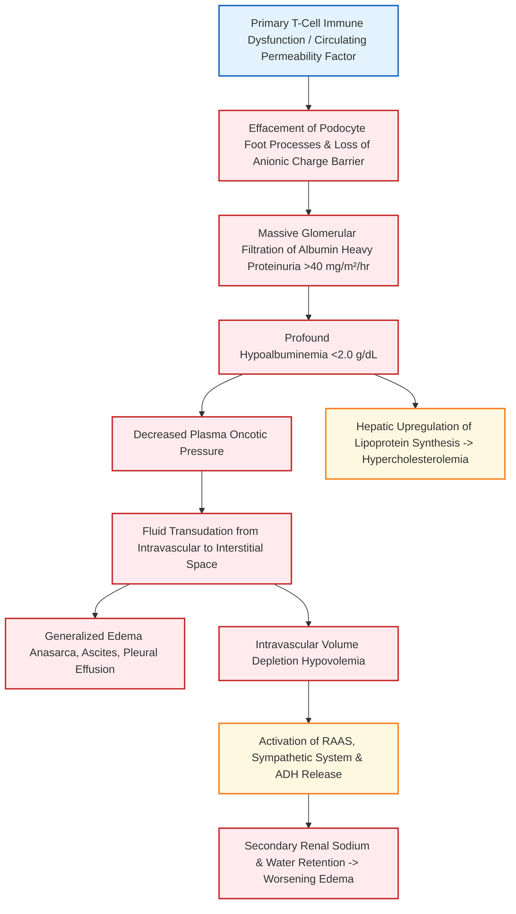
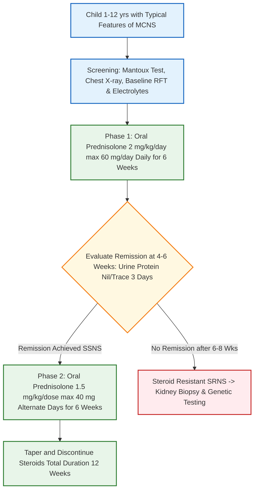

[[C17-Kidney disorder]]
# Nephrotic Syndrome in Children — Etiology, Pathophysiology, Clinical Features, Investigations & Management [⭐ High-Yield]

### 1. Definition [⭐ High-Yield]

- **Nephrotic Syndrome** is a clinical state characterized by heavy glomerular proteinuria, hypoalbuminemia, generalized edema (anasarca), and hyperlipidemia resulting from an abnormal increase in glomerular basement membrane permeability to plasma proteins.
- **Diagnostic Clinical Tetrad** [⭐ High-Yield]:
    1. **Heavy (Nephrotic-range) Proteinuria**: Excretion **>40 mg/m²/hr** (or **>1 g/m²/day**); spot urine protein-to-creatinine ratio (**Up/Uc**) **>2.0 mg/mg**; urine dipstick **3+ to 4+**.
    2. **Hypoalbuminemia**: Serum albumin concentration **<3.0 g/dL** (frequently **<1.5–2.0 g/dL**).
    3. **Generalized Edema (Anasarca)**: Soft, pitting edema starting periorbitally and expanding to dependent sites, scrotum/labia, ascites, and pleural effusions.
    4. **Hyperlipidemia**: Serum total cholesterol **>200–400 mg/dL** and elevated serum triglycerides.

---

### 2. Etiology / Causes / Risk Factors [⭐ High-Yield]

#### A. Primary / Idiopathic Nephrotic Syndrome (INS) (Presents in >90% of Children)

- **Minimal Change Nephrotic Syndrome (MCNS / MCD)**: Accounts for **80–85%** of all childhood nephrotic syndrome cases (peak age **2–6 years**; male-to-female ratio **2:1**).
- **Focal Segmental Glomerulosclerosis (FSGS)**: Accounts for **10–15%** of cases; higher risk of steroid resistance and progressive renal decline.
- **Mesangial Proliferative Glomerulonephritis (MesPGN)**: Accounts for **3–5%** of cases.
- **Membranous Nephropathy & Membranoproliferative GN (MPGN)**: Rare in young children (<5%).

#### B. Secondary Nephrotic Syndrome

- **Infections**: Hepatitis B, Hepatitis C, HIV, Malaria (_Plasmodium malariae_), Congenital Syphilis, Toxoplasmosis.
- **Systemic & Autoimmune Diseases**: Systemic Lupus Erythematosus (**SLE**), Henoch-Schönlein Purpura (IgA Vasculitis), Amyloidosis.
- **Drugs & Toxins**: NSAIDs, gold, penicillamine, pamidronate.
- **Malignancies**: Hodgkin lymphoma, leukemia.

#### C. Congenital and Infantile Nephrotic Syndrome

- Onset within the first **3 months** of life (Congenital NS) or **3–12 months** (Infantile NS).
- Primarily genetic podocytopathies:
    - **Finnish Type (NPHS1 gene mutation)**: Encodes **nephrin** (autosomal recessive).
    - **Steroid-Resistant Podocin Defect (NPHS2 gene mutation)**: Encodes **podocin** (autosomal recessive).
    - **Denys-Drash / Frasier Syndrome (WT1 gene mutation)**: Associated with Wilms tumor and ambiguous genitalia.

---

### 3. Classification [⭐ High-Yield]

#### A. Histological Classification

1. **Non-Proliferative Lesions**: Minimal Change Disease (MCNS), Focal Segmental Glomerulosclerosis (FSGS), Membranous Nephropathy.
2. **Proliferative Lesions**: Mesangial Proliferative GN, Membranoproliferative GN (MPGN).

#### B. Classification Based on Response to Corticosteroid Therapy [⭐ High-Yield]

| Clinical Category            | Diagnostic Operational Definition                                                                                                           |
| :--------------------------- | :------------------------------------------------------------------------------------------------------------------------------------------ |
| **Steroid-Sensitive (SSNS)** | Complete attainment of remission (urine protein nil or trace for **3 consecutive days**) within **4 weeks** of daily prednisolone therapy.  |
| **Steroid-Resistant (SRNS)** | Absence of complete remission despite **6 to 8 weeks** of daily prednisolone at **2 mg/kg/day (60 mg/m²/day)**.                             |
| **Infrequent Relapser**      | **<2 relapses** in the first 6 months of initial response, or **<3 relapses** within any 12-month period.                                   |
| **Frequent Relapser**        | **≥2 relapses** in the first 6 months, or **≥3 relapses** within any 12-month period.                                                       |
| **Steroid-Dependent (SDNS)** | **2 consecutive relapses** occurring while on alternate-day prednisolone or within **14 days** of stopping corticosteroid therapy.          |

---

### 4. Pathophysiology [⭐ High-Yield]

- **Podocyte Injury**: Disruption of T-lymphocyte regulation leads to the release of circulating cytokines/permeability factors, causing **diffuse effacement of podocyte foot processes** and neutralization of negatively charged polyanionic heparan sulfate proteoglycans in the glomerular basement membrane (**GBM**).
- **Underfill Hypothesis (Primary Mechanism in MCNS)**: Massive urinary albumin loss exceeds hepatic synthesis → severe hypoalbuminemia → drop in plasma oncotic pressure → fluid transudation into tissue spaces → intravascular hypovolemia → activation of the Renin-Angiotensin-Aldosterone System (**RAAS**) and antidiuretic hormone (**ADH**) → avid tubular reabsorption of sodium and water.
- **Overfill Hypothesis (Secondary Mechanism in FSGS/Renal Lesions)**: Primary intrarenal defect in sodium excretion causes primary intravascular volume expansion and secondary edema.

---

### 5. Clinical Features [⭐ High-Yield]

#### A. Symptoms

- **Insidious Onset**: Periorbital puffiness noted initially upon waking in the morning, often misdiagnosed as an allergy or conjunctivitis.
- **Progressive Swelling**: Gradual abdominal distension (ascites), swelling of legs, feet, scrotum, or labia.
- **Urinary Changes**: Reduced urine volume (**oliguria**) and dark, frothy urine.
- **Systemic Symptoms**: Anorexia, lethargy, diarrhea (secondary to mucosal edema of the bowel wall), and vague abdominal pain.

#### B. Signs

- **General Inspection**: Soft, doughy, pitting edema of the eyelids, face, lower limbs, and presacral space; **bloated appearance** with temporal wasting.
- **Abdomen**: Shifting dullness and fluid thrill indicating **ascites**; umbilical hernia may develop.
- **Respiratory**: Tachypnea and dullness at lung bases secondary to **pleural effusion** or elevated diaphragms from massive ascites.
- **Cardiovascular & Vitals**:
    - Blood pressure is **normal** in >85–90% of MCNS cases.
    - Cold, clammy extremities with narrow pulse pressure and tachycardia indicate **intravascular hypovolemia**(a medical emergency).

---

### 6. Diagnosis / Investigations [⭐ High-Yield]

#### A. Initial Essential Laboratory Workup

1. **Urinalysis**:
    - **Proteinuria**: **3+ to 4+** on dipstick test; sulfosalicylic acid test positive.
    - **Microscopy**: Hyaline and fatty casts, oval fat bodies; gross hematuria is **absent** (microscopic hematuria present in <20% of MCNS).
    - **Quantitation**: Spot urine protein-to-creatinine ratio (**Up/Uc**) **>2.0 mg/mg** (normal <0.2).
2. **Serum Biochemistry**:
    - **Serum Albumin**: Markedly reduced (**<2.5 g/dL**, often **<1.5 g/dL**); total protein reduced (**<5.0 g/dL**).
    - **Lipid Profile**: Elevated serum total cholesterol (**>200–500 mg/dL**), VLDL, and LDL.
    - **Renal Function Tests**: Blood urea nitrogen (**BUN**) and serum creatinine are typically **normal**; mild elevations occur secondary to prerenal hypovolemia.
    - **Serum Electrolytes**: Serum sodium may be low (hyponatremia due to water retention or dilution); serum calcium is low (due to loss of protein-bound calcium; ionized calcium is normal).
    - **==Serum Complement C3==**: **Normal** in MCNS (low C3 points to MPGN, Lupus Nephritis, or PSGN).
3. **Infection Screening & Pre-Steroid Workup**: capsulated bacterial infection (H.influ, strp. pneumoniae )
    - **Mantoux Test (Tuberculin Skin Test)** and **Chest X-ray**: Mandatory prior to initiating prolonged corticosteroid therapy.
    - Hepatitis B (HBsAg), Hepatitis C, and HIV serology.

#### B. Diagnostic Indications for Kidney Biopsy [⭐ High-Yield]

Renal biopsy is **NOT required** prior to starting treatment in a child aged **1 to 12 years** presenting with typical features of MCNS.

- **Indications for Pre-Treatment Kidney Biopsy**:
    - Age of onset **<1 year** (congenital/infantile) or **>12 years**.
    - Persistent gross hematuria or red cell casts.
    - Persistent hypertension.
    - Persistent elevation of serum creatinine / acute kidney injury not due to hypovolemia.
    - Low serum C3 complement levels.
    - Features suggestive of secondary nephrotic syndrome (rash, joint pain, purpura).
- **Indications for Post-Treatment Kidney Biopsy**:
    - **Steroid-Resistant Nephrotic Syndrome (SRNS)** (lack of remission after 6–8 weeks of prednisolone).
    - Before initiating Calcineurin Inhibitors (**Cyclosporine / Tacrolimus**).

---

### 7. Differential Diagnosis [⭐ High-Yield]

|Feature|**Minimal Change Disease (MCNS)**|**Focal Segmental Glomerulosclerosis (FSGS)**|**Acute Post-Streptococcal GN (PSGN)**|**Congenital Nephrotic Syndrome**|
|:--|:--|:--|:--|:--|
|**Typical Age**|**2–6 years**|Older children (>6 years)|5–15 years|**<3 months of life**|
|**Edema Pattern**|**Insidious, massive anasarca**|Massive anasarca|Moderate facial/pedal edema|Massive edema from birth|
|**Blood Pressure**|**Normal** (in >85–90%)|Frequently **Elevated**|**Hypertension**(common)|Normal or low|
|**Hematuria**|Absent / Microscopic (<20%)|Common (microscopic/gross)|**Gross (Cola-colored)**|Absent|
|**Serum C3**|**Normal**|Normal|**Markedly Low**(normalizes 8–12 wks)|Normal|
|**Renal Biopsy**|**Normal glomeruli** on LM; effacement of podocyte foot processes on EM|Segmental sclerosis of glomerular tufts|Endocapillary proliferation with subepithelial humps|Microcystic dilatation of proximal tubules (Finnish type)|
|**Steroid Response**|**Remission in >85–90%**|Unsatisfactory / Resistant|No role for steroids|**Resistant**|

---

### 8. Treatment / Management of Minimal Change Nephrotic Syndrome (MCNS) [⭐ High-Yield]

#### A. Management of the Initial Episode of MCNS [⭐ High-Yield]

1. **Daily Steroid Phase**:
    - **Prednisolone**: **2 mg/kg/day** (or **60 mg/m²/day**) as a single morning dose (maximum **60 mg/day**) for **6 weeks**.
2. **Alternate-Day Steroid Phase**:
    - **Prednisolone**: **1.5 mg/kg/dose** (or **40 mg/m²/dose**) given as a single morning dose on alternate days (maximum **40 mg/day**) for **6 weeks**.
    - Total duration of initial corticosteroid therapy is **12 weeks** (6 weeks daily + 6 weeks alternate days).

#### B. Management of Relapses

- **Definition of Relapse**: Urine protein **3+ or 4+** on dipstick for **3 consecutive days** in a child previously in remission.
- **Regimen**:
    - **Daily Prednisolone**: **2 mg/kg/day** (max 60 mg/day) until urine protein becomes nil or trace for **3 consecutive days** (usually 7–14 days).
    - Then switch to **Alternate-Day Prednisolone**: **1.5 mg/kg/dose** (max 40 mg/day) for **4 weeks**, then taper and discontinue.

#### C. Management of Frequent Relapses (FRNS) and Steroid Dependence (SDNS) [⭐ High-Yield]

When steroid toxicity develops (Cushingoid habitus, growth retardation, hypertension, cataracts), **steroid-sparing agents**are indicated:

1. **Long-Term Alternate-Day Prednisolone**: Taper to lowest effective dose (**0.5–0.7 mg/kg on alternate days**) for **9–18 months**.
2. **Levamisole**: Oral dose **2–2.5 mg/kg on alternate days** for **1 to 2 years**. (Monitor neutrophil count every 2 months for leukopenia).
3. **Cyclophosphamide**: Oral dose **2 mg/kg/day** for **12 weeks** (cumulative maximum dose **168 mg/kg** to avoid gonadal toxicity and hemorrhagic cystitis).
4. **Mycophenolate Mofetil (MMF)**: Oral dose **800–1000 mg/m²/day** (or **20–30 mg/kg/day**) in 2 divided doses for **1 to 3 years**.
5. **Calcineurin Inhibitors (CNIs)**:
    - **Cyclosporine**: **4–5 mg/kg/day** in 2 divided doses (maintain trough levels 80–120 ng/mL).
    - **Tacrolimus**: **0.1–0.2 mg/kg/day** in 2 divided doses (maintain trough levels 3–7 ng/mL).
6. **Rituximab**: Anti-CD20 monoclonal antibody administered as IV infusion (**375 mg/m²** weekly for 1–2 doses) for severe refractory SDNS.

#### D. Supportive Care & Symptomatic Management [⭐ High-Yield]

- **Dietary Measures**:
    - **Salt Restriction**: Low sodium diet (**no added salt**; <1–2 g/day) during active edema phase; resume normal salt intake once in remission.
    - **Protein Intake**: Age-appropriate normal protein diet (**1.5–2.0 g/kg/day** of high biological value); **high-protein diets are strictly contraindicated** as they worsen hyperfiltration and proteinuria.
- **Diuretic Therapy for Edema**:
    - Mild to moderate edema: Oral **Furosemide (1–2 mg/kg/day)** + **Spironolactone (2–4 mg/kg/day)**.
    - _Caution_: Avoid aggressive diuresis to prevent acute hypovolemic shock and thrombosis.
- **Management of Severe Refractory Edema / Hypovolemia**:
    - Indicated only for severe disabling anasarca, scrotal/labial edema, respiratory compromise from ascites, or intravascular hypovolemia.
    - **20% Salt-Poor Human Albumin Infusion**: **0.5–1.0 g/kg IV** infused slowly over **2 to 4 hours**, followed immediately by IV **Furosemide (1–2 mg/kg)** mid-way or at the end of infusion.
- **Immunization Protocol**:
    - Administer pneumococcal vaccines (**PCV13** and **PPSV23**) and Influenza vaccine to all children.
    - **Live Attenuated Vaccines** (Varicella, MMR, OPV) are **strictly contraindicated** while the child is on high-dose daily steroids or immunosuppressive agents; defer live vaccines until off steroids for at least **4 weeks**.

#### E. Comprehensive Dosage Rule Table [⭐ High-Yield]

|Name|Mechanism of Action (Source Page)|Dose|Dosage / Route|Frequency|Features & Monitoring|Side Effects|When to Start / Stop|
|:--|:--|:--|:--|:--|:--|:--|:--|
|**Prednisolone**|Glomerular podocyte stabilization & immunomodulation _(OP Ghai p.500, 503)_|**2 mg/kg/day**(max 60 mg) initial; **1.5 mg/kg**alternate day|Oral tablet/syrup|Single daily morning dose|First-line DOC for MCNS; monitor BP, height, blood sugar|Cushingoid facies, growth failure, HTN, cataract, osteoporosis|**Start**: At diagnosis of MCNS. **Stop**: Complete 12-wk regimen.|
|**Levamisole**|Immunomodulator enhancing Th1 response _(OP Ghai p.504)_|**2–2.5 mg/kg**|Oral tablet|Alternate days|Steroid-sparing agent for FRNS/SDNS; monitor CBC every 2 mo|Leukopenia, flu-like symptoms, elevated transaminases|**Start**: Steroid dependence/FRNS. **Stop**: Discontinue after 1–2 yrs.|
|**Cyclophosphamide**|Alkylating agent suppressing B and T cell proliferation _(OP Ghai p.504)_|**2 mg/kg/day**(max 168 mg/kg cumulative)|Oral tablet|Single daily dose for **12 weeks**|Maintains remission in 30–40% SDNS; ensure high fluid intake|Alopecia, leukopenia, hemorrhagic cystitis, gonadal toxicity|**Start**: Steroid-dependent MCNS. **Stop**: Strictly at 12 weeks.|
|**Mycophenolate Mofetil (MMF)**|Inhibits inosine monophosphate dehydrogenase, blocking lymphocyte synthesis _(OP Ghai p.504)_|**800–1000 mg/m²/day**(20–30 mg/kg/day)|Oral capsules/suspension|Divided into 2 daily doses|Non-nephrotoxic steroid-sparing agent; monitor CBC|Diarrhea, abdominal pain, leukopenia, mild infections|**Start**: SDNS/FRNS alternative. **Stop**: Duration 1–3 yrs.|
|**Cyclosporine (CyA)**|Calcineurin inhibitor blocking IL-2 transcription in T-cells _(OP Ghai p.504, 505)_|**4–5 mg/kg/day**|Oral solution/capsule|Divided into 2 daily doses|High efficacy in SRNS/SDNS; maintain trough level 80–120 ng/mL|Nephrotoxicity, hirsutism, gum hyperplasia, HTN, hyperlipidemia|**Start**: SRNS or CNI-responsive SDNS. **Stop**: Taper after 1–2 yrs.|
|**Tacrolimus (Tac)**|Potent calcineurin inhibitor blocking T-cell activation _(OP Ghai p.504, 505)_|**0.1–0.2 mg/kg/day**|Oral capsules|Divided into 2 daily doses|Less hirsutism/gum hyperplasia than CyA; trough 3–7 ng/mL|Nephrotoxicity, hyperglycemia, tremors, headache|**Start**: SRNS or SDNS. **Stop**: Taper after 1–2 yrs.|
|**Furosemide**|Loop diuretic inhibiting Na⁺-K⁺-2Cl⁻ cotransporter in Thick Ascending Limb _(OP Ghai p.504)_|**1–2 mg/kg/dose**(IV max 2–4 mg/kg)|Oral / IV|1 to 2 times daily|Use with caution; monitor for hypovolemia and ototoxicity|Hypokalemia, hyponatremia, volume depletion, alkalosis|**Start**: Symptomatic severe edema. **Stop**: When edema resolves.|
|**20% Human Albumin**|Expands intravascular volume & increases oncotic pressure _(OP Ghai p.504, 505)_|**0.5–1.0 g/kg** (2.5–5 mL/kg of 20% solution)|Slow IV infusion|Over **2–4 hours**|Follow with IV Furosemide (1–2 mg/kg); monitor for pulmonary edema|Volume overload, acute heart failure, allergic reactions|**Start**: Severe hypovolemia, pulmonary edema, severe anasarca. **Stop**: Single dose.|

---

### 9. Complications [⭐ High-Yield]

#### A. Severe Infections (Leading Cause of Mortality)

- **Pathophysiology**: Loss of IgG and complement factors (Factor B and Properdin) in urine + impaired opsonization + steroid immunosuppression.
- **Common Infections**:
    - **Spontaneous Bacterial Peritonitis (SBP)**: Classically caused by _**Streptococcus pneumoniae**_ and Gram-negative organisms (_E. coli_, _Klebsiella_). Presents with fever, diffuse abdominal pain, and tenderness.
    - Cellulitis, pneumonia, bacteremia/sepsis.

#### B. Thromboembolism (Medical Emergency)

- **Pathophysiology**: Urinary loss of Antithrombin III, Protein S, and Protein C + increased hepatic synthesis of Fibrinogen (Factors V, VII, VIII, X) + hyperviscosity from hemoconcentration and aggressive diuretic use.
- **Sites**: Renal vein thrombosis (flank pain, hematuria, acute renal failure), deep vein thrombosis (**DVT**), pulmonary embolism, sagittal sinus thrombosis.

#### C. Acute Kidney Injury (AKI) & Hypovolemic Shock

- Severe intravascular volume depletion ("underfill") secondary to acute fluid shifts, gastroenteritis, or excessive unmonitored diuretic administration leads to prerenal azotemia and ischemic acute tubular necrosis (**ATN**).

#### D. Steroid Toxicity & Immunosuppressive Side Effects

- Cushingoid features, short stature / growth suppression, systemic hypertension, posterior subcapsular cataract, glaucoma, osteoporosis, behavioral changes, and impaired glucose tolerance.

---

### 10. Prognosis [⭐ High-Yield]

- **Long-Term Renal Survival**: Over **85–90%** of children with Minimal Change Nephrotic Syndrome (MCNS) achieve permanent remission by late adolescence without any long-term decline in GFR or chronic kidney disease.
- Main clinical challenge revolves around managing recurrent relapses and minimizing drug toxicity.

---

### 11. Mnemonic / Memory Palace

#### Mnemonic: N-E-P-H-R-O-T-I-C

- **N** - **Nephrotic-range proteinuria**: **>40 mg/m²/hr** or Up/Uc **>2.0 mg/mg**
- **E** - **Edema (Anasarca)**: Insidious periorbital and dependent pitting swelling
- **P** - **Prednisolone first-line**: **2 mg/kg/day for 6 wks**, then **1.5 mg/kg alternate days for 6 wks**
- **H** - **Hypoalbuminemia**: Serum albumin **<2.5–3.0 g/dL**
- **R** - **Relapses frequent**: Managed with Levamisole, Cyclophosphamide, or MMF
- **O** - **Opsonization loss**: Predisposes to **_Streptococcus pneumoniae_ SBP**
- **T** - **Thromboembolism risk**: Loss of Antithrombin III & elevated fibrinogen
- **I** - **IgG loss & Normal C3**: Normal complement C3 rules out nephritic syndromes
- **C** - **Cholesterol elevation**: Hyperlipidemia secondary to hepatic lipid synthesis

---

### Clinical Pearl

> **Never perform a routine kidney biopsy in a typical 2-year-old presenting with nephrotic syndrome.**Over 85% of children aged 1 to 12 years with typical features (normotensive, normal C3, no gross hematuria) have Minimal Change Disease (MCNS) and respond to oral prednisolone. Reserve biopsy for steroid resistance, atypical age (<1 or >12 years), or low C3 levels.

---

### Exam Trap

- **The Mix-up**: Recommending a high-protein diet to "replace" the urinary protein loss in nephrotic syndrome.
- **Distinguishing Fact**: High-protein diets increase intraglomerular pressure, accelerate glomerular damage, and increase urinary protein excretion without increasing serum albumin levels. Children should receive a **normal recommended protein intake (1.5–2 g/kg/day)** with low salt during the edema phase.

---

### Diagram 1: Podocyte Foot Process Effacement & Glomerular Filtration Barrier

- **Type**: Labeled ultrastructural diagram.
- **Outline shape to draw**: Cross-section of capillary loop wall showing three layers (Endothelium, GBM, Podocytes).
- **Labels in order**:
    1. **Fenestrated Endothelium**: Inner capillary lining.
    2. **Glomerular Basement Membrane (GBM)**: Middle gel layer containing negatively charged heparan sulfate proteoglycan.
    3. **Normal Podocytes**: Interdigitating foot processes with intact slit diaphragms (nephrin/podocin).
    4. **Minimal Change Pathology**: Diffuse **effacement (flattening/fusion) of podocyte foot processes** with loss of negative charge barrier.
- **Arrows/connections**: Immune Cytokines / Permeability Factor → Loss of GBM Negative Charge → Foot Process Effacement → Massive Albuminuria.
- **Extra Mark Annotation**: Light microscopy in MCNS appears completely normal; foot process effacement is visible ONLY under **Electron Microscopy (EM)**.

---

### Quick Revision

- **Classic Tetrad**: Heavy proteinuria (**>40 mg/m²/hr**), Hypoalbuminemia (**<3 g/dL**), Edema (Anasarca), and Hyperlipidemia.
- **MCNS Frequency**: Accounts for **80–85%** of pediatric nephrotic syndrome (peak age 2–6 years).
- **Initial Steroid Protocol**: Prednisolone **2 mg/kg/day for 6 weeks**, followed by **1.5 mg/kg alternate days for 6 weeks** (total 12 weeks).
- **Kidney Biopsy Rule**: Not required before treatment in typical cases (age 1–12 yrs, normal BP, normal C3, no gross hematuria).
- **Major Infection Risk**: **Spontaneous Bacterial Peritonitis (SBP)** caused by _Streptococcus pneumoniae_.

---

### One-Line Exam Opener

- **Pediatric Nephrotic Syndrome is a glomerular disorder characterized by the classic tetrad of heavy proteinuria, hypoalbuminemia, anasarca, and hyperlipidemia, with Minimal Change Disease accounting for 80–85% of cases and responding dramatically to a 12-week course of oral prednisolone.**